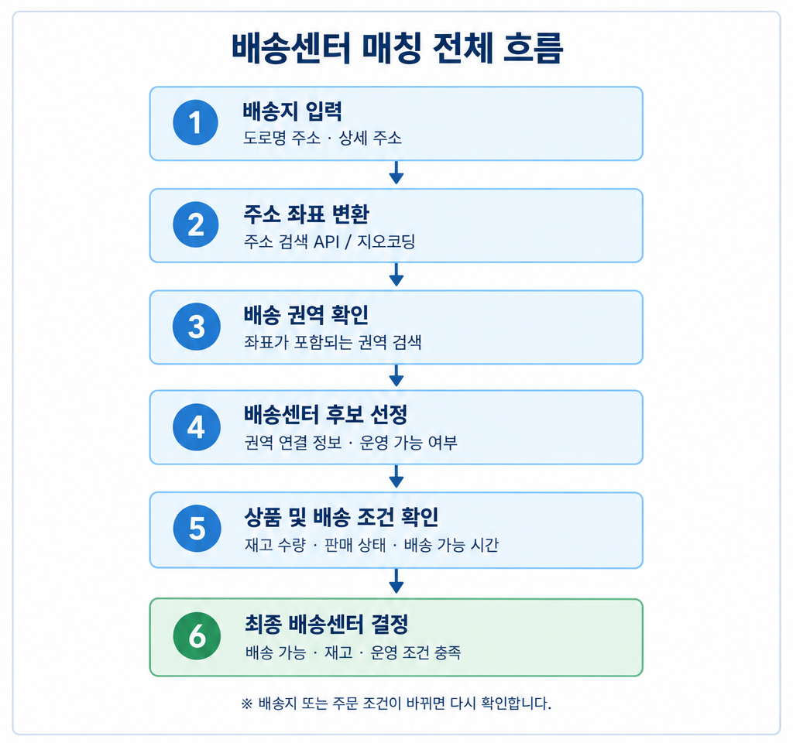
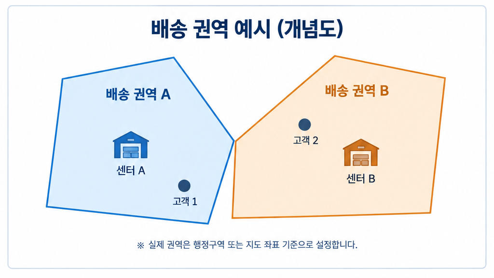

# 배송지 기반 물류센터 매칭 정책

## 1. 목적

고객이 앱에서 배송지를 입력했을 때, 해당 주소로 배송할 수 있는 물류센터를 찾고 그 센터의 상품 재고·가격·배송 가능 여부를 기준으로 주문을 처리한다.

> 이 문서는 B마트와 유사한 다중 물류센터 서비스를 설계하기 위한 제안이다. 실제 B마트 내부의 매칭 알고리즘을 그대로 설명하는 문서는 아니다.

---

## 2. 전체 매칭 흐름



1. 고객이 배송지를 입력한다.
2. 주소 검색 API 또는 지오코딩 기능으로 주소를 좌표로 변환한다.
3. 좌표가 포함되는 배송 권역을 조회한다.
4. 해당 권역을 담당하는 물류센터 후보를 찾는다.
5. 센터의 운영 상태, 상품 판매 상태, 가용 재고, 배송 가능 시간 등을 확인한다.
6. 조건을 만족하는 센터를 확정하고, 해당 센터 기준의 상품 정보를 앱에 표시한다.

### 핵심 원칙

**가장 가까운 센터를 무조건 선택하는 것이 아니라, 배송 권역과 운영 조건을 만족하는 센터를 선택한다.**

---

## 3. 배송 권역 관리 방식



배송 권역을 관리하는 방법은 크게 다음과 같다.

| 방식 | 설명 | 장점 | 주의점 |
|---|---|---|---|
| 행정구역 기준 | 시·구·동 등의 행정구역 코드로 담당 센터 지정 | 구현과 관리가 단순함 | 같은 행정구역 안에서도 배송 여건이 다를 수 있음 |
| 지도 경계 기준 | 지도상의 다각형(Polygon)으로 권역을 정의 | 실제 운영 권역을 세밀하게 표현 가능 | 권역 경계와 변경 이력 관리가 필요함 |
| 거리·시간 기준 | 센터와 고객 사이의 거리 또는 예상 이동 시간을 이용 | 거리와 배송 효율을 고려 가능 | 직선거리만으로는 도로·교통 상황을 충분히 반영하기 어려움 |

### 초기 구현 권장안

초기 버전은 **배송 권역 → 담당 센터 → 센터별 재고 확인** 순서로 구현한다. 처음에는 권역마다 담당 센터를 하나 지정하고, 이후 필요하면 복수 후보 센터를 두고 거리·재고·처리량 등을 고려하도록 확장한다.

---

## 4. 권장 데이터 모델

| 테이블 | 주요 필드 예시 | 역할 |
|---|---|---|
| `FulfillmentCenter` | `center_id`, `name`, `address`, `status` | 물류센터 정보와 운영 상태 관리 |
| `DeliveryZone` | `zone_id`, `name`, `boundary` 또는 `region_code` | 배송 권역 관리 |
| `CenterDeliveryZone` | `center_id`, `zone_id`, `active_from`, `active_to`, `status` | 센터와 배송 권역의 연결 관계 관리 |
| `CustomerAddress` | `address_id`, `member_id`, `address_text`, `latitude`, `longitude` | 고객 배송지 관리 |
| `Inventory` | `center_id`, `product_option_id`, `available_quantity` | 센터별 상품 옵션의 가용 재고 관리 |

`CenterDeliveryZone`을 별도 테이블로 두면 하나의 센터가 여러 권역을 담당하거나, 운영 정책 변경으로 권역 담당 센터가 바뀌는 경우에 대응하기 쉽다.

고객 주소에는 일반적으로 센터 ID를 영구적으로 고정하기보다 주소와 좌표를 저장하고, 현재 배송 권역 정책을 기준으로 센터를 조회한다. 단, 주문이 확정되면 주문에 사용된 센터 ID를 주문 데이터에 기록해야 한다.

---

## 5. 배송지 입력 이후의 재확인 시점

### 5.1 배송지 입력 시

- 주소를 좌표로 변환한다.
- 배송 권역과 담당 센터를 조회한다.
- 배송 가능한 상품, 가격, 재고 및 배송 가능 시간을 조회한다.

### 5.2 장바구니 진입 및 상품 주문 시

- 센터 기준으로 상품 판매 상태와 가용 재고를 다시 확인한다.
- 가격과 배송 가능 여부가 변경되었다면 고객에게 변경 사항을 표시한다.

### 5.3 주문 확정 시

- 재고와 배송 가능 여부를 다시 검사한다.
- 주문에 사용할 센터와 재고를 확정한다.
- 주문 데이터에 센터 ID를 기록한다.

### 5.4 배송지 변경 시

- 기존 센터와 새 센터가 달라지는지 확인한다.
- 새 센터 기준으로 가격, 재고, 판매 상태 및 배송 가능 여부를 다시 조회한다.
- 구매 불가능한 상품이 있으면 고객에게 안내하고 주문 진행을 제한하거나 상품 변경을 요청한다.

---

## 6. 예외 정책으로 정해야 할 항목

- 배송 권역에 포함되지 않는 주소를 입력한 경우
- 하나의 주소가 복수 권역에 포함되거나 권역 경계에 있는 경우
- 담당 센터가 영업 중단 또는 배송 마감 상태인 경우
- 담당 센터에 상품 재고가 없는 경우
- 대체 센터로 자동 전환할 수 있는지 여부
- 배송지 변경 시 장바구니 상품을 유지할지 여부
- 권역 변경 시점과 기존 주문에 적용할 정책

---

## 7. 매칭 로직 예시

```text
배송지 입력
  → 주소 좌표 변환
  → 좌표에 해당하는 배송 권역 조회
  → 권역 담당 센터 조회
  → 센터 운영 상태 확인
  → 상품 판매 상태 및 가용 재고 확인
  → 배송 가능 여부 확인
  → 주문 가능한 센터 반환
```

초기 버전에서는 권역별 담당 센터를 하나로 제한하면 로직과 테스트가 단순하다. 복수 센터 후보를 지원하는 단계에서는 우선순위, 예상 배송 시간, 재고, 센터 처리 용량 등을 기준으로 후보를 평가할 수 있다.

---

## 8. 설계 결정 사항

- [ ] 배송 권역을 행정구역 코드와 지도 경계 중 어떤 방식으로 관리할지 결정
- [ ] 권역별 담당 센터를 하나로 제한할지, 여러 센터를 허용할지 결정
- [ ] 재고 부족 시 대체 센터를 사용할지 결정
- [ ] 센터 운영 중단 시 대체 정책 결정
- [ ] 배송지 변경 시 장바구니 재검사 정책 결정
- [ ] 주문 확정 시 센터와 재고를 확정하는 시점 결정
