# 고객앱 업무 흐름 정리 (장바구니)

> **범위:** 장바구니 → 주문서 → 결제 → 배송·주문 알림 → 반품·교환  
> **프로젝트 변경 정책(2026-10-15):** 상품은 목록·상세에서 장바구니에 추가하며, 실제 재고 및 배송 시간 확정 반영은 결제 완료 시점이다. 최소 주문금액은 15,000원이고, 상품 합계 30,000원 이상 또는 첫 구매면 배달팁 무료로 처리한다. 봉투값은 주문당 100원 고정, 주문 완료 후 정보 변경 및 회수지 변경은 허용하지 않는다. 반품 화면의 9,000원은 반품 배달비 옵션 구매 흐름으로 해석한다. **상품당 기본 최대 구매 수량은 10개이며 상품별로 다를 수 있다. 주문 상품 총중량이 10kg을 초과하면 분할배송한다.**
> **작성 기준:** 화면에서 관찰한 동작은 **화면 관찰**로, 문서에 확정된 항목은 **프로젝트 결정**으로, 추가 설계는 **구현 제안**으로, 합의가 필요한 항목은 **미결정**으로 구분한다. 캡처의 가격·혜택·시간은 촬영 당시 화면의 예시이며 현재 서비스의 고정 정책으로 해석하지 않는다.


## 목차

1. [전체 흐름](#1-전체-흐름)
2. [장바구니](#2-장바구니)
3. [주문서](#3-주문서)
4. [결제 및 결제 예외 처리](#4-결제-및-결제-예외-처리)
5. [배송 방식 및 예약배송](#5-배송-방식-및-예약배송)
6. [주문 상태와 알림](#6-주문-상태와-알림)
7. [반품과 환불](#7-반품과-환불)
8. [교환](#8-교환)
9. [배송완료 후 리뷰](#9-배송완료-후-리뷰)
10. [팀 의사결정 및 확인 목록](#10-팀-의사결정-및-확인-목록)
11. [DB 연결 관계 및 공통 설계](#11-db-연결-관계-및-공통-설계)

## 1. 전체 흐름

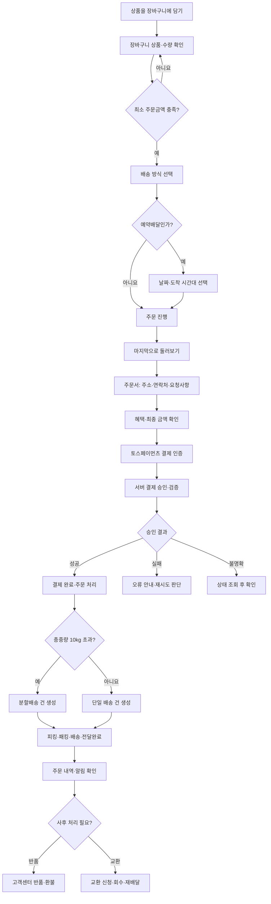

**핵심 구분**

- **장바구니:** 살 상품·수량·배송 방식을 선택하고 주문 가능 여부를 확인한다. 상품별 기본 구매 제한은 10개다(상품별 상이).
- **주문서:** 배송지·라이더 요청·연락처·품절 시 처리·혜택·결제 금액을 최종 확인한다.
- **결제:** 결제창 복귀와 별개로 **서버 승인 결과를 확인한 뒤** 주문을 완료한다.
- **배송과 알림:** 주문 상태와 고객에게 발송한 알림 내역을 구분한다. 총중량 10kg 초과 주문은 배송 건을 분리하되 원 주문번호·결제는 유지한다.
- **사후 처리:** 반품은 고객센터 접수 방식으로 기술되어 있고 (실제 B마트에서 선택 불가능), 교환은 별도의 신청·회수·재배달 흐름이 있다.

---

## 2. 장바구니

### 2.0 상품 목록·상세에서 장바구니에 상품 추가

**고객앱 기본 흐름**

1. 고객은 **상품 목록에서 상품 추가(담기) 버튼**을 누르거나, **상품 상세 페이지에서 상품·옵션·수량을 확인한 뒤 장바구니에 담을 수 있다.**
2. 상품을 추가한 이후 장바구니에서 담은 상품을 확인하고 주문할 품목·수량을 조정한다.
3. 상품 목록에서 담기를 제공하지 않는 품목은 상세 접근 또는 별도 인증을 먼저 요구할 수 있다.
4. **상품당 기본 구매 수량 제한은 10개**로 설정한다. 단, 실제 적용 상한은 상품에 설정된 제한 수량이 우선하며, 목록·상세·장바구니·주문서·서버에서 동일하게 검증한다.
5. 장바구니 수량 변경은 고객의 주문 의사 표시이며, **재고 차감 및 배송 시간의 최종 확정은 결제 완료 시점**에 반영한다. 결제 전에는 재고·주문 가능 시간에 변경이 생길 수 있다.

**일부 성인인증 상품 화면 사례**

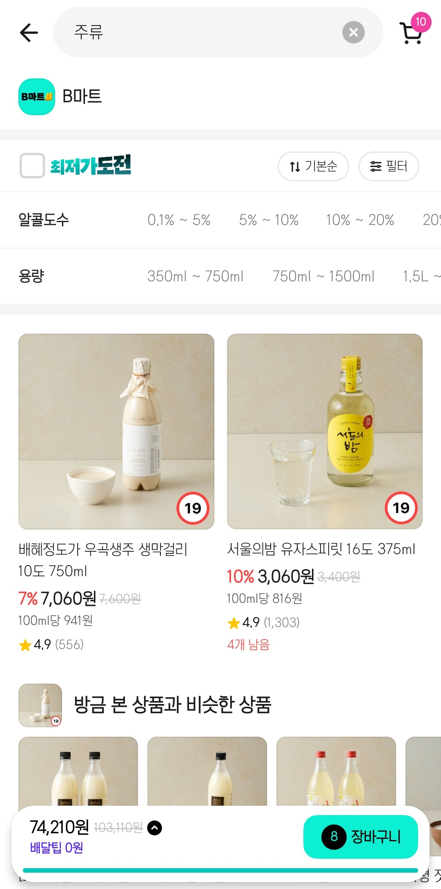

- 첨부한 주류 상품 목록에는 직접 담기 버튼이 없으며, 상세 접근 전에 연령확인을 요구한다.
- 연령확인 화면에는 휴대전화 인증 또는 본인인증 절차와 이름·생년월일·연락처·통신사·약관 확인 단계가 나타난다.
- 해당 상품은 인증 성공 후 상품 상세 또는 구매 흐름으로 복귀시킨다. 개인정보·본인확인 식별값은 불필요하게 보관하지 않는다.

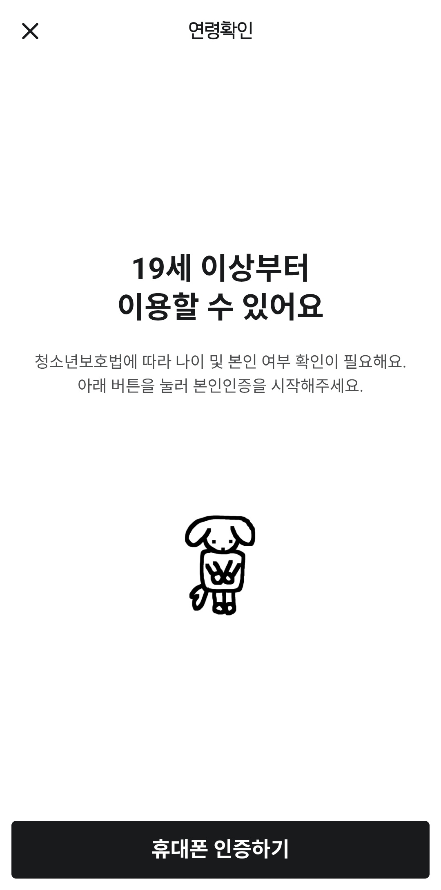

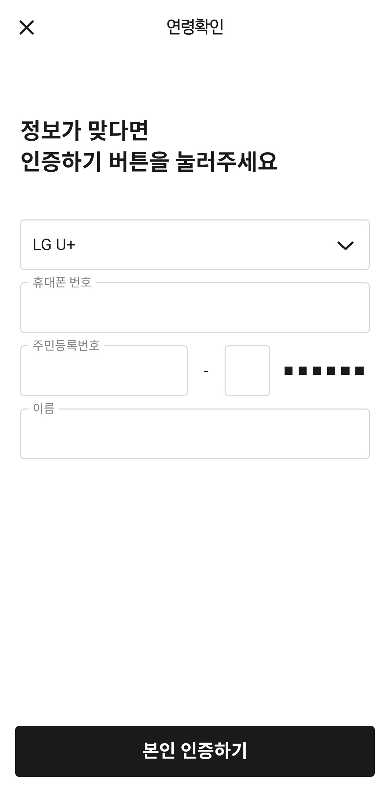

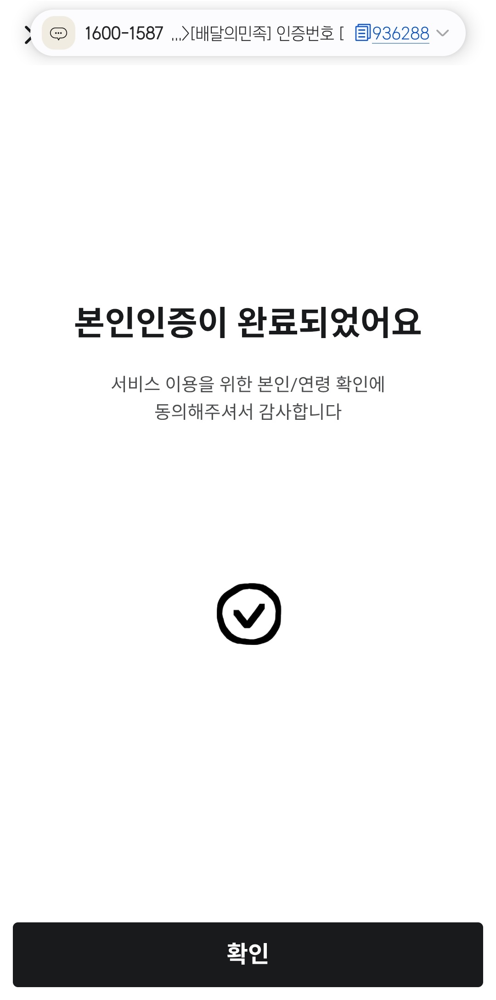

> **범위 주의:** 주류 판매는 업종·연령·지역·판매 방식 관련 법적 요건 검토가 선행되어야 한다. 캡처의 인증 화면이 곧바로 해당 상품 판매 기능의 구현 확정을 의미하지 않는다.

### 2.1 장바구니 진입과 상품 확인

고객이 장바구니를 열면 B마트 상품 목록, 예상 도착 시간, 예약배달 공지 등을 확인한다.

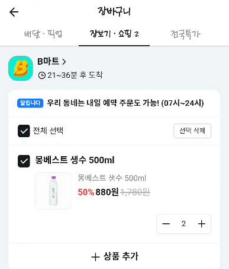

| 화면 요소 | 고객 동작·표시 내용 |
|---|---|
| 장바구니 상품 | 상품명, 썸네일, 할인 전후 가격, 현재 수량을 표시 |
| 상품 선택 체크박스 | 주문할 상품을 선택하거나 해제 |
| 전체 선택 | 장바구니 상품을 한꺼번에 선택 |
| 선택 삭제 | 체크된 상품을 장바구니에서 삭제 |
| 수량 변경 | `-`, `+` 버튼으로 수량 변경. 기본 최대 10개, 상품별 상한 적용 및 재고 검증 |
| 상품 추가 | B마트 상품 탐색 화면으로 이동 |
| 예상 도착 시간 | 고객이 선택한 배송지·배송 방식 등에 대응하는 예상 정보 |
| 예약배달 공지 | 예약 가능 관련 안내 표시 |

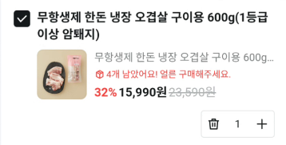

**화면에서 함께 확인되는 요소**

- 함께 담으면 좋은 상품: 추천 상품 카드와 추가 버튼이 제공된다. 추천 기준은 자료에 없다.
- 배달의민족 이벤트·혜택 배너: 별도 이벤트 화면으로 이동한다.

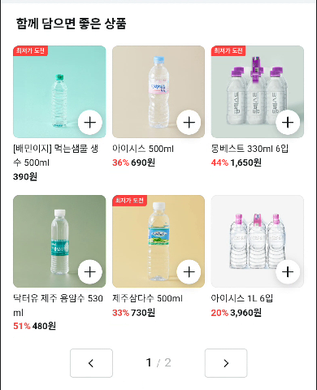


### 2.1.1 상품별 구매 수량 제한 

- 한 상품을 한 주문에서 구매할 수 있는 **기본 상한은 10개**다. 예를 들어 상품에 5개 상한이 등록되어 있다면 5개까지만 구매한다.
- 상품 목록·상세의 담기 버튼, 장바구니 `+` 버튼, 주문서 재검증, 서버 주문 생성 요청에 같은 상한을 적용한다.
- 상한 도달 시 추가 수량 변경을 막고 고객에게 제한 수량을 안내한다. 네트워크 요청에서 임의로 11개 이상을 보내더라도 서버에서 거부한다.
- 구매 수량 상한은 **재고 수량**과 다르다. 사용 가능한 재고가 더 적으면 실제 담기 가능 수량은 `min(상품별 구매상한, 현재 주문 가능 재고)`가 된다.
- **구현 제안:** `products.max_order_qty INT NOT NULL DEFAULT 10`을 사용해 상품별 설정한다. 옵션 단위 제한 또는 고객별 구매 제한은 별도 정책 결정이 필요하다.

### 2.2 배송 방식 선택과 금액 확인

장바구니 하단에서 수령 방법을 선택한다. 이 문서에서는 화면의 **수령 방법**을 업무 용어인 **배송 방식**으로 함께 표기한다.

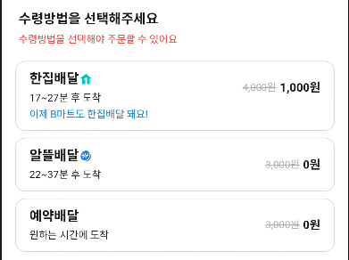

- **한집배달:** 예상 소요 시간과 배달팁을 확인한다.
- **알뜰배달:** 예상 소요 시간과 배달팁을 확인한다.
- **예약배달:** 원하는 도착 시간대를 선택해야 한다.
- 배송 방식에 따라 화면의 배달팁·할인·예상 도착 정보가 변경될 수 있다.

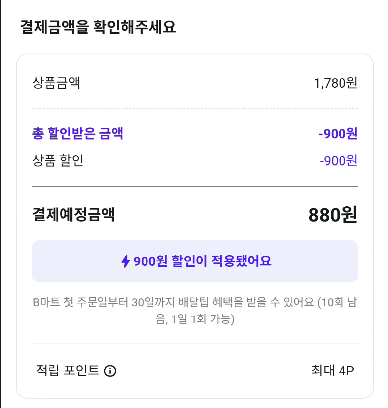

**금액 구조**

```text
상품금액
+ 배달팁(무료 조건 충족 시 0원)
+ 봉투값(100원 고정)
- 상품 할인
- 쿠폰/기타 적용 혜택
= 최종 결제 금액
```

- 금액은 선택된 상품과 실제 적용 가능한 할인 기준으로 다시 계산한다. 
- 봉투값은 주문당 100원 고정으로 합계에 포함한다. 
- 배달팁은 배송 방식별 기준요금에서 무료 조건을 판정한다. 
- 첨부 화면의 880원, 28,480원 등은 **화면 예시**이다. 
- 상품금액·배달팁·할인액은 주문서와 결제 직전에 재확인한다.

### 2.3 주문 가능 여부 검사

| 상태 | 화면 동작 |
|---|---|
| 최소 주문금액 미충족 | 부족 금액 안내, 주문 버튼 비활성화 |
| 최소 주문금액 충족 + 배송 방식 미선택 | `수령방법을 선택해주세요` 표시, 누르면 배송 방식 영역으로 스크롤 |
| 최소 주문금액 충족 + 배송 방식 선택 완료 | 선택 방식에 맞는 `주문하기` 버튼 활성화 |
| 예약배달을 선택했으나 시간 미선택 | 예약 시간 선택을 요구 |

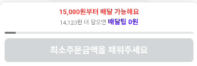


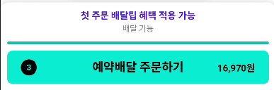

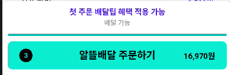

> **중요:** 최소 주문금액은 **15,000원**이며, 미충족 시 주문을 진행할 수 없다.

### 2.4 예약배달 선택

예약배달 선택 시 날짜(오늘/내일)와 도착 시간대를 선택하는 팝업을 표시한다. 선택이 확정되면 장바구니의 예약 정보와 주문 버튼에 반영한다.

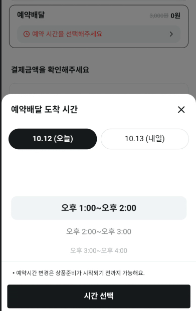

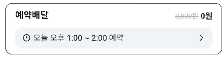

### 2.5 장바구니 네트워크 오류(화면 관찰)

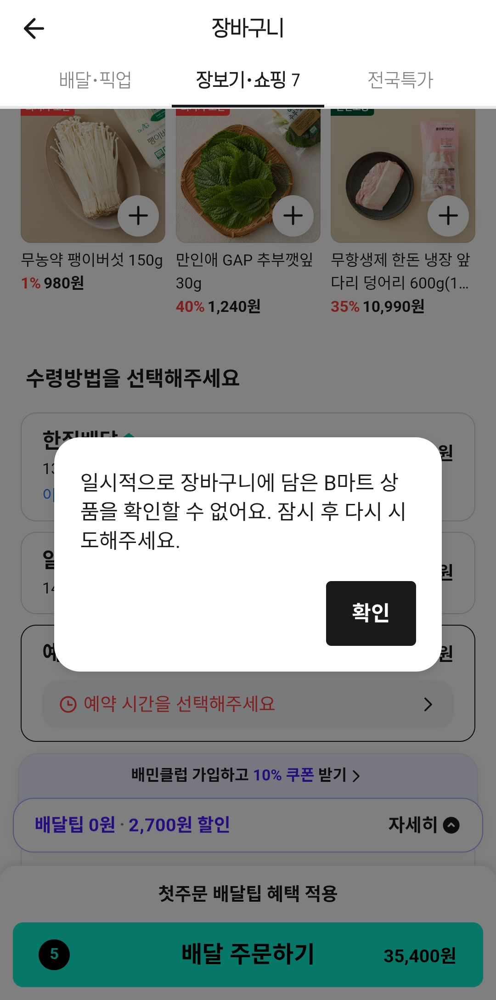

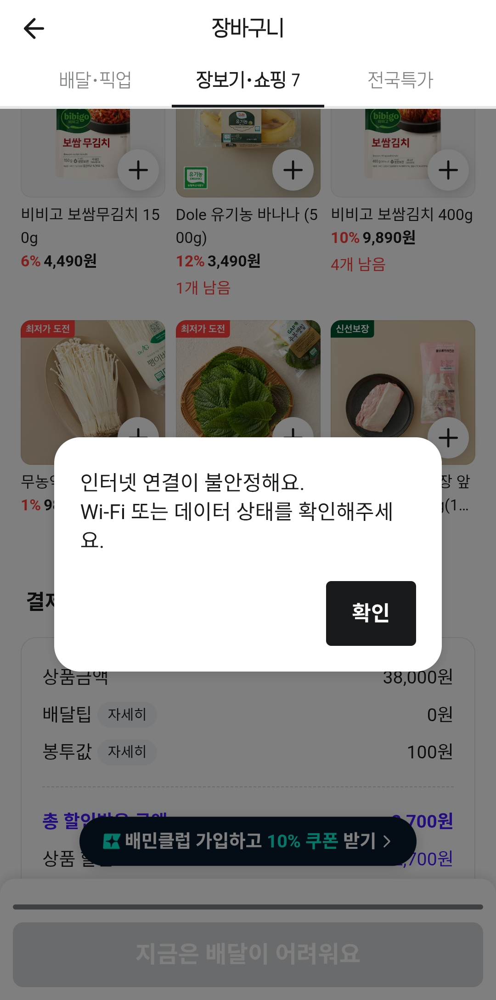

| 발생 단계 | 관찰된 동작 | 프로젝트 적용 시 처리 기준 |
|---|---|---|
| 장바구니에서 배달 방식 선택 | 네트워크 오류 팝업 → 확인 후 장바구니 재조회 사례 | 기존 담기 내역 삭제 없이 재조회, 실패 시 재시도 안내 |
| 장바구니 재조회 | 오류 화면 및 재시도 버튼 노출 사례 | 마지막 성공 데이터와 실재고를 혼동하지 않기 |
| 주문하기 버튼 | 네트워크 오류 팝업 후 홈으로 이동한 사례 | 홈 이동 여부 미결정; 주문이 생성되었는지 서버 조회 필요 |
| 장바구니 진입 | 화면을 불러오지 못했다는 오류 | 로딩 실패와 장바구니 비어 있음 상태를 구분 |

---

### 2.6 기능 연계 임시 데이터 및 DB 구조 설계

#### `customers` — 고객

회원 식별 및 첫 구매 자격 산정의 기준(과거 유효 구매 이력으로 검증)

**테이블 구조**

| 컬럼 | DB 타입 | 제약·의미 |
|---|---|---|
| customer_id | BIGINT | PK |
| nickname | VARCHAR(50) | NOT NULL |
| account_status | VARCHAR(20) | ACTIVE/SUSPENDED |
| registered_at | DATETIME | 등록일자 |

**임시 데이터 (3건)**

| customer_id | nickname | account_status | registered_at |
| --- | --- | --- | --- |
| 1 | 고객A | ACTIVE | 2026-10-01 09:00 |
| 2 | 고객B | ACTIVE | 2026-10-10 10:00 |
| 3 | 고객C | ACTIVE | 2026-10-12 15:00 |


#### `fulfillment_centers` — 배송센터(PPC)

배송지 권역과 실제 출고 재고를 관리하는 물류 거점

**테이블 구조**

| 컬럼 | DB 타입 | 제약·의미 |
|---|---|---|
| center_id | BIGINT | PK |
| center_code | VARCHAR(20) | UNIQUE |
| center_name | VARCHAR(60) | NOT NULL |
| status | VARCHAR(20) | OPEN/CLOSED |

**임시 데이터 (3건)**

| center_id | center_code | center_name | status |
| --- | --- | --- | --- |
| 101 | PPC-A | A센터 | OPEN |
| 102 | PPC-B | B센터 | OPEN |
| 103 | PPC-C | C센터 | OPEN |


#### `products` — 상품 마스터

상품 기본 구매 제한은 10개이며 예외 품목은 다른 max_order_qty 적용

**테이블 구조**

| 컬럼 | DB 타입 | 제약·의미 |
|---|---|---|
| product_id | BIGINT | PK |
| sku | VARCHAR(40) | UNIQUE |
| product_name | VARCHAR(100) | NOT NULL |
| sale_price | INT | 원, >= 0 |
| unit_weight_g | INT | 그램, > 0 |
| max_order_qty | INT | NOT NULL DEFAULT 10 |
| sale_status | VARCHAR(20) | ON_SALE/STOP |

**임시 데이터 (3건)**

| product_id | sku | product_name | sale_price | unit_weight_g | max_order_qty | sale_status |
| --- | --- | --- | --- | --- | --- | --- |
| 301 | SKU-301 | 생수 2kg | 6000 | 2000 | 10 | ON_SALE |
| 302 | SKU-302 | 냉장 상품 | 8000 | 500 | 5 | ON_SALE |
| 303 | SKU-303 | 생활용품 | 6000 | 1000 | 10 | ON_SALE |

> **설계 참고:** 예시 상품명과 중량은 테스트용이며 실제 물품 제원과 무관하다. 중량 단위는 g로 통일한다.


#### `center_inventory` — 센터별 판매 재고

상품 재고는 센터별로 구분, 결제 완료 처리 시 가용 재고 반영

**테이블 구조**

| 컬럼 | DB 타입 | 제약·의미 |
|---|---|---|
| inventory_id | BIGINT | PK |
| center_id | BIGINT | FK → fulfillment_centers |
| product_id | BIGINT | FK → products |
| available_qty | INT | >= 0 |
| reserved_qty | INT | >= 0 |

**임시 데이터 (3건)**

| inventory_id | center_id | product_id | available_qty | reserved_qty |
| --- | --- | --- | --- | --- |
| 401 | 101 | 301 | 30 | 0 |
| 402 | 102 | 302 | 15 | 0 |
| 403 | 103 | 303 | 20 | 0 |

> **설계 참고:** UNIQUE(center_id, product_id). 결제 확정 동시성 처리와 재고 복원/보상 처리 기준은 별도 확정한다.


#### `carts` — 장바구니 헤더

회원당 활성 장바구니를 유지하고 주문 후 별도 주문 스냅샷에 저장

**테이블 구조**

| 컬럼 | DB 타입 | 제약·의미 |
|---|---|---|
| cart_id | BIGINT | PK |
| customer_id | BIGINT | FK → customers |
| cart_status | VARCHAR(20) | ACTIVE/CHECKED_OUT |
| updated_at | DATETIME | 수정 시각 |

**임시 데이터 (3건)**

| cart_id | customer_id | cart_status | updated_at |
| --- | --- | --- | --- |
| 501 | 1 | ACTIVE | 2026-10-16 09:00 |
| 502 | 2 | ACTIVE | 2026-10-16 09:10 |
| 503 | 3 | ACTIVE | 2026-10-16 09:20 |


#### `cart_items` — 장바구니 품목

선택 여부와 구매 수량을 유지; 수량 상한은 products.max_order_qty 적용

**테이블 구조**

| 컬럼 | DB 타입 | 제약·의미 |
|---|---|---|
| cart_item_id | BIGINT | PK |
| cart_id | BIGINT | FK → carts |
| product_id | BIGINT | FK → products |
| quantity | INT | 1..상품 제한 수량 |
| selected | BOOLEAN | 선택 여부 |

**임시 데이터 (3건)**

| cart_item_id | cart_id | product_id | quantity | selected |
| --- | --- | --- | --- | --- |
| 601 | 501 | 301 | 6 | `true` |
| 602 | 502 | 302 | 2 | `true` |
| 603 | 503 | 303 | 3 | `true` |

> **설계 참고:** UNIQUE(cart_id, product_id). 장바구니 기록 자체는 재고 예약이나 배송 슬롯 선점이 아니다.

---

## 3. 주문서

### 3.1 주문서 진입 전: 마지막으로 둘러보기

장바구니에서 주문하기를 누르면 **`마지막으로 둘러보기`** 상품 추천 화면이 나타나는 사례가 확인된다.

- 함께 산 상품
- 맞춤 할인 상품
- 재주문 많은 상품
- 1만원 이하 상품

고객은 추가 상품을 선택할 수 있고, 하단 주문 버튼에서 갱신된 주문 금액을 확인한 뒤 주문서로 이동한다. 이 추천 단계의 노출·건너뛰기 정책은 별도 결정이 필요하다.

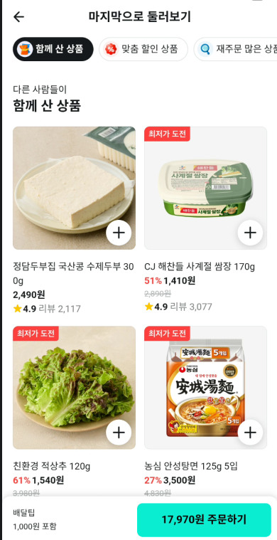


> **네트워크 오류 사례 및 처리:** 주문서 이동을 시도했을 때 인터넷 연결 불안정 안내와 `[확인]` 버튼이 나타나고 클릭 시 홈 화면으로 이동한다.

### 3.2 주문서 기본 정보

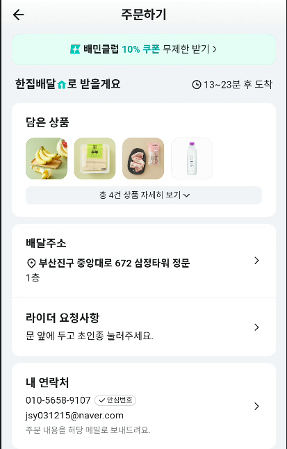

| 순서 | 항목 | 동작 |
|---|---|---|
| 1 | 쿠폰·이벤트 배너 | 적용 가능한 프로모션 안내 |
| 2 | 배송 방식 | 한집·알뜰·예약배달 중 현재 선택된 방식 표시 |
| 3 | 도착 정보 | 예상 소요 시간 또는 예약 도착 시간 표시 |
| 4 | 담은 상품 | 총 상품 건수와 요약 이미지를 표시, 펼치기/접기로 상세 확인 |
| 5 | 배송지 | 등록된 배송지 표시, 주문서에서도 변경 가능 |
| 6 | 라이더 요청 사항 | 기존 요청 확인, 항목 선택 또는 직접 입력·수정 |
| 7 | 내 연락처 | 휴대전화 번호 변경 및 안심번호 사용 여부 선택 |
| 8 | 품절 시 요청 사항 | 품절 상품만 취소 또는 주문 전체 취소 중 선택 |
| 9 | 결제 수단 | 프로젝트에서 사용할 결제 방식을 표시 |
| 10 | 할인·혜택 | 쿠폰·선물함·포인트 항목과 적용 상태 확인 |
| 11 | 결제 요약 | 상품금액·배달팁·할인·결제 금액 표시 |
| 12 | 결제하기 | 최종 금액 기준 결제 시작 |

### 3.3 담은 상품 펼치기

- 최초 주문서에는 썸네일과 상품 건수를 요약 표시한다.
- `총 n건 상품 자세히 보기`를 누르면 상품별 이름·가격·수량을 펼쳐 확인한다.
- 펼친 상태에서는 `접기` 동작으로 되돌아간다.

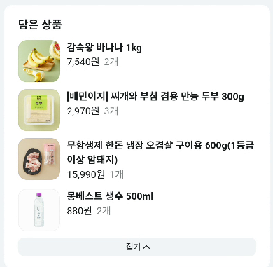

### 3.4 배송지와 라이더 요청 사항

**필수 선택:** 등록된 주소의 상세주소

주문서 내에서 배송지를 변경할 수 있다. 배송지 변경은 **배송 가능 여부, 배달팁, 예상 시간, 예약배달 시간대** 재검증으로 이어져야 한다.

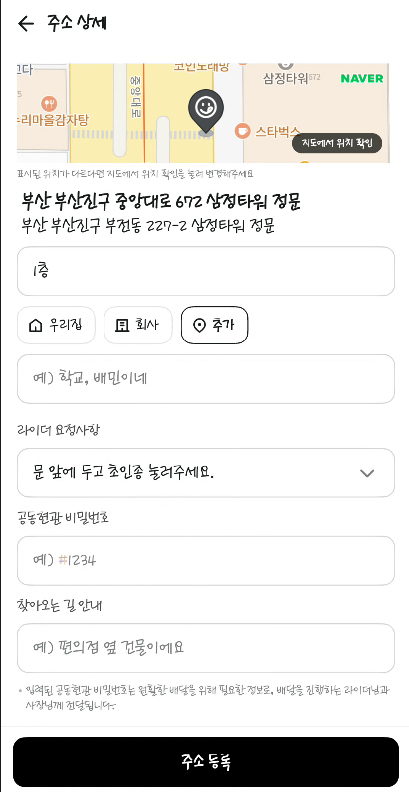

라이더 요청 사항은 선택형 문구 또는 직접 입력 항목으로 작성한다. 주소 상세 화면과 주문서의 요청 사항이 서로 연결되어 있다.

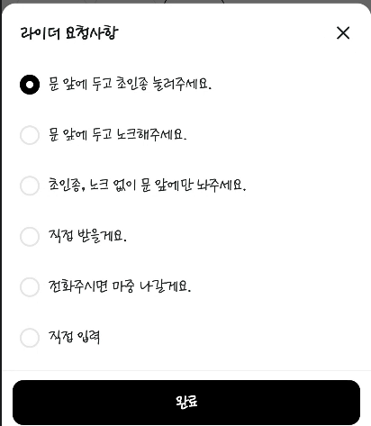

### 3.5 연락처

- 휴대전화 번호를 변경할 수 있다.
- `안심번호 사용` 체크박스를 선택하거나 해제할 수 있다.
- 이메일은 첨부된 주문서 화면에서 수정 항목으로 제공되지 않는다.

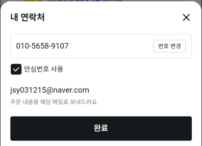

### 3.6 품절 시 요청 사항

**필수 선택:** 주문 처리 중 품절이 발생했을 때 적용할 방식을 지정한다.

1. **품절 상품만 부분 취소해 주세요:** 품절된 상품을 제외하고 나머지 상품의 주문을 이어간다.
2. **주문 전체 취소해 주세요:** 품절이 발생하면 전체 주문을 취소한다.

`다음에도 적용`은 선택사항이며, `완료`를 눌러 저장한다.

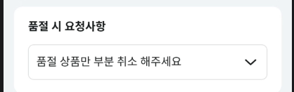

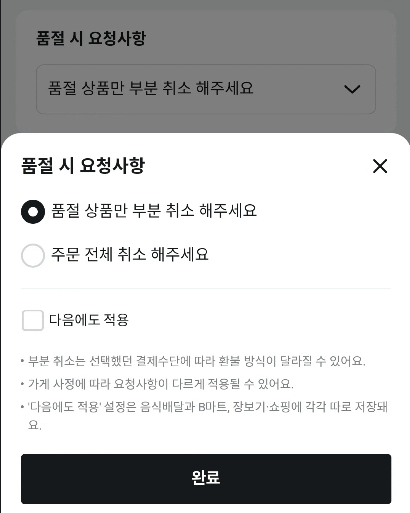

> **중요:** 위의 `품절 상품만 부분 취소`는 주문 상품 단위의 취소 정책이다.

### 3.7 결제 수단과 혜택

원본 캡처에는 여러 결제 수단이 등장하지만, 프로젝트의 **결정 완료 사항은 `토스 외 지원 안 함`**이다. 따라서 캡처의 다른 결제 수단까지 구현 범위로 오해하면 안 된다.

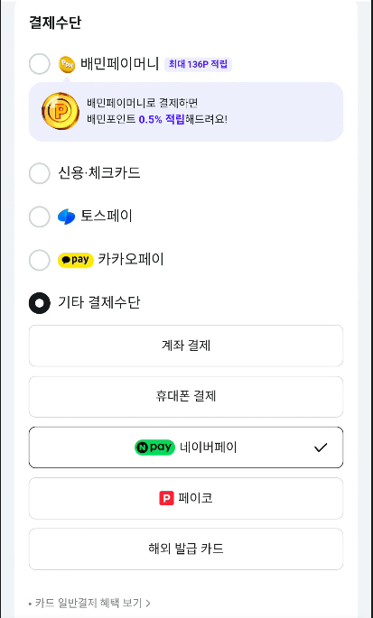

주문서에는 다음 혜택 항목이 나타난다.

- 할인쿠폰: 보유·적용 가능 쿠폰 확인
- 선물함: 선물 관련 잔액 또는 이용 수단 표시
- 포인트: 사용 가능·적용 포인트 확인

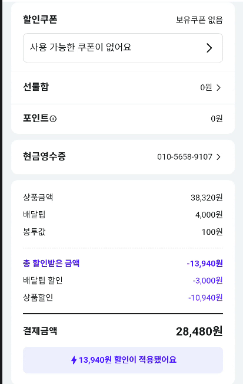

### 3.8 최종 결제 확인

결제 버튼을 누르기 전에 할인과 배달팁을 포함한 **최종 결제 금액**을 보여준다. 유의사항·동의 안내도 함께 표시되는 사례가 있다.

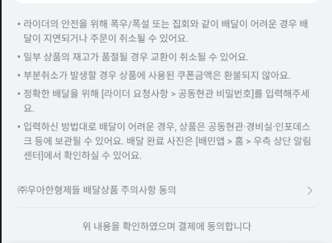


**결제 직전 검증 항목**

- 배송지 및 배송 가능 구역
- 장바구니 상품의 판매 여부, 수량, 재고 및 구매 제한(기본 10개, 상품별 상한)
- 할인·쿠폰·포인트의 유효성
- 선택 배송 방식과 예약 시간대 유효성
- 최종 금액 및 고객 확인 여부
- 품절 시 처리 방식 선택 여부
- 주문 상품 총중량(수량 × 단위중량)과 **10kg 초과 분할배송 필요 여부**

### 3.9 주문·배송비 계산과 최종 확정 정책

**프로젝트 결정**

| 항목 | 적용 규칙 | 판정 시점 |
|---|---|---|
| 최소 주문금액 | 주문 대상 상품금액 **15,000원 이상** | 주문서 진입·결제 직전 |
| 배송 방식 | 한집배달·알뜰배달·예약배달 중 선택 | 주문서에서 선택 확인, 결제 완료 시 확정 |
| 배달팁 무료: 첫 구매 | 해당 고객의 **첫 구매**라면 배달팁 0원 | 서버에서 첫 구매 자격 검증 |
| 배달팁 무료: 주문금액 | **장바구니 주문 대상 상품 합계 30,000원 이상**이면 배달팁 0원 | 결제 직전 재계산 |
| 봉투값 | **주문당 100원 고정** | 최종 결제금액 계산 시 포함 |
| 상품 재고 | 화면 표시 수량은 조회 시점의 정보 | 결제 직전 재검증, 결제 완료 시 실제 판매 재고 반영 |
| 상품별 구매 수량 | **기본 최대 10개, 상품별 개별 상한 우선** | 담기·수량 변경·주문서·서버 최종 검증 |
| 분할배송 | **총 주문 상품 중량 > 10,000g인 경우 분할배송** | 결제 직전 필요 건수 산정, 결제 완료 후 배송 건 확정 |
| 배송 시간 | 예상 도착·예약 가능 시간은 변동 가능 | 결제 직전 재검증, 결제 완료 시 확정 반영 |
| 주문 정보 변경 | **결제 승인으로 주문 완료된 후 주소·연락처·요청·예약시간 등 변경 불가** | 주문 완료 상태 전이 이후 |

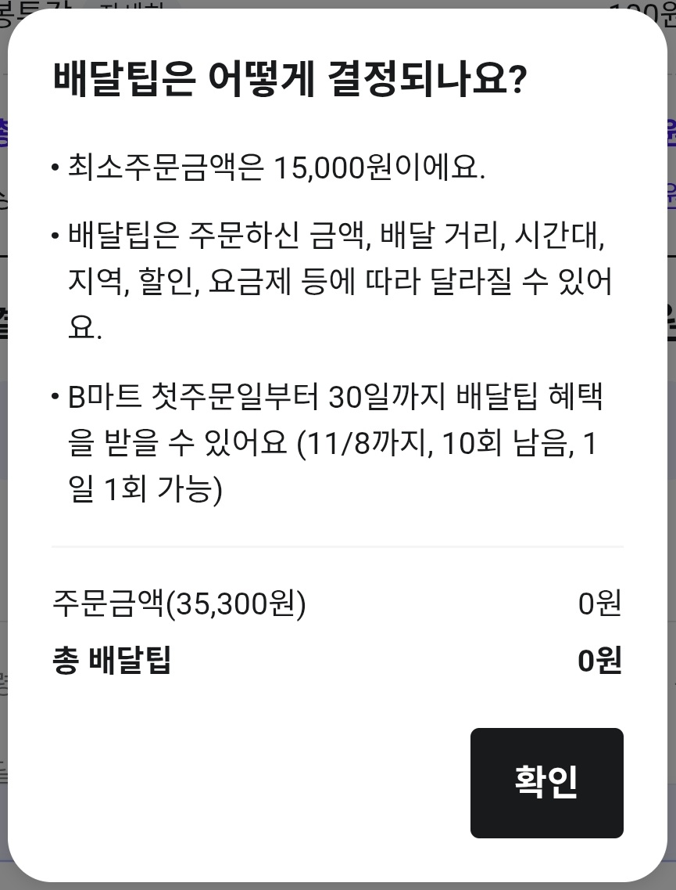

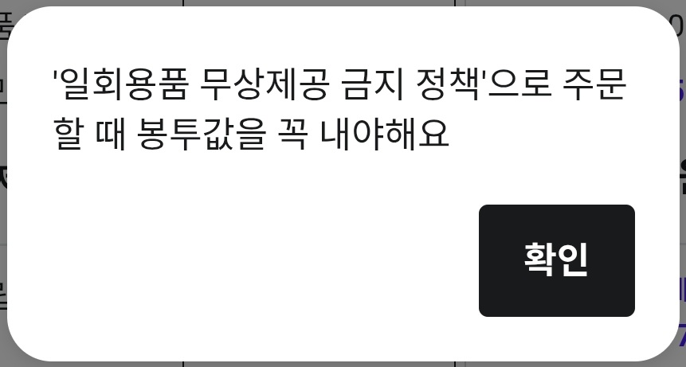

> **중요:** 배달팁 안내 팝업에는 주문 금액뿐 아니라 거리·시간대·지역·할인·요금제 등의 영향을 받을 수 있다고 설명한다. 원본 화면의 특정 금액이나 할인 기간은 촬영 당시의 사례다. **실제 프로젝트에서 적용할 배달팁은 배달 방식별 기본 요금이 고정되는 것으로 정한다.**

> **적용 우선순위:** 배송 방식 기준 배달팁 산출 → 첫 구매 또는 주문금액 30,000원 이상 여부 확인 → 조건을 충족하면 배달팁 0원 → 봉투값 100원 더하기. 두 무료 조건은 중첩하여 추가 할인을 만들지 않는다.

> **예시(설명용):** 상품금액 30,000원, 할인 0원, 배달팁 무료 조건 충족 시 `30,000 + 배달팁 0 + 봉투값 100 = 30,100원`이다. 할인 상품의 최소 주문금액·무료 배송 산정 기준을 할인 전/후 어느 금액으로 볼지는 팀에서 최종 확정해야 한다.

> **법령 표현 주의:** 일회용 봉투의 유상 제공 제도와 별개로, **100원이라는 액수는 이 프로젝트에서 정한 고정값**으로 기록한다. 정부가 모든 서비스에 100원이라는 동일 금액을 강제한다고 단정하지 않는다.

---

### 3.10 기능 연계 임시 데이터 및 DB 구조 설계

#### `customer_addresses` — 배송지

고객이 관리하는 배송지이며 주문 완료 시 주소 문자열은 주문으로 복사

**테이블 구조**

| 컬럼 | DB 타입 | 제약·의미 |
|---|---|---|
| address_id | BIGINT | PK |
| customer_id | BIGINT | FK → customers |
| address_label | VARCHAR(50) | 별칭 |
| address_text | VARCHAR(255) | 상세 포함 |
| is_default | BOOLEAN | 기본 배송지 |

**임시 데이터 (3건)**

| address_id | customer_id | address_label | address_text | is_default |
| --- | --- | --- | --- | --- |
| 201 | 1 | 집 | 예시시 A로 1, 101호 | `true` |
| 202 | 2 | 회사 | 예시시 B로 2, 201호 | `true` |
| 203 | 3 | 기타 | 예시시 C로 3, 301호 | `true` |

> **설계 참고:** 주소는 모두 가상의 예시다. 실제 설계에서는 우편번호, 좌표, 도로명·상세주소를 분리할 수 있다.


#### `orders` — 주문 헤더

1개 주문에 1개 고객·배송방식·최종 결제 금액 저장. 배송은 1:N

**테이블 구조**

| 컬럼 | DB 타입 | 제약·의미 |
|---|---|---|
| order_id | BIGINT | PK |
| customer_id | BIGINT | FK → customers |
| address_id | BIGINT | FK → customer_addresses |
| method_code | VARCHAR(20) | FK → delivery_methods |
| order_status | VARCHAR(24) | PAID 등 |
| delivery_slot_id | BIGINT | FK → delivery_slots, nullable |
| address_snapshot | VARCHAR(255) | 주문 당시 배송지 |
| item_amount | INT | 할인 후 상품금액 |
| delivery_fee | INT | 무료 조건 반영 |
| bag_fee | INT | 100원 |
| pay_amount | INT | 상품+배달팁+봉투값 |
| total_weight_g | INT | 합계 g |
| split_required | BOOLEAN | 10kg 초과 여부 |

**임시 데이터 (3건)**

| order_id | customer_id | address_id | method_code | order_status | delivery_slot_id | address_snapshot | item_amount | delivery_fee | bag_fee | pay_amount | total_weight_g | split_required |
| --- | --- | --- | --- | --- | --- | --- | --- | --- | --- | --- | --- | --- |
| 801 | 1 | 201 | SINGLE | DELIVERED | `NULL` | 예시시 A로 1, 101호 | 36000 | 0 | 100 | 36100 | 12000 | `true` |
| 802 | 2 | 202 | SAVER | DELIVERED | `NULL` | 예시시 B로 2, 201호 | 16000 | 0 | 100 | 16100 | 1000 | `false` |
| 803 | 3 | 203 | RESERVED | DELIVERED | 701 | 예시시 C로 3, 301호 | 18000 | 3000 | 100 | 21100 | 3000 | `false` |

> **설계 참고:** 실제 orders에는 주문번호, 할인 내역, 생성/결제/완료 시각을 추가한다. 첫 구매 무료 배달팁은 802에, 30,000원 이상 무료는 801에 적용한 예시다.


#### `order_items` — 주문 품목 스냅샷

주문 확정 시 단가·수량·중량·구매제한을 고정하여 이후 상품 정보 변경과 분리

**테이블 구조**

| 컬럼 | DB 타입 | 제약·의미 |
|---|---|---|
| order_item_id | BIGINT | PK |
| order_id | BIGINT | FK → orders |
| product_id | BIGINT | FK → products |
| quantity | INT | 확정 주문 수량 |
| unit_price | INT | 주문 당시 원 |
| unit_weight_g | INT | 주문 당시 g |
| line_amount | INT | quantity × unit_price |

**임시 데이터 (3건)**

| order_item_id | order_id | product_id | quantity | unit_price | unit_weight_g | line_amount |
| --- | --- | --- | --- | --- | --- | --- |
| 901 | 801 | 301 | 6 | 6000 | 2000 | 36000 |
| 902 | 802 | 302 | 2 | 8000 | 500 | 16000 |
| 903 | 803 | 303 | 3 | 6000 | 1000 | 18000 |

> **설계 참고:** 상품 가격·중량 변경에도 과거 주문 품목의 스냅샷은 덮어쓰지 않는다.


#### `order_status_history` — 주문 상태 이력

배송 건별 상태와 별개로 주문 단위 상태 변경을 기록

**테이블 구조**

| 컬럼 | DB 타입 | 제약·의미 |
|---|---|---|
| order_history_id | BIGINT | PK |
| order_id | BIGINT | FK → orders |
| status | VARCHAR(24) | 상태 |
| occurred_at | DATETIME | 발생 시각 |

**임시 데이터 (3건)**

| order_history_id | order_id | status | occurred_at |
| --- | --- | --- | --- |
| 951 | 801 | DELIVERED | 2026-10-16 13:00 |
| 952 | 802 | DELIVERED | 2026-10-16 14:00 |
| 953 | 803 | DELIVERED | 2026-10-16 15:00 |

> **설계 참고:** 각 주문의 최신 이벤트만 예시로 제시한 것이며 실제 저장 시 중간 상태도 누적한다.


#### `coupons` — 쿠폰 마스터

할인 정책을 쿠폰 정의로 분리; 사용 가능 기간·대상 조건 필요

**테이블 구조**

| 컬럼 | DB 타입 | 제약·의미 |
|---|---|---|
| coupon_id | BIGINT | PK |
| coupon_code | VARCHAR(40) | UNIQUE |
| discount_type | VARCHAR(12) | FIXED/PERCENT |
| discount_value | INT | 원 또는 % |
| status | VARCHAR(16) | ACTIVE/EXPIRED |

**임시 데이터 (3건)**

| coupon_id | coupon_code | discount_type | discount_value | status |
| --- | --- | --- | --- | --- |
| 211 | WELCOME1000 | FIXED | 1000 | ACTIVE |
| 212 | EVENT5 | PERCENT | 5 | ACTIVE |
| 213 | OLD500 | FIXED | 500 | EXPIRED |


#### `order_coupons` — 주문 적용 쿠폰

고객이 선택한 쿠폰과 확정 할인액의 주문별 연결 테이블

**테이블 구조**

| 컬럼 | DB 타입 | 제약·의미 |
|---|---|---|
| order_coupon_id | BIGINT | PK |
| order_id | BIGINT | FK → orders |
| coupon_id | BIGINT | FK → coupons |
| discount_amount | INT | 실제 적용 금액 |
| apply_status | VARCHAR(16) | APPLIED/REJECTED |

**임시 데이터 (3건)**

| order_coupon_id | order_id | coupon_id | discount_amount | apply_status |
| --- | --- | --- | --- | --- |
| 221 | 801 | 211 | 0 | REJECTED |
| 222 | 802 | 212 | 0 | REJECTED |
| 223 | 803 | 213 | 0 | REJECTED |

> **설계 참고:** 예시는 세 주문 모두 실제 적용 할인 0원이다. 거절된 쿠폰의 할인액을 주문 결제금액에서 차감하지 않는다.

---

## 4. 결제 및 결제 예외 처리

### 4.1 기본 결제 흐름

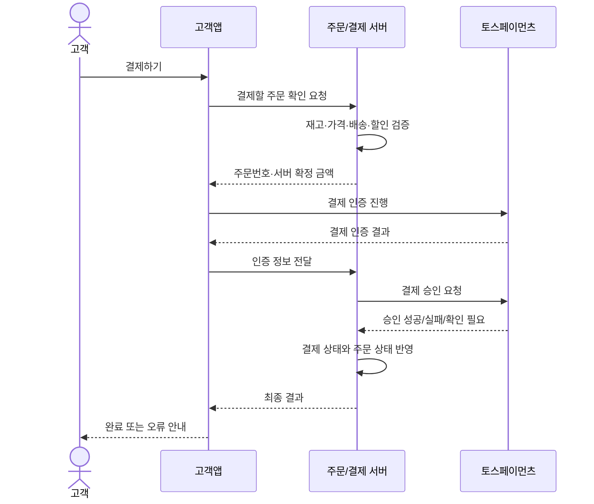

- 결제창에서 돌아왔다고 해서 자동으로 `결제 완료`가 되는 것은 아니다.
- 서버에서 `orderId`·결제 금액을 검증한 뒤 승인한다.
- 승인 성공 뒤 주문·결제 상태를 저장하고 고객에게 완료 화면을 제공한다.
- 승인 상태를 모르는 경우 실패라고 단정하거나 즉시 새 결제를 만들지 않는다.

### 4.2 주문·결제 데이터

| 주문 데이터 | 결제 데이터 |
|---|---|
| 주문번호, 주문상품·수량 | `orderId`, `paymentKey` |
| 상품 금액·할인 금액·배달팁 | 요청/승인 금액, 결제 수단 |
| 최종 결제 금액, 주문 상태 | 결제 상태, 승인 일시 |
| 배송지·배송방식·예약시간 | 취소 금액·사유·거래 이력 |

### 4.3 성공·실패·불명확 상태

| 상황 | 처리 |
|---|---|
| 승인 성공 | 결제 상태 완료 → 주문 처리 단계 진행 → 고객에게 완료 안내 |
| 승인 실패 | 완료로 처리하지 않음 → 원인 안내 → 재시도 가능 여부 판단 |
| 인증 후 결과 확인 실패 | 결제 조회를 통해 실제 승인 여부 확인, 무분별한 재결제 차단 |
| 중복 결제 요청 | 기존 주문·결제 상태 확인, 중복 승인 방지 |
| 금액 불일치 | 서버 계산액과 승인 요청액을 비교, 불일치 시 승인 중단 및 금액 재확인 |
| 승인/취소 통신 오류 | 최종 처리 여부 재조회 후 상태 확정, 멱등성 처리 검토 |

### 4.4 취소 및 환불 연동

1. 결제 전 주문 취소와 승인 후 취소를 구분한다.
2. 승인 후 주문 취소 시 현재 주문 상태와 취소 가능 여부를 확인한다.
3. 결제 취소의 성공 여부를 확인한 뒤 주문·결제 상태를 갱신한다.
4. 취소 오류가 발생한 경우에도 처리 결과를 조회한 뒤 재시도한다.
5. 프로젝트에서 **부분 결제취소를 지원하지 않기로 한 점**과 품절 상품 부분 취소/반품에 따른 정산을 함께 고려해야 한다.

### 4.5 보안과 확정된 범위

- 시크릿 키는 서버에서만 보관한다.
- 클라이언트에 노출되는 결제 금액은 신뢰하지 않고 서버 금액으로 비교한다.
- 승인·취소 요청 결과를 이력으로 남긴다.

**결정 완료:** 토스페이먼츠 **주문서형** 적용, **토스 외 결제 수단 미지원**, **부분 결제취소 미지원**.

참고: [토스페이먼츠 개발자센터](https://docs.tosspayments.com/) · [결제 API](https://docs.tosspayments.com/reference)

### 4.6 결제 UI에서 관찰된 진행 화면

아래 내용은 위의 기본 결제 흐름에서 사용자에게 보이는 화면을 연결한 기록이다.

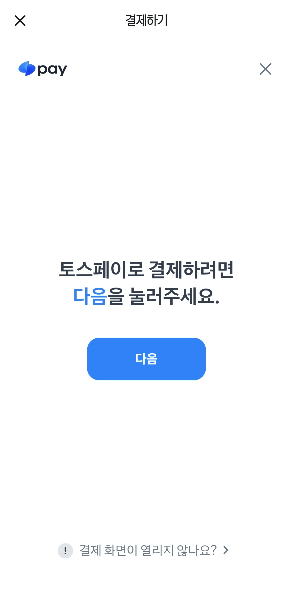

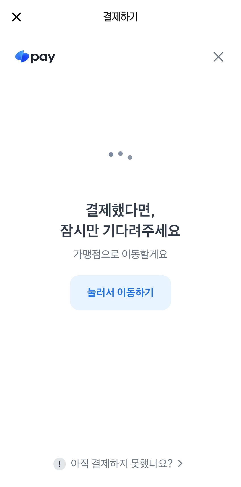


| 순서 | 화면 관찰 | 서버 처리에서 구분할 점 |
|---|---|---|
| 1 | 토스페이 이동 안내/앱 실행 유도 | 외부 결제 인증 진입. 결제 완료 아님 |
| 2 | 결제 진행 중 또는 잠시 기다려 달라는 로딩 화면 | 상태 확인 중. 뒤로가기와 지연 상태 구분 |
| 3 | 주문완료 화면 로딩 후 결과 노출 | **결제 승인 확인과 서버 주문 확정 후** 완료 노출 |

> **주의:** 첨부 캡처 일부에는 다른 결제수단 표시도 존재한다. 이는 실제 화면 관찰 사례이며, **프로젝트는 토스페이먼츠만 지원**한다는 기존 범위가 우선한다. 

---

### 4.7 기능 연계 임시 데이터 및 DB 구조 설계

#### `payments` — 결제 거래

주문 단위 토스 승인 금액과 최종 상태를 기록, 주문/배송에 중복 차감 금지

**테이블 구조**

| 컬럼 | DB 타입 | 제약·의미 |
|---|---|---|
| payment_id | BIGINT | PK |
| order_id | BIGINT | FK → orders |
| provider | VARCHAR(20) | TOSS |
| pg_order_id | VARCHAR(64) | UNIQUE |
| payment_key | VARCHAR(100) | 승인 응답값, UNIQUE |
| approved_amount | INT | 서버 확정 원 |
| payment_status | VARCHAR(24) | DONE/CANCELED 등 |

**임시 데이터 (3건)**

| payment_id | order_id | provider | pg_order_id | payment_key | approved_amount | payment_status |
| --- | --- | --- | --- | --- | --- | --- |
| 1001 | 801 | TOSS | BARO-801 | MOCK_KEY_801 | 36100 | DONE |
| 1002 | 802 | TOSS | BARO-802 | MOCK_KEY_802 | 16100 | DONE |
| 1003 | 803 | TOSS | BARO-803 | MOCK_KEY_803 | 21100 | DONE |

> **설계 참고:** MOCK_KEY_*는 임시 데이터이며 실제 토스 paymentKey가 아니다. paymentKey/시크릿 키의 로그 노출을 제한한다.


#### `payment_attempts` — 결제 승인/취소 요청 이력

멱등성 키로 중복 처리하고 결과 불명확 시 조회부터 수행

**테이블 구조**

| 컬럼 | DB 타입 | 제약·의미 |
|---|---|---|
| attempt_id | BIGINT | PK |
| payment_id | BIGINT | FK → payments |
| request_type | VARCHAR(20) | APPROVE/CANCEL/LOOKUP |
| idempotency_key | VARCHAR(80) | UNIQUE |
| result_status | VARCHAR(20) | SUCCESS/UNKNOWN/FAIL |
| requested_at | DATETIME | 요청 시각 |

**임시 데이터 (3건)**

| attempt_id | payment_id | request_type | idempotency_key | result_status | requested_at |
| --- | --- | --- | --- | --- | --- |
| 1101 | 1001 | APPROVE | idem-801-approve | SUCCESS | 2026-10-16 10:01 |
| 1102 | 1002 | APPROVE | idem-802-approve | SUCCESS | 2026-10-16 10:11 |
| 1103 | 1003 | APPROVE | idem-803-approve | SUCCESS | 2026-10-16 10:21 |

---

## 5. 배송 방식 및 예약배송

### 5.1 배송 방식 비교

| 구분 | 한집배달 | 알뜰배달 | 예약배달 |
|---|---|---|---|
| 고객 선택 | 즉시형 | 즉시형 | 도착 시간대 지정 |
| 도착 정보 | n~n분 후 | n~n분 후 | 선택된 날짜·시간대 |
| 기본 배달팁 | 4,000원 | 3,000원 | 3,000원 |
| 추가 동작 | 배송 방식 선택 | 배송 방식 선택 | 예약 날짜·시간 선택 |

- **별도 추가 배달팁 없음**
- **프로젝트 결정:** 첫 구매이거나 장바구니 주문 대상 상품 합계가 **30,000원 이상**이면 배달팁을 무료(0원)로 적용한다. 이 조건은 배송 방식 기본요금보다 우선한다.
- **프로젝트 결정:** 봉투값 **100원**은 배달팁 무료 여부와 관계없이 부과한다.
- 캡처에는 할인 적용으로 배달팁 **0원**이 표시된 사례도 있다. 표의 금액을 할인 전제와 무관한 절대 금액으로 처리하지 않는다.
- **00:00~08:00에는 예약배달만 가능**

### 5.1.1 총중량 10kg 초과 시 분할배송 (프로젝트 결정)

1. 주문 품목마다 `단위중량(g) × 주문 수량`을 계산하고 전부 합산한다.
2. **총중량이 10,000g 이하**면 원칙적으로 배송 건 1개를 생성한다. **10,000g 초과**면 배송 건을 최소 2개 이상 생성한다. `10,000g` 정확히는 초과가 아니므로 이 규칙에 의한 분할 대상이 아니다.
3. 분할된 각 배송 건에는 서로 다른 `shipment_id`를 부여하고 `order_id`는 동일하게 유지한다. 한 주문의 품목·수량을 여러 배송 건에 배정할 수 있어야 한다.
4. 각 배송 건의 합산 상품 중량이 10,000g을 넘지 않도록 배분하고, 피킹·패킹·배차·라이더 인계·배송완료를 배송 건별로 관리한다.
5. 주문서/배송현황에는 고객이 **한 주문이 여러 번 나뉘어 도착할 수 있음**을 알 수 있게 총 배송 건수, 각 배송 건 상태, 예상 정보를 표시한다.
6. 배송 완료 처리는 배송 건별로 먼저 저장하고, **모든 배송 건이 완료된 경우에만 주문 전체를 배송완료**로 집계한다.

> **산정 예시:** 2kg 상품 6개 = 12,000g → 배송 1/2(5개, 10,000g), 배송 2/2(1개, 2,000g). 고객 주문 1건·토스 결제 1건은 그대로 유지한다.

주문 확정 시 품목 중량 스냅샷을 저장하고 배송 건/배정 품목을 트랜잭션으로 생성한다. 부분 피킹 실패, 재배차, 미배송, 회수는 개별 배송 건 단위로 추적한다.

**미결정:** 포장재 중량 포함 기준, 상품 1개가 10kg 초과인 경우의 처리, 냉장·냉동 혼합 배정 방식, 분할배송 시 추가 배달비 부과 여부, 배송 건마다 다른 도착 시간 허용 범위. 이 항목들은 임의로 고정하지 않는다.

### 5.2 예약배달 시간 선택

1. 장바구니에서 예약배달 선택
2. 시간 선택 팝업 열기
3. 오늘/내일 중 날짜 선택
4. 조회된 **1시간 단위** 도착 시간대 중 하나 선택
5. 선택 완료 → 장바구니에 선택 내용 반영
6. 주문서 진입과 결제 요청 직전에 시간대 재검증

### 5.3 마감·변경·조회 오류

| 상황 | 처리 |
|---|---|
| 선택한 시간대가 마감됨 | 해당 시간대 비활성화, 다른 시간 재선택 안내 |
| 전체 시간대가 마감됨 | 선택 불가 안내, 필요하면 다른 날짜/재조회 제공 |
| 배송지 변경 | 새 배송지 기준 가능 시간 재조회 |
| 시간대 조회 오류 | 오류 안내, 조회 실패한 시간을 유효 시간으로 확정하지 않음 |
| 장바구니 상품 조회 오류 | 상품을 불러오지 못했다는 안내와 확인 후 재조회 사례 기록 |

**운영 메모:** 조회 오류 시 자동 재시도는 하지 않는다 (B마트에서 확인한 방식). 이전 시간대 임시 표시 허용 조건도 적혀 있으나, **조회 실패 시 주문 진행 허용 여부**는 원문에 결정 결과 없이 남아 있어 미결정으로 분리한다.

### 5.4 주문 완료 후 배송현황 화면과 상태별 이동

주문완료 후 배송현황 진입 시 로딩이 표시되고, 주문 확인 화면에서 상태 진행 바·지도·배송지·주문 정보를 조회할 수 있다. 예약 주문의 경우 선택한 도착 예정 시간대가 표시된다.

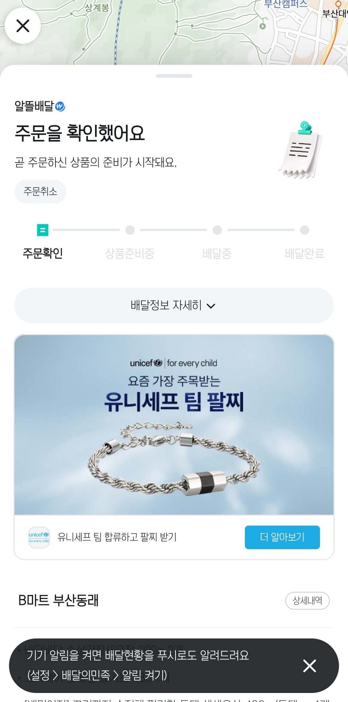

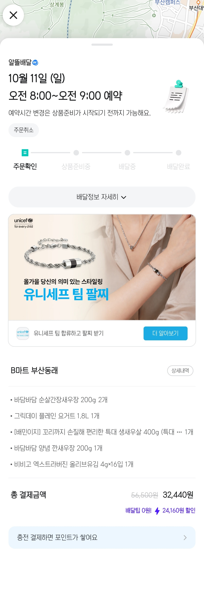

**배송 과정의 화면 흐름**

1. **주문확인:** 주문 접수 및 처리 준비 단계 표시, 배송정보 자세히 보기 제공.
2. **배송예약:** 확정된 예약 도착 시간대 표시. 이 단계에서 시간 변경 UI가 보이는 사례가 있으나 본 프로젝트는 **주문 완료 후 변경 불가**를 적용한다.
3. **배달중:** 지도에서 라이더 위치 마커, 배송 진행 상태, 갱신된 예상 도착 정보 표시.
4. **배송완료:** 배송현황 대신 완료 안내 및 주문상세에서 기록 조회. 분할배송이면 모든 배송 건이 완료된 이후에 주문 전체 완료로 표시.

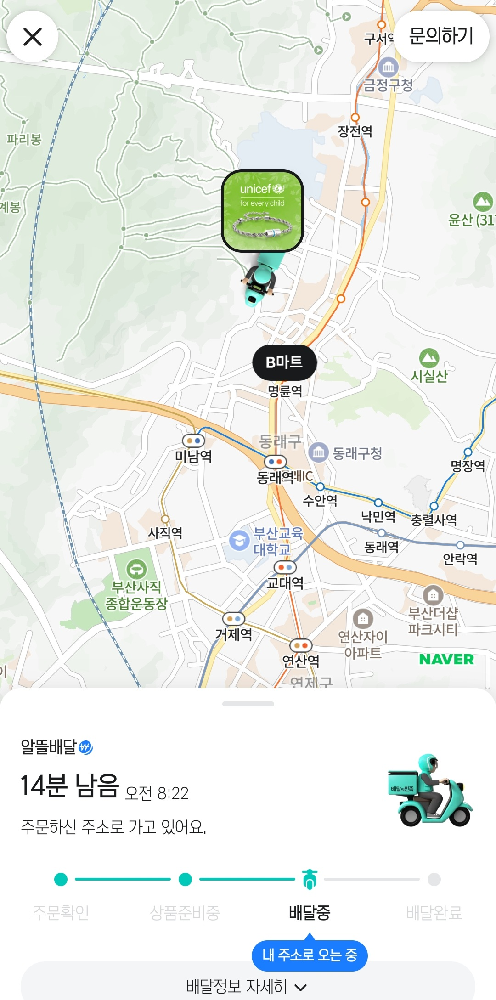

- 지도 출발지·도착지, 라이더 위치 및 실제 배송 예상 시간은 서버 배송 이벤트/위치 데이터에 연동한다.
- **분할배송:** 주문상세에 `배송 1/2`, `배송 2/2`처럼 배송 건별 진행 상태·담긴 품목·라이더/예상시간을 분리 표시한다. 배송 건마다 상태가 다를 수 있다.
- 예상 시간은 확정 도착 보증이 아니라 표시 당시 예측 정보이며, **주문 완료 시점의 배송 조건 확정**과 구분한다.
- 클릭이 반응하지 않는 `주문확인` 화면 사례가 있으므로, 링크가 제공되지 않는 상태와 실제 기능 오류를 분리해 검증한다.
- 주문 상태가 배송완료로 바뀐 뒤 옛 배송현황 링크에 접근하면 주문상세로 이동시키거나 완료 안내를 제공한다.

---

### 5.5 기능 연계 임시 데이터 및 DB 구조 설계


#### `delivery_methods` — 배송 방식

배달팁 산정 기준값. 첫 구매/3만원 이상 무료 조건은 서버에서 별도 적용

**테이블 구조**

| 컬럼 | DB 타입 | 제약·의미 |
|---|---|---|
| method_code | VARCHAR(20) | PK |
| display_name | VARCHAR(40) | NOT NULL |
| base_fee | INT | 기본 배달팁, 원 |
| is_reservation | BOOLEAN | 예약형 |

**임시 데이터 (3건)**

| method_code | display_name | base_fee | is_reservation |
| --- | --- | --- | --- |
| SINGLE | 한집배달 | 4000 | `false` |
| SAVER | 알뜰배달 | 3000 | `false` |
| RESERVED | 예약배달 | 3000 | `true` |

> **설계 참고:** 배달 방식별 가격은 현재 문서의 프로젝트 결정값이며 화면 캡처 예시와 구별한다.


#### `delivery_slots` — 예약 배송 시간대

배송 권역·센터·날짜별 선택 가능한 슬롯; 결제 완료에 수용량 반영

**테이블 구조**

| 컬럼 | DB 타입 | 제약·의미 |
|---|---|---|
| slot_id | BIGINT | PK |
| center_id | BIGINT | FK → fulfillment_centers |
| window_start | DATETIME | 도착 시작 |
| window_end | DATETIME | 도착 종료 |
| capacity | INT | 예약 수용량 |
| confirmed_count | INT | 확정 건수 |

**임시 데이터 (3건)**

| slot_id | center_id | window_start | window_end | capacity | confirmed_count |
| --- | --- | --- | --- | --- | --- |
| 701 | 103 | 2026-10-16 18:00 | 2026-10-16 19:00 | 20 | 3 |
| 702 | 101 | 2026-10-16 19:00 | 2026-10-16 20:00 | 10 | 7 |
| 703 | 102 | 2026-10-17 09:00 | 2026-10-17 10:00 | 15 | 0 |

> **설계 참고:** 예약 슬롯 확정은 결제 완료 시점에 한 번 수행한다. 시각은 캡처 재현이 아닌 가상 값이다.


#### `riders` — 라이더

분할배송의 각 배송 건에 라이더를 따로 지정할 수 있도록 함

**테이블 구조**

| 컬럼 | DB 타입 | 제약·의미 |
|---|---|---|
| rider_id | BIGINT | PK |
| display_code | VARCHAR(30) | UNIQUE |
| rider_status | VARCHAR(20) | AVAILABLE/BUSY |

**임시 데이터 (3건)**

| rider_id | display_code | rider_status |
| --- | --- | --- |
| 1401 | RIDER-A | AVAILABLE |
| 1402 | RIDER-B | BUSY |
| 1403 | RIDER-C | AVAILABLE |


#### `shipments` — 배송 건(분할배송 핵심)

한 주문에 여러 배송 건 생성. 각 배송 건 중량은 최대 10,000g

**테이블 구조**

| 컬럼 | DB 타입 | 제약·의미 |
|---|---|---|
| shipment_id | BIGINT | PK |
| order_id | BIGINT | FK → orders |
| shipment_no | INT | 주문 내 순번 |
| center_id | BIGINT | FK → fulfillment_centers |
| rider_id | BIGINT | FK → riders, NULL 허용 |
| shipment_weight_g | INT | <= 10,000g |
| status | VARCHAR(24) | PICKING/DELIVERED 등 |

**임시 데이터 (3건)**

| shipment_id | order_id | shipment_no | center_id | rider_id | shipment_weight_g | status |
| --- | --- | --- | --- | --- | --- | --- |
| 1201 | 801 | 1 | 101 | 1401 | 10000 | DELIVERED |
| 1202 | 801 | 2 | 101 | 1402 | 2000 | DELIVERED |
| 1203 | 802 | 1 | 102 | 1403 | 1000 | DELIVERED |

> **설계 참고:** UNIQUE(order_id, shipment_no). 주문 801은 12kg이므로 10kg·2kg 두 배송 건으로 분리된다. 분할 추가 배달비는 확정하지 않았다.


#### `shipment_items` — 배송 건별 품목 할당

분할배송 시 주문 품목 수량을 배송 건 단위로 나누어 연결

**테이블 구조**

| 컬럼 | DB 타입 | 제약·의미 |
|---|---|---|
| shipment_item_id | BIGINT | PK |
| shipment_id | BIGINT | FK → shipments |
| order_item_id | BIGINT | FK → order_items |
| allocated_qty | INT | >= 1 |
| allocated_weight_g | INT | 품목별 배정 총중량 |

**임시 데이터 (3건)**

| shipment_item_id | shipment_id | order_item_id | allocated_qty | allocated_weight_g |
| --- | --- | --- | --- | --- |
| 1301 | 1201 | 901 | 5 | 10000 |
| 1302 | 1202 | 901 | 1 | 2000 |
| 1303 | 1203 | 902 | 2 | 1000 |

> **설계 참고:** 합계 검증: 주문 801의 주문 품목 901 수량 6개 = 배송 1201의 5개 + 배송 1202의 1개. 배송 완료 시에도 원 주문은 하나다.


#### `shipment_events` — 배송 상태 이력

배송 건별 도착·인계·완료 이벤트를 누적 기록

**테이블 구조**

| 컬럼 | DB 타입 | 제약·의미 |
|---|---|---|
| shipment_event_id | BIGINT | PK |
| shipment_id | BIGINT | FK → shipments |
| event_type | VARCHAR(30) | PICKED_UP/DELIVERED 등 |
| event_at | DATETIME | 발생 시각 |

**임시 데이터 (3건)**

| shipment_event_id | shipment_id | event_type | event_at |
| --- | --- | --- | --- |
| 1501 | 1201 | DELIVERED | 2026-10-16 12:50 |
| 1502 | 1202 | DELIVERED | 2026-10-16 13:00 |
| 1503 | 1203 | DELIVERED | 2026-10-16 14:00 |

> **설계 참고:** 분할배송 주문은 배송 건 전체 완료 시점에 주문 상태를 배송완료로 승격하도록 설계한다.

---

## 6. 주문 상태와 알림

### 6.0 주문내역·주문상세·문의하기 진입

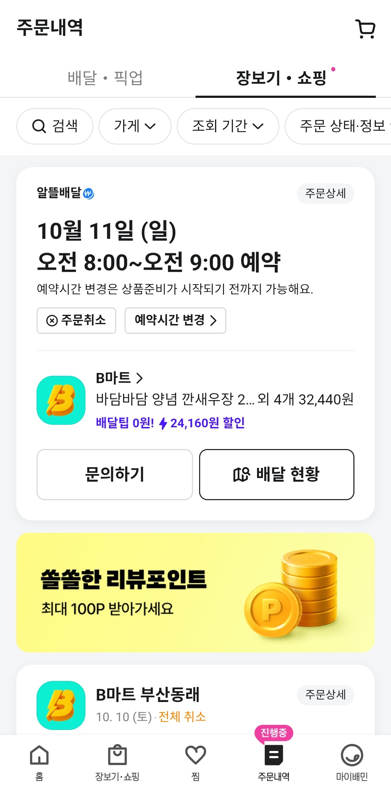

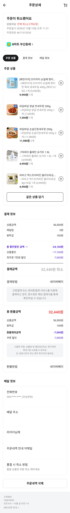

- **주문내역:** 주문 이력이 없으면 빈 상태 안내를 표시하고, 주문 이력이 있으면 주문별 상품·주문 상태·예상/예약 도착 정보를 보여준다.
- **주문상세:** 주문상품·결제정보·배송정보 탭 또는 영역으로 세부 데이터를 확인한다. 배송완료 이후에는 현금영수증 버튼, 반품·교환, 문의하기와 같은 사후 기능이 나타난다.
- **같은 상품 담기:** 과거 주문의 상품을 **새 장바구니에 추가**하는 기능으로, 이미 완료된 주문을 수정하는 것이 아니다.
- **품절 상품:** 같은 상품을 다시 담을 수 없으면 품절 상태를 표시하고 비슷한 상품을 추천하는 화면 사례가 있다.
- **문의하기:** 상단 버튼 또는 스크롤 시 나타나는 플로팅 버튼에서 문의 사유를 선택한다.
- **주문 취소:** 주문의 `상품준비` 단계 이전까지는 주문 취소가 자유롭게 가능하다. **주문 정보 수정 불가**와 **주문 취소 허용 여부**는 서로 다른 정책이다.

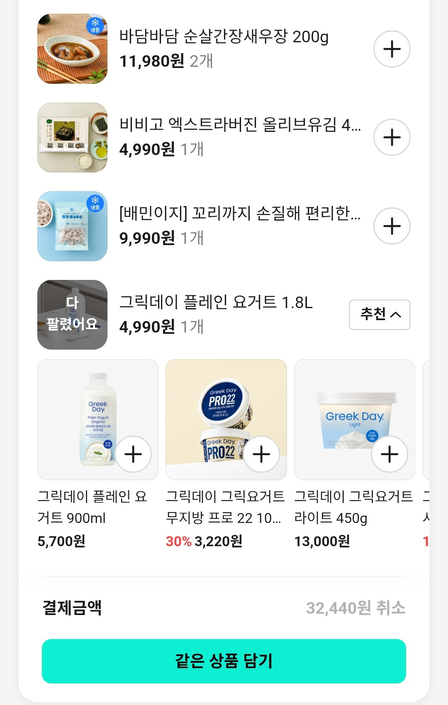

**프로젝트 결정:** 주문 완료 후 예약시간·배송지·연락처·라이더 요청 사항 등의 변경은 불가능하다. 단, 첨부 캡처에서 `예약시간 변경` 버튼이 보이는 것은 **화면 관찰** 사례이며 프로젝트 허용 정책이 아니다.

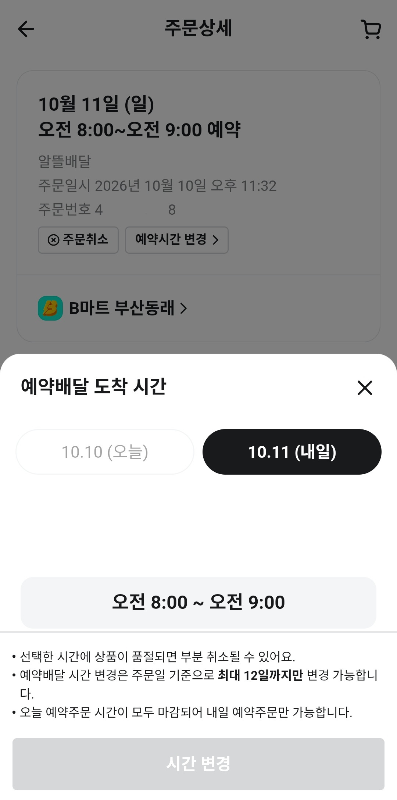

### 6.1 배송 완료와 알림 발송

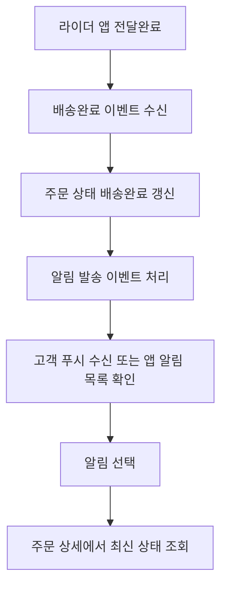

- 라이더가 `전달완료`를 처리하면 주문이 `배송완료`로 갱신된다.
- 고객은 푸시 또는 앱 알림 목록에서 해당 주문을 확인한다.
- 발송된 알림 문구는 **발송 당시 상태**를 유지하지만, 알림을 통해 연 주문 상세는 **현재 상태**를 보여준다.

> **예시:** `배송중` 알림을 눌렀더라도, 현재 주문 상태가 `배송완료`라면 주문 상세에 `배송완료`를 표시한다.

### 6.1.1 분할배송 알림 집계

- 배송 건별 이벤트에는 `shipment_id`를 포함해 같은 주문에서 배송 1/2과 2/2의 알림을 구분한다.
- 배송 1/2만 완료되었다면 주문 전체의 `배송완료` 알림을 먼저 보내지 않는다. 필요하면 `일부 배송완료` 알림을 별도 발송한다.
- 모든 배송 건이 완료되면 주문 상태를 배송완료로 변경하고, 해당 주문의 최종 배송완료 알림은 **주문 단위로 한 번**만 생성한다.
- 알림을 열면 주문 상세에서 **최신 주문 상태 및 배송 건별 최신 상태**를 조회한다.

### 6.2 중복 알림·역행 방지

- 같은 주문의 같은 이벤트에 대해 동일 채널로 중복 알림을 보내지 않는다.
- 늦게 도착한 이전 상태 이벤트가 현재 주문 상태를 덮어쓰지 않도록 한다.
- 발송된 과거 알림의 문구를 최신 상태로 일괄 변경하지 않는다.
- 알림 자체를 눌러 상세 페이지에 진입하고 돌아온 뒤 읽음 상태를 반영하여 동작한다.

### 6.3 알림 권한과 종류

| 구분 | 의미 |
|---|---|
| OS 푸시 권한 | 운영체제에서 알림 수신 허용 여부 |
| 앱 내부 수신 동의 | 앱에서 설정한 알림 종류별 동의 여부 |
| 주문·배송 알림 | 주문 처리·배송 상태 등 서비스 정보 |
| 마케팅 알림 | 광고·이벤트·프로모션 정보 |

OS 푸시 권한이 없어도 고객은 **주문 내역에서 현재 상태를 조회**할 수 있어야 한다. 마케팅 알림 동의 철회는 마케팅 발송 중단으로 처리하고, 주문·배송 알림 정책과 분리한다.

### 6.4 알림 예외

- 알림이 없는 경우 빈 화면 안내
- 알림을 열었으나 주문 상세를 조회하지 못하면 재시도 안내
- 대상 주문이 없거나 접근 불가하면 안내 메시지 표시
- 잠금화면 메시지의 개인정보 노출 수준, SMS·이메일 추가 발송은 별도 결정

### 6.5 알림센터·푸시 클릭 후 목적지

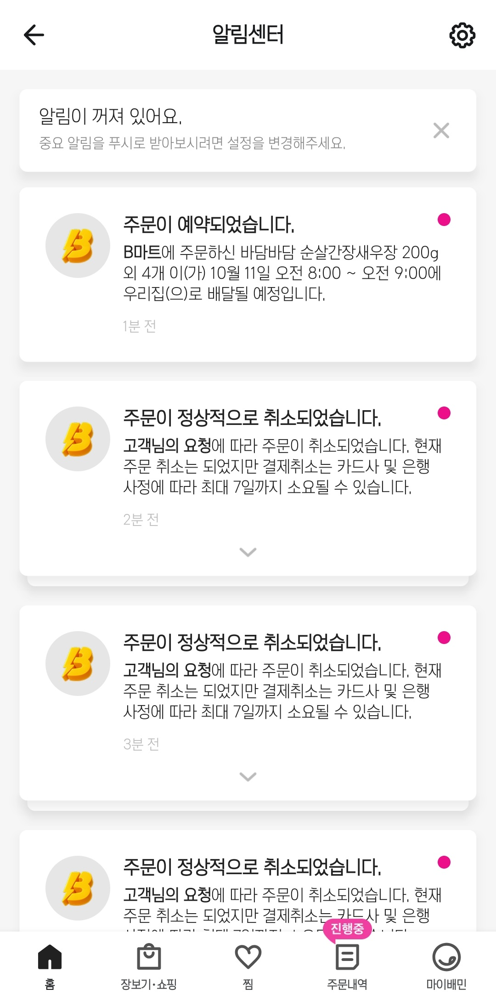

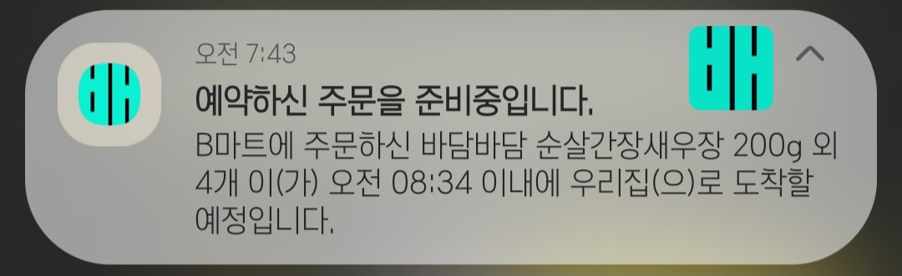


| 알림 유형 | 관찰된 클릭 후 목적지 | 프로젝트 적용 시 주의 |
|---|---|---|
| 주문 준비중 | 배송현황 | 접근 시 주문의 최신 상태 조회 |
| 배달 시작/진행/근처 | 배송현황 | 실시간 배송 단계와 지도 정보를 새로 요청 |
| 배달 완료 | 주문상세 | 완료 후 이전 배송현황 재현을 요구하지 않음 |
| 배달 완료 후 리뷰 유도 | 리뷰 작성 가능 목록/후속 진입 | 발송 시점·중복 방지·참여 가능 여부 검증 |
| 알림 비동의 상태 | 알림센터 안내 및 알림 권한 동의 경로 | OS 권한과 앱 내부 수신 설정 구분 |

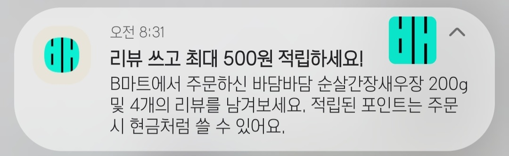

> **중요:** 배송완료 후 과거 배송현황 알림을 다시 선택하면, 완료된 주문의 배송 정보는 주문내역에서 확인하도록 안내하는 사례가 있다. 완료 상태의 기록 보존은 주문상세에서 제공한다.

---

### 6.6 기능 연계 임시 데이터 및 DB 구조 설계

#### `notifications` — 고객 알림

주문 단위 알림과 개별 배송 건 알림을 모두 표현

**테이블 구조**

| 컬럼 | DB 타입 | 제약·의미 |
|---|---|---|
| notification_id | BIGINT | PK |
| customer_id | BIGINT | FK → customers |
| order_id | BIGINT | FK → orders |
| shipment_id | BIGINT | FK → shipments, nullable |
| event_key | VARCHAR(100) | UNIQUE, 중복 방지 |
| notice_type | VARCHAR(30) | SHIPMENT/ORDER |
| is_read | BOOLEAN | 읽음 여부 |

**임시 데이터 (3건)**

| notification_id | customer_id | order_id | shipment_id | event_key | notice_type | is_read |
| --- | --- | --- | --- | --- | --- | --- |
| 1601 | 1 | 801 | 1201 | order801-ship1201-done | SHIPMENT | `true` |
| 1602 | 1 | 801 | 1202 | order801-ship1202-done | SHIPMENT | `false` |
| 1603 | 2 | 802 | 1203 | order802-ship1203-done | SHIPMENT | `true` |

> **설계 참고:** 분할배송에서 1/2건 완료는 배송 건 알림, 2/2건 완료 시 주문 배송완료 알림을 별개 이벤트로 처리할 수 있다.

---

## 7. 반품과 환불

### 7.1 신청 경로와 기본 구분

> **프로젝트 결정 변경:** 과거(2021년) 반품 화면을 일반적인 상품 반품 신청 화면으로 해석하지 않는다. 해당 화면은 **반품 배달비 9,000원 옵션을 구매하는 페이지**로 정의한다. 실제 반품 사유 심사·회수·환불과는 별도 처리한다.

```text
주문내역 → 배송완료 주문상세 → 반품·교환
                              ├─ 교환 신청(별도 흐름)
                              └─ 반품 경로/반품 배달비 옵션 안내
                                      ↓
                              반품 배달비 9,000원 옵션 구매
                                      ↓
                              고객센터/운영자 반품 적격 심사·회수 판단
                                      ↓
                              회수·검수(필요 시) → 환불 심사·결제 처리
```

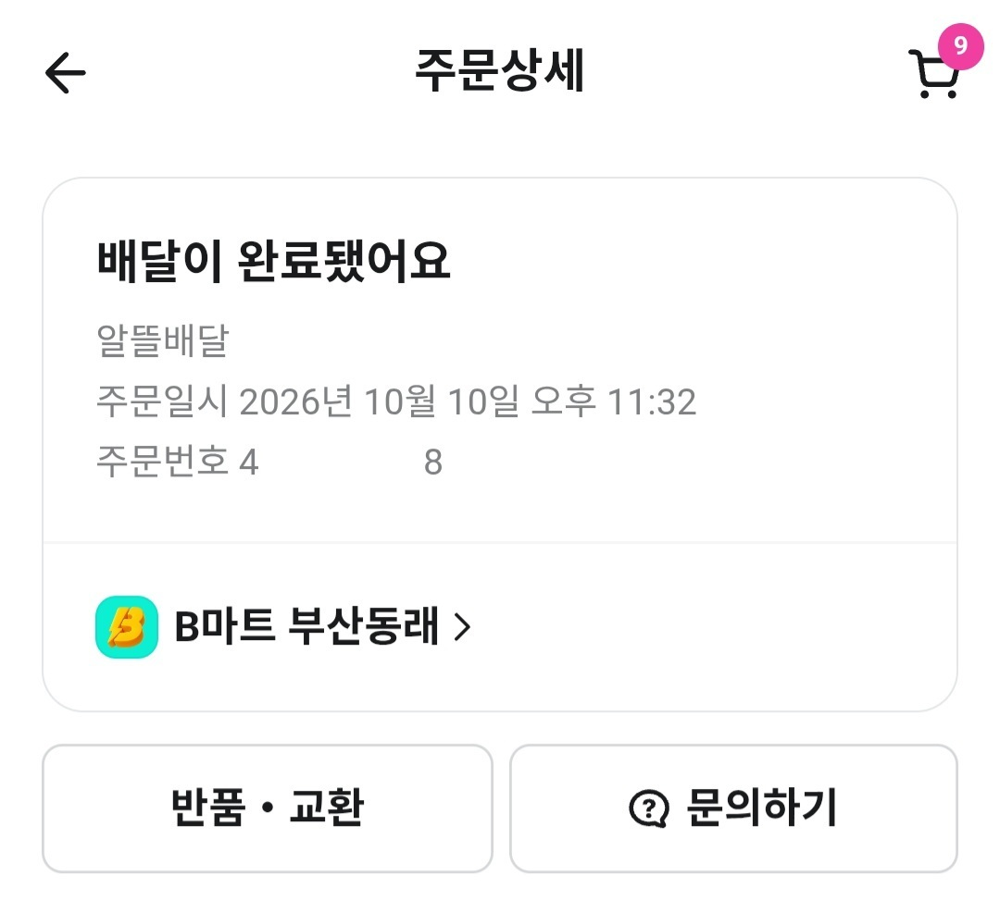

- **화면 관찰:** 배송완료 주문상세에서 `반품·교환`, `문의하기`가 제공된다.
- **프로젝트 결정:** 반품 관련 9,000원 페이지의 역할은 **반품 배달비 옵션 구매**다. 구매 즉시 환불 완료로 취급하지 않는다.
- **구현 제안:** 상품 하자·오배송 등 고객 귀책이 아닌 경우에는 배달비를 부과하지 않도록 사유별 유상/무상 기준을 별도로 확정한다.
- **미결정:** 반품 배달비 결제를 별도 주문/결제 거래로 처리할지, 본 주문에서 차감할지, 반품 거절·미회수 시 이미 수납한 배달비를 어떻게 정산할지.

**참고 링크:** [2021년 반품 화면 참고 자료](https://blog.naver.com/heartfelt10/222272871225). 외부 글의 본문 이미지는 직접 검증하지 못했으므로, 9,000원 옵션 구매라는 해석은 **이번 프로젝트 결정**으로 명시한다.

### 7.2 고객센터 접수 정보

- 주문번호, 주문일자, 배송완료 여부
- 주문 상품과 수량, 실제 결제 금액
- 적용된 쿠폰·할인과 기존 교환·환불 이력
- 반품할 품목·수량, 사유·상세 설명·사진
- 배송되지 않은 상품은 일반 반품이 아닌 **미배송 환불**로 분리

### 7.3 반품 사유

| 유형 | 사유 예시 | 원문 기재 증빙 |
|---|---|---|
| 변심·실수 | 마음에 들지 않음, 잘못 주문, 주소 설정 오류 | 상세 이유·사진 선택 |
| 상품문제 | 설명과 다름, 기능 문제, 변질, 이물질, 소비기한 경과 | 상세 이유·사진 필수 |
| 배달 문제 | 파손, 오배송, 일부 미배송, 배달완료인데 미수령 | 상세 이유·사진 필수 |

위 필수 여부는 문서에 정리된 초안이며, 반품의 경우 **운영 정책 확정 필요 항목**에도 포함되어 있다.

### 7.4 회수와 환불

1. 고객센터가 회수 필요 여부 판단
2. 필요하면 회수 상품·수량을 정하고 라이더 회수 업무 생성. 분할배송이라면 품목이 실제 어느 `shipment_id`로 배송되었는지도 연결
3. **회수지는 주문 당시 배송지로 고정**하며 주소 변경 불가. 해당 주소 기준으로 회수 요청 사항만 입력
4. 회수 완료 여부 기록 또는 회수 생략 사유 기록
5. 고객이 실제 지불한 금액과 적용 혜택을 고려해 환불 금액 산정
6. 기존 결제 수단 기반 환불/취소 요청과 결과 기록
7. 고객에게 환불 예정 금액·처리 결과 안내

> **정산 주의:**품절 시 **기존 결제 전체 취소 → 품절분을 제외한 금액으로 재결제**한 참고 사례가 있다. 그러나 이것을 프로젝트의 기본 반품·환불 정책으로 결정한 것은 아니다. 부분 결제취소 미지원 방침 아래 재결제 동의·실패·쿠폰 복원 등 후속 설계가 필요하다.

### 7.4.1 반품 배달비 옵션과 환불금 분리

- **프로젝트 결정:** 9,000원은 일반 환불액이 아니라 **반품 회수 배달비 옵션 구매 금액**으로 구분한다.
- 본래 상품 결제 거래, 반품 배달비 옵션 거래, 최종 환불 거래는 서로 참조하되 각각 거래 식별자를 둔다(구현 제안).
- 이미 반품 배달비 옵션을 구매했다고 해서 반품 승인/환불 금액이 자동 결정되는 것은 아니다.
- 회수 주소 변경은 불가능하며, 주문 당시 배송지 이외의 주소로 회수 접수되지 않도록 서버에서도 검증한다.

### 7.5 반품 상태

`접수` → `확인 중` → (`회수 대기` → `회수 중` → `회수 완료`) → `환불 처리 중` → `환불 완료`

- 회수가 필요 없는 경우 회수 단계를 건너뛸 수 있다.
- 가능 여부 심사에서 `반품 거절`로 종료할 수 있다.

> 실제 B마트의 상태 체계로 확인된 것은 아니다.

### 7.6 고객 안내

접수 여부, 거절 사유, 회수 상태, 환불 예정액·완료 결과를 안내하고 주문 상세에서 처리 내역을 확인할 수 있도록 한다.

### 7.7 배송완료 주문에서의 고객 문의 분기


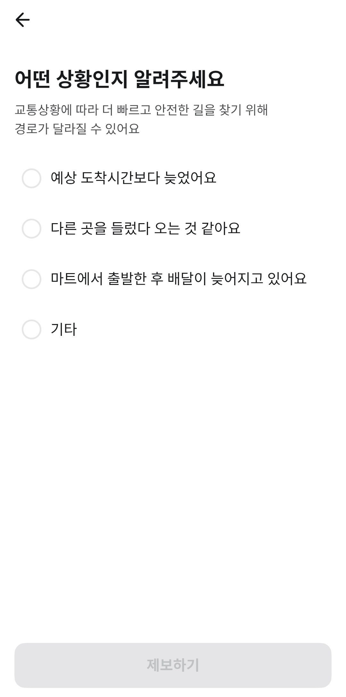

배송완료 주문의 `문의하기` 진입 후 `배달이 다른 길로 돌아서 늦었어요`, `입력한 주소와 다른 곳으로 배달됐어요`, `그 외 문의` 등 사유별 선택 화면을 확인할 수 있다. 지연 문의는 이유 선택 (두번째 이미지), 오배송 문의는 주문 당시 입력 주소와 라이더가 찍은 사진이 맞는지 검증과 라이더 통화·실시간 채팅상담 등 후속 동작이 나타난다.

> 배송중 주문 화면에는 다른 선택지가 보여질 것으로 예상한다.

고객 문의의 유형을 지연·오배송·품질·기타로 분류하여 상담 작업함에 등록하고, 반품·교환·재배달·환불과 연결한다. 고객 문의 접수 자체가 곧바로 PG 환불을 실행하지 않도록 상태를 분리한다.

---

### 7.8 기능 연계 임시 데이터 및 DB 구조 설계

#### `claims` — 반품·교환 접수

반품/교환 신청 헤더와 원 주문의 결합. 회수지는 원 주문의 주소 스냅샷 사용

**테이블 구조**

| 컬럼 | DB 타입 | 제약·의미 |
|---|---|---|
| claim_id | BIGINT | PK |
| order_id | BIGINT | FK → orders |
| claim_type | VARCHAR(20) | RETURN/EXCHANGE |
| reason_type | VARCHAR(20) | CHANGE/PRODUCT/DELIVERY |
| claim_status | VARCHAR(30) | RECEIVED/APPROVED 등 |
| pickup_address_mode | VARCHAR(20) | ORDER_ONLY |

**임시 데이터 (3건)**

| claim_id | order_id | claim_type | reason_type | claim_status | pickup_address_mode |
| --- | --- | --- | --- | --- | --- |
| 1701 | 801 | RETURN | CHANGE | APPROVED | ORDER_ONLY |
| 1702 | 802 | EXCHANGE | PRODUCT | RECEIVED | ORDER_ONLY |
| 1703 | 801 | RETURN | PRODUCT | RECEIVED | ORDER_ONLY |


#### `claim_items` — 반품·교환 품목

회수/교환 대상은 원 주문 품목과 수량으로 특정, 출고 배송 건도 추적 가능

**테이블 구조**

| 컬럼 | DB 타입 | 제약·의미 |
|---|---|---|
| claim_item_id | BIGINT | PK |
| claim_id | BIGINT | FK → claims |
| order_item_id | BIGINT | FK → order_items |
| shipment_id | BIGINT | FK → shipments, nullable |
| quantity | INT | 청구 수량 |

**임시 데이터 (3건)**

| claim_item_id | claim_id | order_item_id | shipment_id | quantity |
| --- | --- | --- | --- | --- |
| 1801 | 1701 | 901 | 1201 | 1 |
| 1802 | 1702 | 902 | 1203 | 1 |
| 1803 | 1703 | 901 | 1202 | 1 |

> **설계 참고:** 원 주문 품목 수량을 초과하여 반품/교환 신청하지 못하도록 누적 처리량을 검증한다.


#### `return_fee_transactions` — 반품 배달비 옵션 결제

상품 결제와 별도 9,000원 옵션 구매·재시도 이력

**테이블 구조**

| 컬럼 | DB 타입 | 제약·의미 |
|---|---|---|
| return_fee_id | BIGINT | PK |
| claim_id | BIGINT | FK → claims |
| fee_amount | INT | 반품 배달비 9,000원 |
| payment_status | VARCHAR(20) | DONE/PENDING/FAILED |
| pg_reference | VARCHAR(80) | 별도 거래 참조 |

**임시 데이터 (3건)**

| return_fee_id | claim_id | fee_amount | payment_status | pg_reference |
| --- | --- | --- | --- | --- |
| 1901 | 1701 | 9000 | DONE | MOCK-FEE-1 |
| 1902 | 1703 | 9000 | FAILED | MOCK-FEE-2 |
| 1903 | 1703 | 9000 | PENDING | MOCK-FEE-3 |

> **설계 참고:** 하자·오배송 등 면제 정책은 아직 미확정이다. 9,000원은 모든 반품에 자동 부과되는 고정 결과로 간주하지 않는다.


#### `refunds` — 환불 요청 및 결과

주문 취소/반품 처리와 실제 PG 환불 상태를 분리

**테이블 구조**

| 컬럼 | DB 타입 | 제약·의미 |
|---|---|---|
| refund_id | BIGINT | PK |
| claim_id | BIGINT | FK → claims |
| payment_id | BIGINT | FK → payments |
| refund_amount | INT | 환불 요청액, 원 |
| refund_status | VARCHAR(24) | REQUESTED/FAILED/DONE |
| request_key | VARCHAR(70) | UNIQUE, 멱등성 |

**임시 데이터 (3건)**

| refund_id | claim_id | payment_id | refund_amount | refund_status | request_key |
| --- | --- | --- | --- | --- | --- |
| 2001 | 1701 | 1001 | 6000 | DONE | refund-1701-a |
| 2002 | 1703 | 1001 | 6000 | FAILED | refund-1703-a |
| 2003 | 1703 | 1001 | 6000 | REQUESTED | refund-1703-b |

> **설계 참고:** 부분 결제취소 미지원 결정 때문에 실제 집행은 별도 합의된 전액 취소·재결제/대체 정산 전략이 필요하다. DONE 행은 정산 프로세스 구현 가정용 사례다.

---

## 8. 교환

### 8.1 신청 조건과 흐름

원문에 정리된 교환 조건:

- **배송 완료 이후** 신청 가능
- **상온 제품:** 단순 변심·실수 교환 허용
- **냉장·냉동 식품:** 단순 변심·실수 교환 제한
- **신선보장 제품:** 신선하지 않은 경우 교환 가능

```text
주문내역 → 교환 신청 → 대상 상품 선택(전체 선택 가능)
        → 교환 사유 선택 → 배달팁 확인
        → 회수·재배달 정보 및 요청 사항 작성
        → 접수 → 라이더 회수 및 교환 상품 재배달
```

### 8.2 교환 사유

| 유형 | 주요 선택 사유 | 상세 이유·사진 |
|---|---|---|
| 변심·실수 | 마음에 들지 않음, 잘못 주문, 주소 설정 오류 | 선택 |
| 상품문제 | 설명 다름, 기능 문제, 변질, 이물질, 소비기한 경과 | 필수 |
| 배달 문제 | 파손, 오배송, 일부 미배송, 배달완료 후 미수령 | 필수 |

### 8.3 회수·재배달 및 배달팁

- 교환 방법은 **라이더가 회수·재배달**하는 방식이다.
- 분할배송으로 수령한 품목도 교환 신청은 원 주문에서 시작하되 회수 대상 배송 건과 주문 품목을 연결해 추적한다.
- 기존 상품 회수 요청 사항과 새 상품 재배달 요청 사항을 **별도 작성**한다.
- **프로젝트 결정:** 회수지는 주문 당시 입력한 배송지로 **고정하며 변경 불가능**하다. 재배달 주소·연락처를 주문 완료 후 변경하는 것도 불허한다. 회수·재배달 요청 문구는 주소 변경 기능과 구분한다.

| 교환 사유 | 원문에 기재된 교환 배달팁 |
|---|---:|
| 변심·실수 | 9,000원 |
| 상품문제 | 무료 |
| 배달 문제 | 무료 |

**결정 완료 사항**

- 여러 상품을 교환할 때 사유는 **신청 전체 공통**으로 적용
- 동일 주문건의 **중복 교환 신청 불가**
- **회수지 변경 불허**
- 회수·재배달 요청 사항은 **자유 입력, 35~40자**라고 기재되어 있으나 단일 최대 글자 수는 아직 명확하지 않음

---

### 8.4 기능 연계 임시 데이터 및 DB 구조 설계

#### `exchange_tasks` — 교환 회수·재배달 작업

교환 요청이 승인된 경우 회수와 재배달을 별도 작업 단계로 관리

**테이블 구조**

| 컬럼 | DB 타입 | 제약·의미 |
|---|---|---|
| exchange_task_id | BIGINT | PK |
| claim_id | BIGINT | FK → claims |
| task_type | VARCHAR(20) | PICKUP/INSPECTION/REDELIVERY |
| shipment_id | BIGINT | FK → shipments, nullable |
| task_status | VARCHAR(20) | REQUESTED/DONE |

**임시 데이터 (3건)**

| exchange_task_id | claim_id | task_type | shipment_id | task_status |
| --- | --- | --- | --- | --- |
| 2101 | 1702 | PICKUP | 1203 | DONE |
| 2102 | 1702 | INSPECTION | 1203 | DONE |
| 2103 | 1702 | REDELIVERY | `NULL` | REQUESTED |

> **설계 참고:** 하나의 교환 신청에 회수·검수·재배달 작업을 연결한다. 동일 단계의 중복 작업 생성은 막는다.

---

## 9. 배송완료 후 리뷰

### 9.1 리뷰 작성 가능 상품 확인

주문 배송완료 후 리뷰관리의 `리뷰 쓰기` 목록에 작성 가능한 상품이 나타난다. `내가 쓴 리뷰` 탭을 통해 등록 내역을 조회할 수 있다. 알림에서 리뷰 작성을 유도하는 사례도 확인된다.

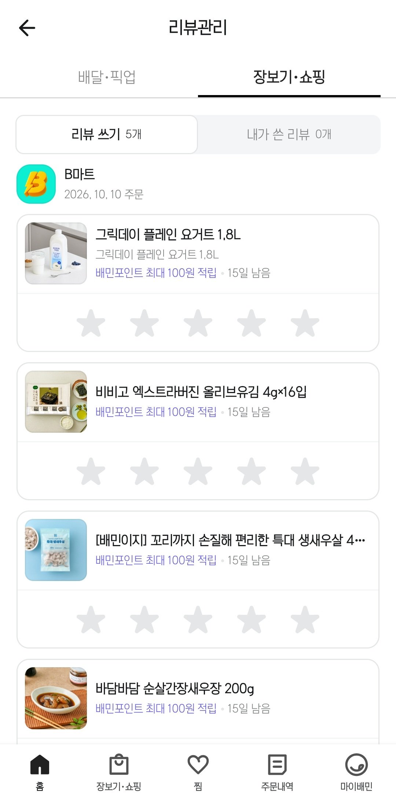

### 9.2 리뷰 작성·등록

1. 리뷰 대상 상품을 선택해 `리뷰 쓰기` 화면에 진입한다.
2. 별점을 선택하고 상품에 관한 내용을 입력한다.
3. 사진을 첨부할 수 있는 UI가 나타난다. 첨부 최대 개수는 화면 사례로만 취급한다.
4. `리뷰정책안내`를 열어 금지 내용과 작성 기준을 확인할 수 있다.
5. 등록 버튼을 누르면 완료 화면으로 전환되는 사례가 확인된다.

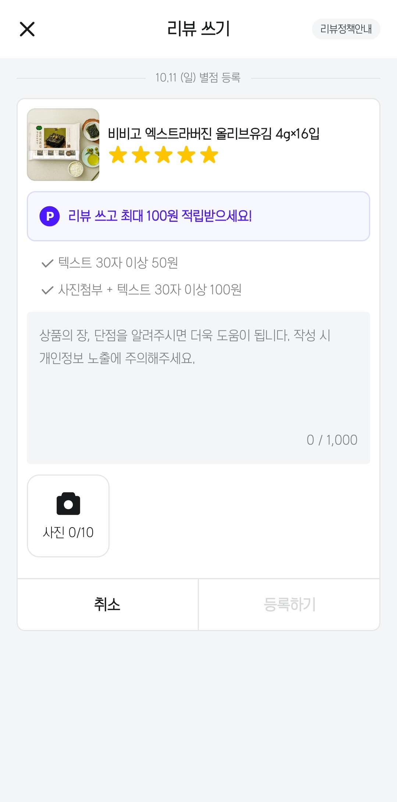

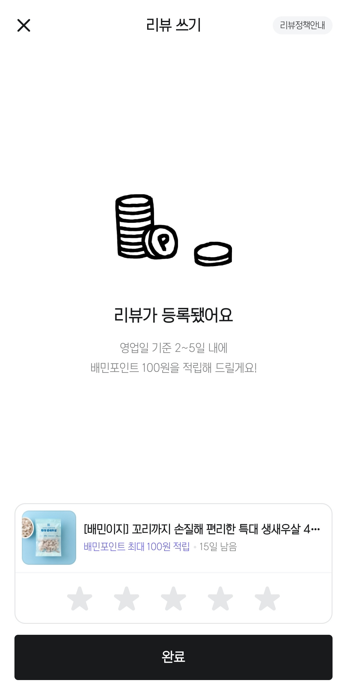

**미결정:** 리뷰 작성 허용 기간, 구매당 중복 리뷰, 리뷰 수정·삭제, 이미지 용량 제한, 작성 보상·포인트, 부적절한 리뷰 신고/차단 정책.

---

### 9.3 기능 연계 임시 데이터 및 DB 구조 설계

#### `reviews` — 상품 리뷰

배송 완료한 주문 품목을 기준으로 별점·내용 작성

**테이블 구조**

| 컬럼 | DB 타입 | 제약·의미 |
|---|---|---|
| review_id | BIGINT | PK |
| customer_id | BIGINT | FK → customers |
| order_item_id | BIGINT | FK → order_items |
| rating | TINYINT | 1..5 |
| review_text | VARCHAR(500) | 후기 내용 |
| review_status | VARCHAR(20) | PUBLISHED/HIDDEN |

**임시 데이터 (3건)**

| review_id | customer_id | order_item_id | rating | review_text | review_status |
| --- | --- | --- | --- | --- | --- |
| 2201 | 1 | 901 | 5 | 포장 상태가 좋았어요 | PUBLISHED |
| 2202 | 2 | 902 | 4 | 배송이 빨랐어요 | PUBLISHED |
| 2203 | 3 | 903 | 5 | 잘 받았습니다 | PUBLISHED |

> **설계 참고:** 동일 주문 품목의 중복 리뷰 정책은 미결정이므로 UNIQUE(customer_id,order_item_id) 확정 전 검토한다.

---

## 10. 팀 의사결정 및 확인 목록

아래는 원문의 메모를 구현 시점에 혼동하지 않도록 **결정됨 / 확인 필요**로 다시 구분한 것이다.

### 10.1 문서상 결정된 사항

| 영역 | 내용 |
|---|---|
| 주문 | 최소 주문금액 15,000원 고정; 상품 담기는 목록·상세에서 시작 |
| 주문 | 결제 완료 시 재고 차감 및 배송 시간 최종 확정 반영 |
| 상품 | 상품당 기본 최대 10개, 상품별 개별 상한 우선 |
| 배송 | 주문 상품 총중량이 10kg을 초과하면 분할배송(원 주문·결제는 1건) |
| 주문 | 결제 승인 후 주문 완료되면 주문·배송 정보 변경 불가 |
| 배송 | 봉투값 주문당 100원 고정(프로젝트 정책) |
| 배송 | 첫 구매 또는 주문 대상 상품 합계 30,000원 이상이면 배달팁 무료 |
| 결제 | 토스페이먼츠 주문서형 선택, 토스 외 미지원 |
| 결제 | 부분 결제취소 미지원 |
| 배송 | 한집 4,000원 / 알뜰 3,000원 / 예약 3,000원 기재, 예약배달 별도 추가 배달팁 없음 |
| 배송 | 예약배달 시간 조회 오류 시 자동 재시도 안 함 |
| 반품 | 2021년 참고 화면의 반품 9,000원은 반품 배달비 옵션 구매로 취급 |
| 반품·교환 | 회수지는 주문 당시 배송지로 고정하며 변경 불가 |
| 교환 | 사유는 신청 전체 공통, 동일 주문 중복 교환 불가, 회수지 변경 불가 |
| 교환 | 변심·실수 9,000원, 상품문제·배달 문제 무료 |

### 10.2 팀 논의가 필요한 사항

| 영역 | 논의 항목 | 왜 필요한가 |
|---|---|---|
| 장바구니 | 체크된 상품만 최소 주문금액·합계에 포함할지 | 장바구니 선택 정책과 금액 검증 연결 |
| 장바구니 | 재고 부족·판매 중지 시 상품 표시·수량 처리 | 주문 버튼·최종 가격 정합성 |
| 추천 | 마지막으로 둘러보기 노출·건너뛰기 방식 | 주문 이동 단계 단축 여부 |
| 배송 | 지역별 배달팁·할인, 시간대 마감 판정 시점 | 예시 금액을 고정 규칙으로 잘못 구현하지 않기 위해 |
| 배송 | 조회 오류 시 주문 진행 가능 여부 | 원문에 결과 없이 남은 미결정 사항 |
| 분할배송 | 포장재 중량, 한 품목 단위중량 10kg 초과, 냉장·냉동 분리, 건별 도착시간, 추가 배달팁 | 분할배송의 운송 제약과 정산 기준 확정 필요 |
| 상품 | 단품과 옵션별 수량 상한, 회원별 구매 제한 적용 여부 | 기본 10개 제한을 세부 상품 정책과 연결 |
| 주문 | **결제 전** 주소 변경 시 배송 방식·예약 시간·혜택 초기화 범위 | 변경된 배송 조건 재검증. 결제 완료 후 변경은 불가 |
| 주문 | 품절 상품 부분 취소 후 실제 결제 정산 방식 | 부분 결제취소 미지원 방침과 연결 |
| 결제 | 결제 상태 미확정 시 고객 안내·재조회/재시도 정책 | 중복 승인·중복 결제 방지 |
| 알림 | 상태 이벤트 식별·중복 방지 키·읽음 처리 시점 | 알림 중복 및 상태 역행 방지 |
| 알림 | 잠금화면 문구·SMS·이메일 등 발송 채널 | 개인정보 노출·알림 범위 |
| 반품 | 반품 배달비 옵션 구매 전제에서 고객센터/운영자 접수 시점 | 유상 옵션 구매와 실제 반품 심사 연결 |
| 반품 | 신청 기간, 온도 유형별 허용 기준, 신선보장 기준 | 상품별 반품 가능 여부 |
| 반품 | 고객센터 연결(전화·채팅·1:1 문의) | 접수 UI·운영 도구 결정 |
| 반품 | 사유별 증빙 필수 여부 및 상품별/신청별 사유 | 검증·상담 UI 결정 |
| 반품 | 회수/자체 폐기 기준, 9,000원 배달비 부담·취소·환불 | 회수지 변경은 불가로 확정, 비용 정산만 논의 |
| 반품 | 쿠폰·할인 재계산, 환불 시점, 전체 취소 후 재결제 | 고객 환불금·PG 일치 여부 |
| 반품 | 중복 반품 신청, 상태 전이, 고객 안내 시점 | 고객센터 처리와 주문 기록 정합성 |
| 교환 | 35~40자 중 정확한 요청 사항 글자 수 제한 | 프론트·백 검증 기준 통일 |
| 주문 | 첫 구매 정의(이력, 취소 주문 처리)·30,000원 산정 시 할인 적용 기준 | 무료 배달팁 판정의 일관성 |
| 상품 | 성인인증 상품 구매 구현 범위와 인가·법령 요건 | 화면 사례만으로 판매 가능 조건을 확정할 수 없음 |
| 리뷰 | 작성 기간, 중복 작성, 보상, 이미지 제한·신고 | 후속 서비스 기능 범위 확정 |
| 주문조회 | 주문 취소 허용 상태, 예약시간 변경 버튼 UI 제거/안내 | 프로젝트 정책과 실제 캡처의 차이 해결 |

---

## 11. DB 연결 관계 및 공통 설계

### 11.1 범위와 모델링 전제

- **DB 기준:** MySQL 8.x 관계형 DB를 가정한 **초기 논리 설계**다. 실제 운영 DB 확정 전 테이블·컬럼·제약은 팀과 합의한다.
- **데이터 구분:** 마스터(`customers`, `products`, `delivery_methods`), 현재 상태(`center_inventory`, `carts`), 주문 스냅샷(`orders`, `order_items`), 처리 이력(`payment_attempts`, `shipment_events`, `order_status_history`), 사후 처리(`claims`, `refunds`)를 분리한다.
- **시점:** 조회/장바구니 추가 시 표시된 재고·배송 시간은 확정 데이터가 아니다. **결제 승인 성공을 확인하고 주문 완료를 반영할 때** 재고·배송 슬롯 확정을 한 번 수행하도록 멱등성 있게 설계한다. 예약·동시성 확보를 위한 임시 홀드 도입 여부는 별도 결정한다.
- **스냅샷:** 주문 품목의 단가·중량과 주문 배송지는 확정 시점 값을 보존한다. 이후 상품 마스터/기본 배송지가 바뀌어도 과거 주문을 변경하지 않는다.
- **분할배송:** `orders (1) → shipments (N) → shipment_items (N)`이며 상품별 합계 수량은 원 주문 수량과 같고 배송 건 중량은 각각 10,000g 이하다. `orders.total_weight_g > 10000`이면 `split_required = true`다.
- **결제:** 원 주문의 결제 의무는 주문 금액 한 번으로 관리한다. 분할배송으로 결제 승인 횟수 또는 봉투값을 배송 건 수만큼 늘리지 않는다. 별도 배송비 여부는 미결정이다.
- **명칭:** PK는 `*_id`, 참조는 동일한 FK명, 등록일자는 `created_at` 또는 `registered_at`을 사용한다. 실제 테이블에는 공통 감사 컬럼(`created_at`, `updated_at`, `created_by`)을 필요에 따라 추가한다.

### 11.2 주요 연결 관계

| 시작 테이블 | 관계 | 대상 테이블 | 목적 / 제약 |
|---|---|---|---|
| `customers` | 1:N | `customer_addresses` | 회원의 배송지 관리 |
| `customers` | 1:N | `carts` → `cart_items` | 회원의 장바구니와 품목 |
| `products` | 1:N | `center_inventory` | 센터별 상품 가용 재고 |
| `carts` | 1:N | `cart_items` | 상품별 수량·선택 상태 |
| `customers` | 1:N | `orders` | 고객별 주문 목록 |
| `orders` | 1:N | `order_items` | 주문 품목 스냅샷 |
| `orders` | 1:N | `order_status_history` | 주문 상태 이벤트 |
| `orders` | 1:N | `order_coupons` → `coupons` | 적용/미적용 쿠폰 이력 |
| `orders` | 1:N(이력) | `payments` → `payment_attempts` | 토스 거래·승인/취소 재시도 |
| `delivery_methods` | 1:N | `orders` | 주문별 배송 방식 |
| `fulfillment_centers` | 1:N | `delivery_slots` | 센터별 예약 시간대 |
| `orders` | 1:N | `shipments` | 10kg 초과 시 복수 배송 건 |
| `shipments` | 1:N | `shipment_items` | 개별 배송에 어떤 수량을 싣는지 |
| `order_items` | 1:N | `shipment_items` | 동일 주문 품목을 여러 건으로 나눠 배정 |
| `shipments` | 1:N | `shipment_events` | 배송 건별 상태 이력 |
| `shipments` | N:1 | `riders` | 배송 건별 담당 라이더 |
| `orders` | 1:N | `notifications` | 주문/배송별 고객 알림 |
| `orders` | 1:N | `claims` → `claim_items` | 반품·교환 신청 품목 |
| `claims` | 1:N(시도) | `return_fee_transactions` | 9,000원 반품 옵션 결제 |
| `claims` | 1:N(시도) | `refunds` | 환불 처리 및 재시도 |
| `claims` | 1:N | `exchange_tasks` | 교환 회수/재배달 업무 |
| `order_items` | 1:N | `reviews` | 상품별 배송 완료 후기 |

### 11.3 주문·결제 연결도

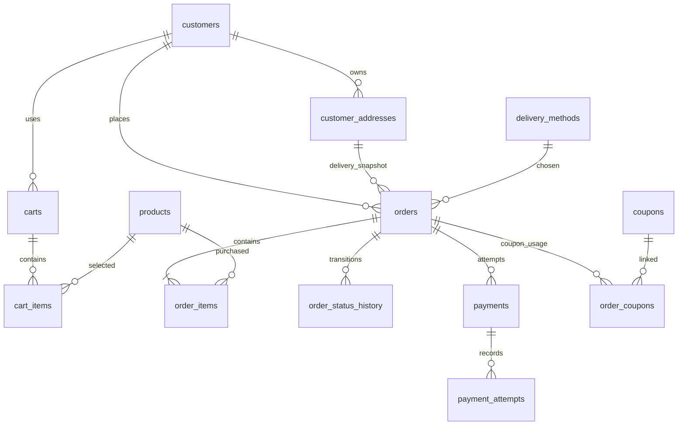

### 11.4 센터·분할배송 연결도


### 11.5 반품·교환·리뷰 연결도


### 11.6 실제 구현 전 검증 항목

| 구분 | 서버 검증 및 데이터 제약 |
|---|---|
| 구매 상한 | `1 <= cart_items.quantity <= products.max_order_qty`, `max_order_qty` 기본 10, 상품별 변경 가능; 주문 생성 시 재검증 |
| 중량 합계 | `orders.total_weight_g = SUM(order_items.quantity * order_items.unit_weight_g)` |
| 분할 여부 | `orders.split_required = (orders.total_weight_g > 10000)` |
| 배송 무게 | `SUM(shipment_items.allocated_weight_g)` = 해당 `shipments.shipment_weight_g`, 각 건 10,000g 이하 |
| 수량 정합성 | 주문 확정 후 `SUM(shipment_items.allocated_qty)` = 각 `order_items.quantity` (할당 진행중 상태는 예외) |
| 금액 | `orders.pay_amount = item_amount + delivery_fee + bag_fee` (추가 할인이 있다면 item_amount에 반영한 기준) |
| 첫 구매 혜택 | 서버에서 취소/환불 주문 포함 기준 합의 후 결제 직전 판정 |
| 결제 멱등성 | 토스 승인/취소 요청마다 멱등성 키를 적용하고 PG 결과 불명확 시 조회 우선 |
| 주문 상태 집계 | 배송 건 일부 완료는 주문 전체 `DELIVERED`로 집계하지 않음 |
| 회수지 고정 | 접수 시 원 주문의 배송지 스냅샷을 사용하며 수정 API를 제공하지 않음 |
| 환불 분리 | `claims` 상태와 `refunds` 결과가 다를 수 있고, 수납한 옵션 결제도 별도 추적 |

> **필수 인덱스 권장:** `cart_items(cart_id,product_id)` UNIQUE, `center_inventory(center_id,product_id)` UNIQUE, `orders(customer_id,created_at)`, `order_items(order_id)`, `shipments(order_id,shipment_no)` UNIQUE, `shipment_items(shipment_id,order_item_id)`, `notifications(customer_id,is_read)`, `payment_attempts(idempotency_key)` UNIQUE, `claims(order_id,claim_type)`.

### 11.7 트랜잭션 및 동시성 예시

```text
고객 장바구니 변경
  └─ 상품별 구매 상한(기본 10) 확인 → 선택 수량 임시 저장
주문서 생성/결제 인증 전
  └─ 가격·재고·배송 시간·총중량·배송 건수·배달팁 재계산
토스 인증 후 서버 승인
  └─ 서버 확정 주문번호/금액 비교 → 승인 요청(멱등성 키)
승인 성공 확인
  └─ 주문 상태 확정, 재고/예약 슬롯 실제 반영(한 번만)
  └─ order_items 주문 당시 가격·단위중량 스냅샷 저장
  └─ 10kg 초과면 shipments 여러 건 및 shipment_items 수량 배정
  └─ Outbox/이벤트로 피킹·배차·알림 연동
각 배송 건 배송완료
  └─ shipment_events 저장 → 미완료 배송 건 확인 → 전부 완료 시 주문 배송완료
```

> **구현 주의:** PG 승인 호출과 데이터베이스 트랜잭션은 하나의 원자적 트랜잭션으로 묶을 수 없다. 승인 성공 후 주문 확정 실패 시 보상·재처리 작업함이 필요하며, 이 설계는 결제 흐름 `4.1`의 화면/시퀀스 자체를 변경하지 않고 **실패 복구를 위한 내부 데이터 처리 상세**를 추가한 것이다.

> **샘플 데이터 사용 주의:** 기능별 임시 데이터는 테이블당 대표 3행만 제공한다. 이는 DB에 바로 실행하는 완결된 INSERT 시드가 아니다. 실제 샘플 DB를 구성할 때는 누락된 배송/상태 이력, 회원 과거 주문, 주문-배송지 스냅샷, 날짜 및 FK 연결 행을 모두 채우고 무결성 검사를 수행한다.
