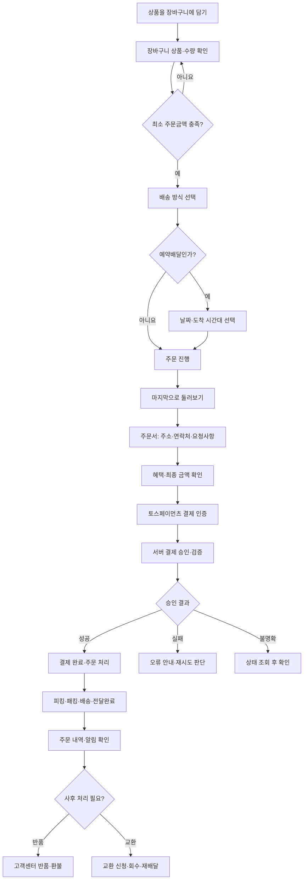
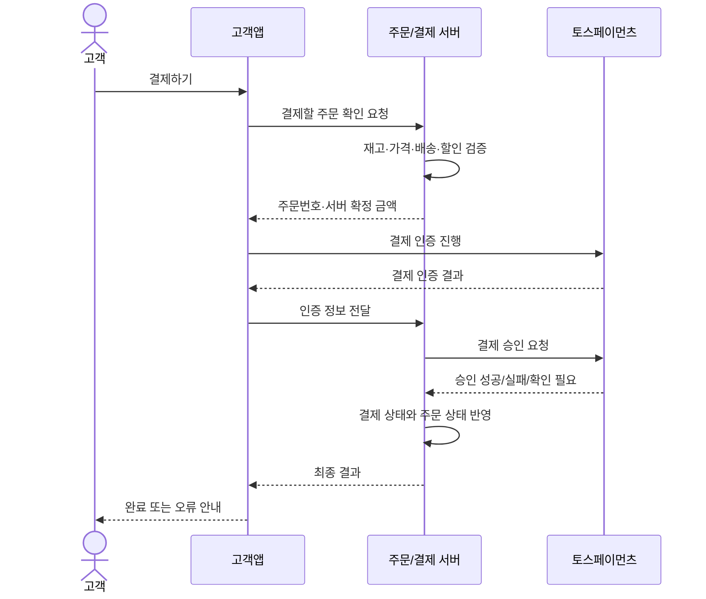
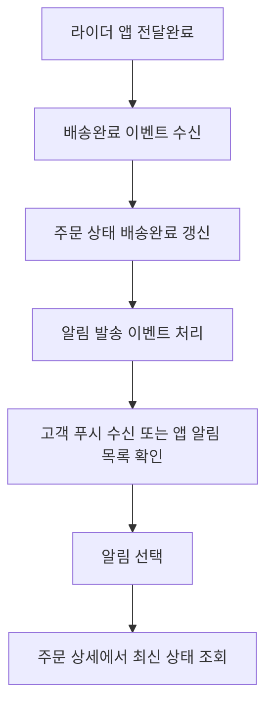

# 고객앱 업무 흐름 정리

## 목차

1. [전체 흐름](#1-전체-흐름)
2. [장바구니](#2-장바구니)
3. [주문서](#3-주문서)
4. [결제 및 결제 예외 처리](#4-결제-및-결제-예외-처리)
5. [배송 방식 및 예약배송](#5-배송-방식-및-예약배송)
6. [주문 상태와 알림](#6-주문-상태와-알림)
7. [반품과 환불](#7-반품과-환불)
8. [교환](#8-교환)
9. [팀 의사결정 및 확인 목록](#9-팀-의사결정-및-확인-목록)

## 1. 전체 흐름



**핵심 구분**

- **장바구니:** 살 상품·수량·배송 방식을 선택하고 주문 가능 여부를 확인한다.
- **주문서:** 배송지·라이더 요청·연락처·품절 시 처리·혜택·결제 금액을 최종 확인한다.
- **결제:** 결제창 복귀와 별개로 **서버 승인 결과를 확인한 뒤** 주문을 완료한다.
- **배송과 알림:** 주문 상태와 고객에게 발송한 알림 내역을 구분한다.
- **사후 처리:** 반품은 고객센터 접수 방식으로 기술되어 있고, 교환은 별도의 신청·회수·재배달 흐름이 있다.

---

## 2. 장바구니

### 2.1 장바구니 진입과 상품 확인

고객이 장바구니를 열면 B마트 상품 목록, 예상 도착 시간, 예약배달 공지 등을 확인한다.


| 화면 요소 | 고객 동작·표시 내용 |
|---|---|
| 장바구니 상품 | 상품명, 썸네일, 할인 전후 가격, 현재 수량을 표시 |
| 상품 선택 체크박스 | 주문할 상품을 선택하거나 해제 |
| 전체 선택 | 장바구니 상품을 한꺼번에 선택 |
| 선택 삭제 | 체크된 상품을 장바구니에서 삭제 |
| 수량 변경 | `-`, `+` 버튼으로 수량 변경, 재고·구매제한 수량 검증 필요 |
| 상품 추가 | B마트 상품 탐색 화면으로 이동 |
| 예상 도착 시간 | 고객이 선택한 배송지·배송 방식 등에 대응하는 예상 정보 |
| 예약배달 공지 | 예약 가능 관련 안내 표시 |


**화면에서 함께 확인되는 요소**

- 함께 담으면 좋은 상품: 추천 상품 카드와 추가 버튼이 제공된다. 추천 기준은 자료에 없다.
- 배달의민족 이벤트·혜택 배너: 별도 이벤트 화면으로 이동한다.


### 2.2 배송 방식 선택과 금액 확인

장바구니 하단에서 수령 방법을 선택한다. 이 문서에서는 화면의 **수령 방법**을 업무 용어인 **배송 방식**으로 함께 표기한다.


- **한집배달:** 예상 소요 시간과 배달팁을 확인한다.
- **알뜰배달:** 예상 소요 시간과 배달팁을 확인한다.
- **예약배달:** 원하는 도착 시간대를 선택해야 한다.
- 배송 방식에 따라 화면의 배달팁·할인·예상 도착 정보가 변경될 수 있다.


**금액 구조**

```text
상품금액
+ 배달팁
- 상품 할인
- 쿠폰/기타 적용 혜택
= 최종 결제 금액
```

금액은 선택된 상품과 실제 적용 가능한 할인 기준으로 다시 계산한다. 첨부 화면의 880원, 28,480원 등은 **화면 예시**이다. 상품금액·배달팁·할인액은 주문서와 결제 직전에 재확인한다.

### 2.3 주문 가능 여부 검사

| 상태 | 화면 동작 |
|---|---|
| 최소 주문금액 미충족 | 부족 금액 안내, 주문 버튼 비활성화 |
| 최소 주문금액 충족 + 배송 방식 미선택 | `수령방법을 선택해주세요` 표시, 누르면 배송 방식 영역으로 스크롤 |
| 최소 주문금액 충족 + 배송 방식 선택 완료 | 선택 방식에 맞는 `주문하기` 버튼 활성화 |
| 예약배달을 선택했으나 시간 미선택 | 예약 시간 선택을 요구 |


**프로젝트 기재 기준:** 최소 주문금액은 **15,000원**. 이는 첨부 자료의 프로젝트 기재값이며, 화면 예시의 배달팁 0원 등과 마찬가지로 실제 서비스 전체의 고정값이라고 단정하지 않는다.

### 2.4 예약배달 선택

예약배달 선택 시 날짜(오늘/내일)와 도착 시간대를 선택하는 팝업을 표시한다. 선택이 확정되면 장바구니의 예약 정보와 주문 버튼에 반영한다.


---

## 3. 주문서

### 3.1 주문서 진입 전: 마지막으로 둘러보기

장바구니에서 주문하기를 누르면 **`마지막으로 둘러보기`** 상품 추천 화면이 나타나는 사례가 확인된다.

- 함께 산 상품
- 맞춤 할인 상품
- 재주문 많은 상품
- 1만원 이하 상품

고객은 추가 상품을 선택할 수 있고, 하단 주문 버튼에서 갱신된 주문 금액을 확인한 뒤 주문서로 이동한다. 이 추천 단계의 노출·건너뛰기 정책은 별도 결정이 필요하다.


**네트워크 오류 사례:** 주문서 이동(주문하기 버튼)을 시도했을 때 인터넷 연결 불안정 안내와 `[확인]` 버튼이 나타나고 홈 화면으로 이동한다 (실제 B마트 처리). 이 화면 이동을 프로젝트에 그대로 적용할지는 결정해야 한다.

### 3.2 주문서 기본 정보


| 순서 | 항목 | 동작 |
|---|---|---|
| 1 | 쿠폰·이벤트 배너 | 적용 가능한 프로모션 안내 |
| 2 | 배송 방식 | 한집·알뜰·예약배달 중 현재 선택된 방식 표시 |
| 3 | 도착 정보 | 예상 소요 시간 또는 예약 도착 시간 표시 |
| 4 | 담은 상품 | 총 상품 건수와 요약 이미지를 표시, 펼치기/접기로 상세 확인 |
| 5 | 배송지 | 등록된 배송지 표시, 주문서에서도 변경 가능 |
| 6 | 라이더 요청 사항 | 기존 요청 확인, 항목 선택 또는 직접 입력·수정 |
| 7 | 내 연락처 | 휴대전화 번호 변경 및 안심번호 사용 여부 선택 |
| 8 | 품절 시 요청 사항 | 품절 상품만 취소 또는 주문 전체 취소 중 선택 |
| 9 | 결제 수단 | 프로젝트에서 사용할 결제 방식을 표시 |
| 10 | 할인·혜택 | 쿠폰·선물함·포인트 항목과 적용 상태 확인 |
| 11 | 결제 요약 | 상품금액·배달팁·할인·결제 금액 표시 |
| 12 | 결제하기 | 최종 금액 기준 결제 시작 |

### 3.3 담은 상품 펼치기

- 최초 주문서에는 썸네일과 상품 건수를 요약 표시한다.
- `총 n건 상품 자세히 보기`를 누르면 상품별 이름·가격·수량을 펼쳐 확인한다.
- 펼친 상태에서는 `접기` 동작으로 되돌아간다.


### 3.4 배송지와 라이더 요청 사항

주문서 내에서 배송지를 변경할 수 있다. 배송지 변경은 **배송 가능 여부, 배달팁, 예상 시간, 예약배달 시간대** 재검증으로 이어져야 한다.


라이더 요청 사항은 선택형 문구 또는 직접 입력 항목으로 작성한다. 주소 상세 화면과 주문서의 요청 사항이 서로 연결되어 보이는 동작을 확인했다.


### 3.5 연락처

- 휴대전화 번호를 변경할 수 있다.
- `안심번호 사용` 체크박스를 선택하거나 해제할 수 있다.
- 이메일은 첨부된 주문서 화면에서 수정 항목으로 제공되지 않는다.


### 3.6 품절 시 요청 사항

**필수 선택:** 주문 처리 중 품절이 발생했을 때 적용할 방식을 지정한다.

1. **품절 상품만 부분 취소해 주세요:** 품절된 상품을 제외하고 나머지 상품의 주문을 이어간다.
2. **주문 전체 취소해 주세요:** 품절이 발생하면 전체 주문을 취소한다.

`다음에도 적용`은 선택사항이며, `완료`를 눌러 저장한다.


> **중요:** 위의 `품절 상품만 부분 취소`는 주문 상품 단위의 취소 정책이다. 프로젝트가 결정한 `토스페이먼츠 부분 결제취소 미지원`과 같은 뜻이 아니다. 부분 결제취소를 지원하지 않는 상태에서 품절분 금액을 어떻게 정산할지는 별도 설계해야 한다.

### 3.7 결제 수단과 혜택

원본 캡처에는 여러 결제 수단이 등장하지만, 프로젝트 문서의 **결정 완료 사항은 `토스 외 지원 안 함`**이다. 따라서 캡처의 다른 결제 수단까지 구현 범위로 오해하면 안 된다.


주문서에는 다음 혜택 항목이 나타난다.

- 할인쿠폰: 보유·적용 가능 쿠폰 확인
- 선물함: 선물 관련 잔액 또는 이용 수단 표시
- 포인트: 사용 가능·적용 포인트 확인


### 3.8 최종 결제 확인

결제 버튼을 누르기 전에 할인과 배달팁을 포함한 **최종 결제 금액**을 보여준다. 유의사항·동의 안내도 함께 표시되는 사례가 있다.


**결제 직전 검증 항목**

- 배송지 및 배송 가능 구역
- 장바구니 상품의 판매 여부, 수량, 재고 및 구매 제한
- 할인·쿠폰·포인트의 유효성
- 선택 배송 방식과 예약 시간대 유효성
- 최종 금액 및 고객 확인 여부
- 품절 시 처리 방식 선택 여부

---

## 4. 결제 및 결제 예외 처리

### 4.1 기본 결제 흐름



- 결제창에서 돌아왔다고 해서 자동으로 `결제 완료`가 되는 것은 아니다.
- 서버에서 `orderId`·결제 금액을 검증한 뒤 승인한다.
- 승인 성공 뒤 주문·결제 상태를 저장하고 고객에게 완료 화면을 제공한다.
- 승인 상태를 모르는 경우 실패라고 단정하거나 즉시 새 결제를 만들지 않는다.

### 4.2 주문·결제 데이터

| 주문 데이터 | 결제 데이터 |
|---|---|
| 주문번호, 주문상품·수량 | `orderId`, `paymentKey` |
| 상품 금액·할인 금액·배달팁 | 요청/승인 금액, 결제 수단 |
| 최종 결제 금액, 주문 상태 | 결제 상태, 승인 일시 |
| 배송지·배송방식·예약시간 | 취소 금액·사유·거래 이력 |

### 4.3 성공·실패·불명확 상태

| 상황 | 처리 |
|---|---|
| 승인 성공 | 결제 상태 완료 → 주문 처리 단계 진행 → 고객에게 완료 안내 |
| 승인 실패 | 완료로 처리하지 않음 → 원인 안내 → 재시도 가능 여부 판단 |
| 인증 후 결과 확인 실패 | 결제 조회를 통해 실제 승인 여부 확인, 무분별한 재결제 차단 |
| 중복 결제 요청 | 기존 주문·결제 상태 확인, 중복 승인 방지 |
| 금액 불일치 | 서버 계산액과 승인 요청액을 비교, 불일치 시 승인 중단 및 금액 재확인 |
| 승인/취소 통신 오류 | 최종 처리 여부 재조회 후 상태 확정, 멱등성 처리 검토 |

### 4.4 취소 및 환불 연동

1. 결제 전 주문 취소와 승인 후 취소를 구분한다.
2. 승인 후 주문 취소 시 현재 주문 상태와 취소 가능 여부를 확인한다.
3. 결제 취소의 성공 여부를 확인한 뒤 주문·결제 상태를 갱신한다.
4. 취소 오류가 발생한 경우에도 처리 결과를 조회한 뒤 재시도한다.
5. 프로젝트에서 **부분 결제취소를 지원하지 않기로 한 점**과 품절 상품 부분 취소/반품에 따른 정산을 함께 고려해야 한다.

### 4.5 보안과 확정된 범위

- 시크릿 키는 서버에서만 보관한다.
- 클라이언트에 노출되는 결제 금액은 신뢰하지 않고 서버 금액으로 비교한다.
- 승인·취소 요청 결과를 이력으로 남긴다.

**문서상 결정 완료:** 토스페이먼츠 **주문서형** 적용, **토스 외 결제 수단 미지원**, **부분 결제취소 미지원**.

참고: [토스페이먼츠 개발자센터](https://docs.tosspayments.com/) · [결제 API](https://docs.tosspayments.com/reference)

---

## 5. 배송 방식 및 예약배송

### 5.1 배송 방식 비교

| 구분 | 한집배달 | 알뜰배달 | 예약배달 |
|---|---|---|---|
| 고객 선택 | 즉시형 | 즉시형 | 도착 시간대 지정 |
| 도착 정보 | n~n분 후 | n~n분 후 | 선택된 날짜·시간대 |
| 문서의 배달팁 기준값 | 4,000원 | 3,000원 | 3,000원 |
| 추가 동작 | 배송 방식 선택 | 배송 방식 선택 | 예약 날짜·시간 선택 |

- 예약배달에 **별도 추가 배달팁 없음** -> 지점마다 적용이 다를 수도 있다.
- 캡처에는 할인 적용(첫주문 등)으로 배달팁 **0원**이 표시된 사례도 있다.
- 원문 기준 **00:00~08:00에는 예약배달만 가능**으로 기재되어 있다. 실제 운영시간·지역별 예외 검증은 별도 필요하다.

### 5.2 예약배달 시간 선택

1. 장바구니에서 예약배달 선택
2. 시간 선택 팝업 열기
3. 오늘/내일 중 날짜 선택
4. 조회된 **1시간 단위** 도착 시간대 중 하나 선택
5. 선택 완료 → 장바구니에 선택 내용 반영
6. 주문서 진입과 결제 요청 직전에 시간대 재검증

### 5.3 마감·변경·조회 오류

| 상황 | 처리 |
|---|---|
| 선택한 시간대가 마감됨 | 해당 시간대 비활성화, 다른 시간 재선택 안내 |
| 전체 시간대가 마감됨 | 선택 불가 안내, 필요하면 다른 날짜/재조회 제공 |
| 배송지 변경 | 새 배송지 기준 가능 시간 재조회 |
| 시간대 조회 오류 | 오류 안내, 조회 실패한 시간을 유효 시간으로 확정하지 않음 |
| 장바구니 상품 조회 오류 | 상품을 불러오지 못했다는 안내와 확인 후 재조회 사례 기록 |

**자료상 운영 메모:** 조회 오류 시 자동 재시도는 하지 않기로 기록되어 있다. 이전 시간대 임시 표시 허용 조건도 적혀 있으나, **조회 실패 시 주문 진행 허용 여부**는 원문에 결정 결과 없이 남아 있어 미결정으로 분리한다.

---

## 6. 주문 상태와 알림

### 6.1 배송 완료와 알림 발송



- 라이더가 `전달완료`를 처리하면 주문이 `배송완료`로 갱신된다.
- 고객은 푸시 또는 앱 알림 목록에서 해당 주문을 확인한다.
- 발송된 알림 문구는 **발송 당시 상태**를 유지하지만, 알림을 통해 연 주문 상세는 **현재 상태**를 보여준다.

**예시:** `배송중` 알림을 눌렀더라도, 현재 주문 상태가 `배송완료`라면 주문 상세에 `배송완료`를 표시한다.

### 6.2 중복 알림·역행 방지

- 같은 주문의 같은 이벤트에 대해 동일 채널로 중복 알림을 보내지 않는다.
- 늦게 도착한 이전 상태 이벤트가 현재 주문 상태를 덮어쓰지 않도록 한다.
- 발송된 과거 알림의 문구를 최신 상태로 일괄 변경하지 않는다.
- 알림 자체를 눌러 상세 페이지에 진입하고 돌아온 뒤 읽음 상태를 반영하는 동작이 문서에 기재되어 있다.

### 6.3 알림 권한과 종류

| 구분 | 의미 |
|---|---|
| OS 푸시 권한 | 운영체제에서 알림 수신 허용 여부 |
| 앱 내부 수신 동의 | 앱에서 설정한 알림 종류별 동의 여부 |
| 주문·배송 알림 | 주문 처리·배송 상태 등 서비스 정보 |
| 마케팅 알림 | 광고·이벤트·프로모션 정보 |

OS 푸시 권한이 없어도 고객은 **주문 내역에서 현재 상태를 조회**할 수 있어야 한다. 마케팅 알림 동의 철회는 마케팅 발송 중단으로 처리하고, 주문·배송 알림 정책과 분리한다.

### 6.4 알림 예외

- 알림이 없는 경우 빈 화면 안내
- 알림을 열었으나 주문 상세를 조회하지 못하면 재시도 안내
- 대상 주문이 없거나 접근 불가하면 안내 메시지 표시
- 잠금화면 메시지의 개인정보 노출 수준, SMS·이메일 추가 발송은 별도 결정

---

## 7. 반품과 환불

### 7.1 신청 경로와 기본 구분

원문은 **배송 완료 후**, 고객이 주문 상세에서 `반품·교환 신청하기`에 접근하지만 **`상품 반품` 항목은 비활성화**된 사례를 바탕으로, **고객센터를 통해 반품을 접수**하는 흐름을 정리한다.

```text
마이배민 → 주문내역 → B마트 주문상세 → 반품·교환 신청하기
                                             ├─ 상품 교환
                                             └─ 상품 반품 (화면 사례: 비활성화)

고객센터 문의 → 주문·상품·사유 확인 → 반품 가능 여부 판단
           → 회수 필요 여부 판단 → 회수 또는 회수 생략 → 환불 처리 → 결과 안내
```

> **주의:** `상품 반품`이 왜 비활성화되었는지(상시 제한인지, 특정 주문·상품 조건 때문인지)는 첨부 화면만으로 확정할 수 없다. 프로젝트가 고객센터 접수를 기본 흐름으로 채택할지와 실제 B마트의 현행 정책은 구분한다.

### 7.2 고객센터 접수 정보

- 주문번호, 주문일자, 배송완료 여부
- 주문 상품과 수량, 실제 결제 금액
- 적용된 쿠폰·할인과 기존 교환·환불 이력
- 반품할 품목·수량, 사유·상세 설명·사진
- 배송되지 않은 상품은 일반 반품이 아닌 **미배송 환불**로 분리

### 7.3 반품 사유

| 유형 | 사유 예시 | 원문 기재 증빙 |
|---|---|---|
| 변심·실수 | 마음에 들지 않음, 잘못 주문, 주소 설정 오류 | 상세 이유·사진 선택 |
| 상품문제 | 설명과 다름, 기능 문제, 변질, 이물질, 소비기한 경과 | 상세 이유·사진 필수 |
| 배달 문제 | 파손, 오배송, 일부 미배송, 배달완료인데 미수령 | 상세 이유·사진 필수 |

위 필수 여부는 문서에 정리된 초안이며, 반품의 경우 **운영 정책 확정 필요 항목**에도 포함되어 있다.

### 7.4 회수와 환불

1. 고객센터가 회수 필요 여부 판단
2. 필요하면 회수 상품·수량을 정하고 라이더 회수 업무 생성
3. 기본 회수지는 기존 배송지 사용, 회수 요청 사항 입력
4. 회수 완료 여부 기록 또는 회수 생략 사유 기록
5. 고객이 실제 지불한 금액과 적용 혜택을 고려해 환불 금액 산정
6. 기존 결제 수단 기반 환불/취소 요청과 결과 기록
7. 고객에게 환불 예정 금액·처리 결과 안내

**정산 주의:** 원문에는 품절 시 **기존 결제 전체 취소 → 품절분을 제외한 금액으로 재결제**한 참고 사례가 있다. 그러나 이것을 프로젝트의 기본 반품·환불 정책으로 결정한 것은 아니다. 부분 결제취소 미지원 방침 아래 재결제 동의·실패·쿠폰 복원 등 후속 설계가 필요하다.

### 7.5 반품 상태(프로젝트 제안)

`접수` → `확인 중` → (`회수 대기` → `회수 중` → `회수 완료`) → `환불 처리 중` → `환불 완료`

- 회수가 필요 없는 경우 회수 단계를 건너뛸 수 있다.
- 가능 여부 심사에서 `반품 거절`로 종료할 수 있다.
- 원문의 상태명은 **프로젝트 구현 제안**이며 실제 B마트의 상태 체계로 확인된 것은 아니다.

### 7.6 고객 안내

접수 여부, 거절 사유, 회수 상태, 환불 예정액·완료 결과를 안내하고 주문 상세에서 처리 내역을 확인할 수 있도록 한다.

---

## 8. 교환

### 8.1 신청 조건과 흐름

- **배송 완료 이후** 신청 가능
- **상온 제품:** 단순 변심·실수 교환 허용
- **냉장·냉동 식품:** 단순 변심·실수 교환 제한
- **신선보장 제품:** 신선하지 않은 경우 교환 가능

```text
주문내역 → 교환 신청 → 대상 상품 선택(전체 선택 가능)
        → 교환 사유 선택 → 배달팁 확인
        → 회수·재배달 정보 및 요청 사항 작성
        → 접수 → 라이더 회수 및 교환 상품 재배달
```

### 8.2 교환 사유

| 유형 | 주요 선택 사유 | 상세 이유·사진 |
|---|---|---|
| 변심·실수 | 마음에 들지 않음, 잘못 주문, 주소 설정 오류 | 선택 |
| 상품문제 | 설명 다름, 기능 문제, 변질, 이물질, 소비기한 경과 | 필수 |
| 배달 문제 | 파손, 오배송, 일부 미배송, 배달완료 후 미수령 | 필수 |

### 8.3 회수·재배달 및 배달팁

- 교환 방법은 **라이더가 회수·재배달**하는 방식이다.
- 기존 상품 회수 요청 사항과 새 상품 재배달 요청 사항을 **별도 작성**한다.
- 회수지 정보는 기존 배송지를 그대로 사용한다.

| 교환 사유 | 원문에 기재된 교환 배달팁 |
|---|---:|
| 변심·실수 | 9,000원 |
| 상품문제 | 무료 |
| 배달 문제 | 무료 |

**결정 완료 사항**

- 여러 상품을 교환할 때 사유는 **신청 전체 공통**으로 적용
- 동일 주문건의 **중복 교환 신청 불가**
- **회수지 변경 불허**
- 회수·재배달 요청 사항은 **자유 입력, 35~40자**라고 기재되어 있으나 단일 최대 글자 수는 아직 명확하지 않음

---

## 9. 팀 의사결정 및 확인 목록

아래는 원문의 메모를 구현 시점에 혼동하지 않도록 **결정됨 / 확인 필요**로 다시 구분한 것이다.

### 9.1 문서상 결정된 사항

| 영역 | 내용 |
|---|---|
| 주문 | 최소 주문금액 15,000원으로 기재 |
| 결제 | 토스페이먼츠 주문서형 선택, 토스 외 미지원 |
| 결제 | 부분 결제취소 미지원 |
| 배송 | 한집 4,000원 / 알뜰 3,000원 / 예약 3,000원 기재, 예약배달 별도 추가 배달팁 없음 |
| 배송 | 예약배달 시간 조회 오류 시 자동 재시도 안 함 |
| 교환 | 사유는 신청 전체 공통, 동일 주문 중복 교환 불가, 회수지 변경 불가 |
| 교환 | 변심·실수 9,000원, 상품문제·배달 문제 무료 |

### 9.2 팀 논의가 필요한 사항

| 영역 | 논의 항목 | 왜 필요한가 |
|---|---|---|
| 장바구니 | 체크된 상품만 최소 주문금액·합계에 포함할지 | 장바구니 선택 정책과 금액 검증 연결 |
| 장바구니 | 재고 부족·판매 중지 시 상품 표시·수량 처리 | 주문 버튼·최종 가격 정합성 |
| 추천 | 마지막으로 둘러보기 노출·건너뛰기 방식 | 주문 이동 단계 단축 여부 |
| 배송 | 지역별 배달팁·할인, 시간대 마감 판정 시점 | 예시 금액을 고정 규칙으로 잘못 구현하지 않기 위해 |
| 배송 | 조회 오류 시 주문 진행 가능 여부 | 원문에 결과 없이 남은 미결정 사항 |
| 주문 | 주소 변경 시 배송 방식·예약 시간·혜택 초기화 범위 | 변경된 배송 조건 재검증 |
| 주문 | 품절 상품 부분 취소 후 실제 결제 정산 방식 | 부분 결제취소 미지원 방침과 연결 |
| 결제 | 결제 상태 미확정 시 고객 안내·재조회/재시도 정책 | 중복 승인·중복 결제 방지 |
| 알림 | 상태 이벤트 식별·중복 방지 키·읽음 처리 시점 | 알림 중복 및 상태 역행 방지 |
| 알림 | 잠금화면 문구·SMS·이메일 등 발송 채널 | 개인정보 노출·알림 범위 |
| 반품 | 직접 신청 비활성화 원인 및 고객센터 기본 운영 여부 | 단일 캡처로 상시 제한 단정 불가 |
| 반품 | 신청 기간, 온도 유형별 허용 기준, 신선보장 기준 | 상품별 반품 가능 여부 |
| 반품 | 고객센터 연결(전화·채팅·1:1 문의) | 접수 UI·운영 도구 결정 |
| 반품 | 사유별 증빙 필수 여부 및 상품별/신청별 사유 | 검증·상담 UI 결정 |
| 반품 | 회수/자체 폐기 기준, 회수 비용 부담, 회수지 변경 | 라이더 업무와 비용 산정 |
| 반품 | 쿠폰·할인 재계산, 환불 시점, 전체 취소 후 재결제 | 고객 환불금·PG 일치 여부 |
| 반품 | 중복 반품 신청, 상태 전이, 고객 안내 시점 | 고객센터 처리와 주문 기록 정합성 |
| 교환 | 35~40자 중 정확한 요청 사항 글자 수 제한 | 프론트·백 검증 기준 통일 |

### 9.3 읽을 때 주의할 구분

- **화면 관찰:** 첨부 이미지에 나타난 버튼, 팝업, 화면 구성이다. 반드시 현재 실서비스의 최신 정책을 보증하지는 않는다.
- **프로젝트 결정:** 원본 문서에서 `결정 완료`로 표시된 선택이다. 화면 캡처보다 구현 범위를 정하는 데 우선한다.
- **구현 제안:** 안정적인 주문·결제·알림 처리에 필요한 검증·상태 설계다. 실제 B마트 내부 정책으로 단정하지 않는다.
- **미결정:** 팀이 별도로 확인·합의해야 하며 코드에 임의로 고정하지 않는다.

**원본 참고 링크:** [반품 관련 조사 자료](https://sk956.tistory.com/636)
