# 바로픽(BARO PICK) 백오피스 통합 설계 초안

## 목차

1. [문서 목적 및 설계 원칙](#1-문서-목적-및-설계-원칙)
2. [임시 결정사항 반영](#2-임시-결정사항-반영)
3. [관리자별 메뉴 및 권한 구분](#3-관리자별-메뉴-및-권한-구분)
4. [백오피스와 DC/PPC 운영 시스템의 경계](#4-백오피스와-dcppc-운영-시스템의-경계)
5. [백오피스 메뉴 구조](#5-백오피스-메뉴-구조)
6. [메뉴별 핵심 기능](#6-메뉴별-핵심-기능)
7. [각 메뉴별 대표 화면 이미지](#7-각-메뉴별-대표-화면-이미지)
8. [임시 데이터](#8-임시-데이터)
9. [DB 구조 설계](#9-db-구조-설계)
10. [메뉴별 DB 연결 관계](#10-메뉴별-db-연결-관계)
11. [주요 승인 흐름](#11-주요-승인-흐름)
12. [설계 시 남겨둘 정책](#12-설계-시-남겨둘-정책)
13. [개발 적용 순서와 점검 항목](#13-개발-적용-순서와-점검-항목)

---

## 1. 문서 목적 및 설계 원칙

### 1.1 목적

- 통합 백오피스가 담당할 **조회·관리·승인·운영 통제** 기능을 정의한다.
- DC/PPC의 현장 실행 기능과 백오피스 기능을 중복 구현하지 않도록 경계를 설정한다.
- 메뉴별 대표 화면, 임시 데이터, 논리 DB 테이블을 서로 연결해 개발 담당자가 공통 기준으로 사용할 수 있게 한다.
- 팀 회의에서 확정해야 할 정책을 일반 기능 명세와 구분한다.

### 1.2 표기 기준

| 구분 | 의미 | 예시 |
|---|---|---|
| 임시 결정 | 팀 논의에서 현재 채택한 방향. 추후 변경 가능 | 통합 운영 담당자의 재고 직접 수정 |
| 설계 제안 | 구현 편의와 정합성을 고려한 제안. 확정된 정책이 아님 | 변경 이력·감사 로그 기록 |
| 미결정 | 실행 전에 별도 정책 확정이 필요한 항목 | 개인정보 상세 조회 범위 |
| 샘플 데이터 | 화면 검토를 위한 가상 기록. 실제 실적·거래가 아님 | ORD001, PPC-01, 23,800원 |

**주의:** 아래 DB는 **논리 테이블 설계**다. DC/PPC/주문/배송 서비스가 분리되는 경우 단일 DB에 모든 테이블을 모으라는 뜻이 아니며, 데이터 소유 서비스에서 API 또는 이벤트를 제공하는 구조를 우선 고려한다.

### 1.3 서비스 정책의 기존 전제

| 정책 | 반영 방향 | 비고 |
|---|---|---|
| 최소 주문 금액 | 상품 주문금액 15,000원 이상 | 구체적인 할인 전후 판정 시점은 별도 확정 |
| 봉투값 | 주문당 100원 | 프로젝트에서 채택한 임시 정책이며 법률상 의무 금액으로 단정하지 않음 |
| 배달 방식 | 한집배달 / 알뜰배달 / 예약배달 | 배달비 금액표 및 적용 기준은 미정 |
| 첫 구매 배달팁 | 무료 적용 | 최초 구매 판정과 중복 쿠폰 처리 미정 |
| 예약 배송 제한 | 00:00~08:00에는 예약배달만 허용 | 센터별 실제 운영시간·마감 기준은 추가 확정 |
| 결제사 | Toss Payments | 결제 승인·취소·환불 API 연동, 내부 거래 기록 유지 |
| 재고·배송시간 검증 | 주문·결제 확정 단계에서 재검증 | 장바구니에 보이는 수량·시간은 확정 값이 아님 |

---

## 2. 임시 결정사항 반영

| 결정 사항 | 논의 내용 | 임시 결정 | 설계 반영 | 상태 |
|---|---|---|---|---|
| 관리자 권한 범위 | 총괄 관리자가 모든 업무를 직접 실행할 수 있는지 | **가능** | 모든 메뉴 및 업무 실행 권한 부여 | 임시 결정 |
| 승인 체계 | 어떤 작업에 사전 승인이 필요한지 | **DC/PPC 상품 등록, 프로모션 요청** | 공통 승인 요청/이력 적용 | 임시 결정 |
| 상품 관리 주체 | 공통 상품 등록을 DC에서만 수행할지 | **백오피스도 포함** | 백오피스 상품 등록 기능 제공 | 임시 결정 |
| 재고 수정 권한 | 통합 운영 담당자가 직접 재고 수정 가능한지 | **가능** | 조정 사유·변경 이력 기록과 함께 수정 기능 제공 | 임시 결정 |
| 라이더 관리 | 백오피스와 PPC의 관리 권한 | **백오피스 관리, PPC 조회** | PPC의 라이더 등록·수정 권한 제거 | 임시 결정 |
| 고객정보 접근 | 개인정보 조회·마스킹·접근 기록 | **미정** | 기본 마스킹·접근 로그를 제안만 함 | 미결정 |
| 결제 관리자 분리 | 내부 결제 담당자와 외부 PG 관리자 구분 | **외부 PG는 Toss만 사용** | 별도 자체 PG 운영 기능 없이 내부 거래/정산 조회 기능 유지 | 임시 결정 |
| 운영 장애 재처리 | 자동·수동 재처리, 승인 기준 | **미정** | 조회·기록부터 설계, 실행 권한은 추후 확정 | 미결정 |

> **해석 주의:** '총괄 관리자 모든 업무 실행 가능'과 '자기 요청을 직접 승인할 수 있는지'는 서로 다른 정책이다. 총괄 관리자의 **자기승인 허용 여부는 미결정**으로 유지한다. 또한 백오피스 직접 상품 등록에 승인 절차가 필요한지 역시 아직 확정하지 않는다.

---

## 3. 관리자별 메뉴 및 권한 구분

### 3.1 역할 정의

| 관리자 유형 | 주요 책임 | 권한 범위/주의점 |
|---|---|---|
| 총괄 관리자 | 전체 권한, 정책 및 승인 체계 관리 | 모든 업무 실행 가능. 고위험 행위 감사 로그 필수 제안 |
| 통합 운영 담당자 | 전체 센터 상품·재고·직원·배송 현황 관리 | 재고 직접 수정 가능. 범위가 전체인지 담당 센터별인지 추가 설정 가능 |
| 상품 담당자 | 상품 마스터, 가격 및 버전 관리, 상품 요청 검토 | 담당 센터·상품 범위 적용. 본인 요청에 대한 자기승인 금지 제안 |
| 이벤트 담당자 | 행사·할인·쿠폰 등록 및 승인 요청 | 행사 요청은 스스로 승인하지 않도록 분리 제안 |
| CS 담당자 | 고객·주문·배송 조회, 문의 및 환불 접수·처리 | 고객 개인정보 접근 및 환불 실행 권한은 상세 정책 필요 |
| 결제·정산 담당자 | Toss 결제 결과, 취소·환불 결과 및 대사 | Toss 이외 자체 PG 운영 관리자 역할은 생성하지 않음 |
| 시스템(자동 처리 주체) | 검증, 상태 변경, 승인 결과 적용, 실패 기록 | 화면에 로그인하는 사람 역할이 아니라 서버 처리 주체 |

### 3.2 메뉴 권한 매트릭스(초안)

표시: **전체** = 조회 및 허용된 실행, **관리** = 해당 업무 등록·수정, **조회** = 읽기 중심, **요청** = 승인 요청 생성, **승인** = 권한 검증 후 승인·반려, **-** = 기본 미부여. 하나의 행에 표시된 권한은 추후 상세 기능 단위로 나눠야 한다.

| 1차 메뉴 | 총괄 | 통합 운영 | 상품 | 이벤트 | CS | 결제·정산 |
|---|---|---|---|---|---|---|
| 대시보드 | 전체 | 조회 | 조회 | 조회 | 조회 | 조회 |
| 상품 관리 | 전체 | 조회 | 관리 | 조회 | 조회 | - |
| 프로모션 관리 | 전체 | 조회 | 승인(제안) | 관리·요청 | 조회 | 조회 |
| 주문 관리 | 전체 | 조회 | - | - | 조회·처리 | 조회 |
| 재고 관리 | 전체 | 관리 | 조회 | - | 조회 | - |
| 물류센터 관리 | 전체 | 관리 | 조회 | - | 조회 | - |
| 배송 관리 | 전체 | 관리 | - | - | 조회 | - |
| 고객센터 | 전체 | 조회 | - | - | 관리 | 조회(제한) |
| 결제·정산 | 전체 | 조회 | - | 조회(집계) | 조회·요청 | 관리·조회 |
| 승인 관리 | 전체 | 조회 | 승인(제안) | 요청 | 요청(해당 업무) | - |
| 시스템 관리 | 전체 | 조회(제한) | - | - | - | - |

> **구현 구분:** 메뉴 표시 여부는 `role_permission`으로, 담당 센터·상품 등 데이터 접근 범위는 `admin_access_scope` 등으로 각각 검사한다. 화면 버튼을 숨기는 것만으로 권한 검사를 끝내지 않고 백엔드 API에서도 동일한 검사를 수행한다.

---

## 4. 백오피스와 DC/PPC 운영 시스템의 경계

| 업무 | 통합 백오피스 | DC 운영 시스템 | PPC 운영 시스템 | 실제 작업 주체/비고 |
|---|---|---|---|---|
| 상품 마스터 | 공통 상품 등록·수정·승인 | 상품 등록 요청 가능 | 상품 등록 요청 가능 | 요청 승인 시 공통 상품 반영 |
| 센터별 취급 상품 | 전체 정책·판매 상태 조회/관리 | DC 취급 상품 관리·요청 | PPC 취급 상품 조회/요청 | 센터별 상품 상태는 공통 마스터와 분리 |
| 가격·행사 | 가격 관리, 프로모션 승인 | 가격 조회 | 가격·행사 조회 | 행사 담당자의 요청과 승인 분리 |
| 재고 | 전 센터 조회·직접 조정 | 현장 재고·적치·실사 수행 | 현장 재고·피킹 수행 | 조정 내역 추적 필수 제안 |
| 로트·소비기한 | 전체 조회 및 이상 알림 | 로트/소비기한 기록 | 센터별 로트/소비기한 조회 | 현장 입력·스캔이 원천 데이터 |
| 직원 | 통합 조회, 관리 정책 | DC 직원 관리 | PPC 직원 관리 | 담당 센터 운영자 권한 유지 |
| 피킹·패킹 | 진행 상태 모니터링 | 해당 작업의 실행·완료 | 피킹·패킹 실행·완료 | PDA/현장 시스템 소유 |
| 출고·인계 | 통합 현황 및 예외 조회 | 출고 처리 | 출고·라이더 인계 실행 | 출고 확정의 원천은 현장 시스템 |
| 라이더 | **등록·수정·소속·상태 관리** | 배달 현황 조회 | **라이더 정보 조회만** | 사용자 임시 결정 우선 적용 |
| 배송 | 통합 배송 조회·운영 모니터링 | 연계 배송 현황 조회 | 배송·인계 현황 조회 | 배송 상태 발생 원천은 배송 시스템 |
| 고객 문의 | 주문·배송 확인 및 CS 처리 | 요청 시 작업 상황 확인 | 요청 시 배송/상품 상황 확인 | CS 처리 정책에 따라 반영 |
| 장애·재처리 | 통합 장애 조회 및 재처리 통제(미정) | 허용 범위 내 현장 재처리(미정) | 허용 범위 내 현장 재처리(미정) | 중복 실행 방지 설계 필요 |

> **원칙:** 백오피스는 전사의 **통합 관리·승인·정책·감사**를 담당하고, DC/PPC는 **적치·피킹·패킹·출고·인계의 실제 수행**을 담당한다. 동일한 업무의 최종 변경 권한을 여러 시스템에 중복 부여하지 않는다.

---

## 5. 백오피스 메뉴 구조

```text
BARO PICK BackOffice
├─ 01. 대시보드
│  ├─ 통합 운영 현황
│  ├─ 운영 알림
│  └─ 승인 대기
├─ 02. 상품 관리
│  ├─ 상품 목록·등록
│  ├─ 가격 관리
│  └─ 상품 등록 요청
├─ 03. 프로모션 관리
│  ├─ 행사 관리
│  ├─ 쿠폰 관리
│  └─ 행사 요청
├─ 04. 주문 관리
│  ├─ 주문 조회
│  ├─ 주문 상태
│  └─ 주문 예외
├─ 05. 재고 관리
│  ├─ 센터별 재고
│  ├─ 재고 수정
│  └─ 재고 이력
├─ 06. 물류센터 관리
│  ├─ 센터 관리
│  ├─ 직원 관리
│  └─ 작업 현황
├─ 07. 배송 관리
│  ├─ 배송 현황
│  ├─ 라이더 관리
│  └─ 라이더 배정·소속
├─ 08. 고객센터
│  ├─ 고객 조회
│  ├─ 문의 관리
│  └─ 취소·교환·환불
├─ 09. 결제·정산
│  ├─ 결제 내역
│  ├─ 환불 내역
│  └─ 정산 조회
├─ 10. 승인 관리
│  ├─ 승인 대기
│  ├─ 승인 처리
│  └─ 승인 이력
└─ 11. 시스템 관리
   ├─ 관리자 계정·권한
   ├─ 운영 정책
   ├─ 장애·재처리
   └─ 감사 로그
```

> 트리의 1차 메뉴는 11개이며, 대표 화면은 각 메뉴의 기본 **목록/현황 페이지**를 대상으로 한다. 세부 화면은 향후 목록 → 상세 → 등록/수정 → 처리 이력 순서로 확장한다.

---

## 6. 메뉴별 핵심 기능

| 1차 메뉴 | 제공 화면/기능 | 주요 조작 | 유의 사항 |
|---|---|---|---|
| 대시보드 | 주문/결제/배송/승인 KPI, 운영 알림, 센터 현황 | 조회·기간/센터 필터 | 수치 집계 기준·갱신 주기 필요 |
| 상품 관리 | 공통 상품, 가격, 센터 등록 요청 | 조회·등록·수정·승인 요청 | DC/PPC 등록은 승인 대상 |
| 프로모션 관리 | 행사, 쿠폰, 프로모션 요청 | 등록·수정·발행·승인 요청 | 행사 승인 전 적용 금지 |
| 주문 관리 | 주문 목록·상태·예외 | 검색·상세·예외 처리 | 결제/재고/배송의 상태 분리 |
| 재고 관리 | 센터·로트별 수량, 수정, 변경 이력 | 조회·조정 | 수정 전후 값·사유 기록 |
| 물류센터 관리 | DC/PPC 등록정보, 직원, 작업 진행률 | 조회·센터 관리·직원 관리 | PDA의 현장 처리와 구분 |
| 배송 관리 | 배송 내역, 라이더 계정·소속 | 배송 조회·라이더 등록/수정 | PPC는 라이더 조회 전용 |
| 고객센터 | 고객·문의, 주문 취소, 교환·환불 | 문의 접수·상태 처리·환불 요청 | 개인정보·환불 실행 정책 미정 |
| 결제·정산 | Toss 결제/환불 결과, 거래 대사 | 조회·재조회·집계 | 승인 불명 시 조회 우선, 중복 환불 방지 |
| 승인 관리 | 상품·행사 승인 요청, 승인/반려 | 승인·반려·이력 조회 | 요청자와 승인자 및 사유 기록 |
| 시스템 관리 | 계정/RBAC, 운영 정책, 장애, 감사 | 계정·권한·설정·조회 | 재처리 허용 범위 미정 |

---

## 7. 각 메뉴별 대표 화면 이미지

디자인은 동일한 백오피스 UI를 공유하지만, 테이블 컬럼·필터·탭·운영 수치는 메뉴 목적에 맞게 분리했다. **실제 구현 화면이 아닌 시안**이다.

### 7.1 대시보드

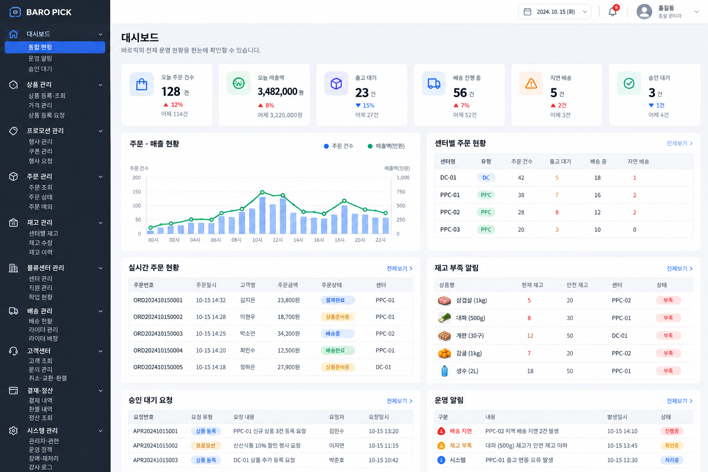

주문 KPI·주문 추이·운영 알림·센터별 현황을 한 화면에서 확인한다.

### 7.2 상품 관리

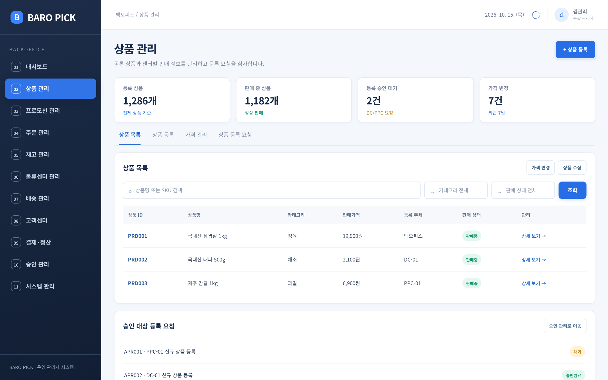

상품 목록/등록/가격/등록 요청 탭과 상품·판매 상태 검색을 제공한다.

### 7.3 프로모션 관리

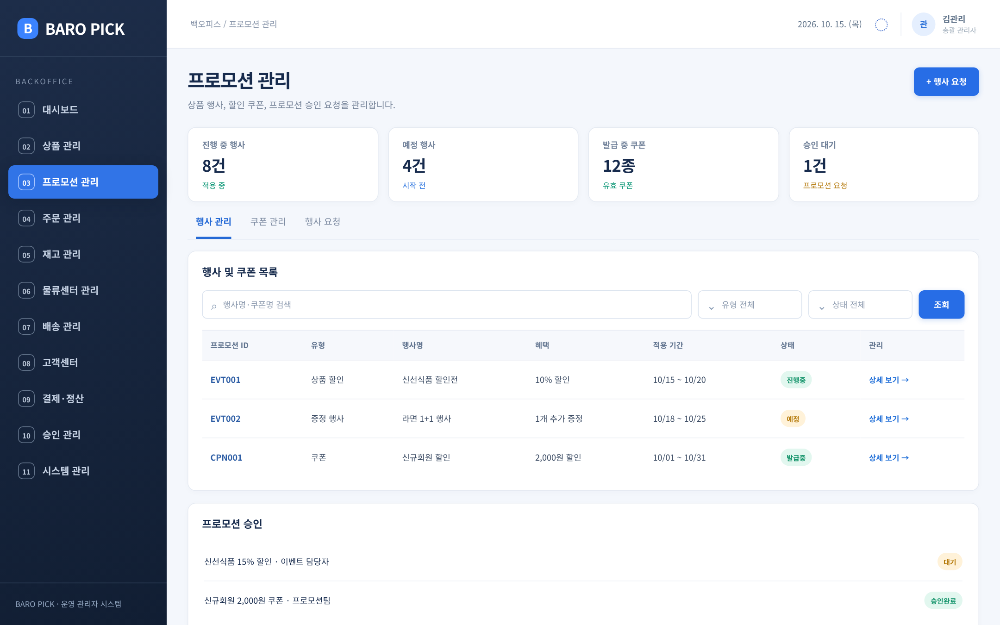

행사·쿠폰 목록과 프로모션 승인 요청을 조회한다.

### 7.4 주문 관리

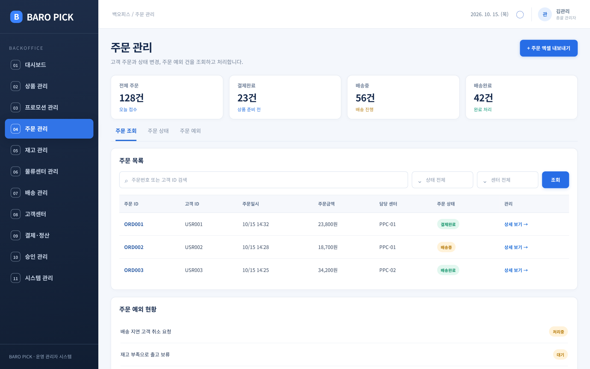

주문번호·고객·상태·센터 조건을 기준으로 주문과 예외 건을 조회한다.

### 7.5 재고 관리

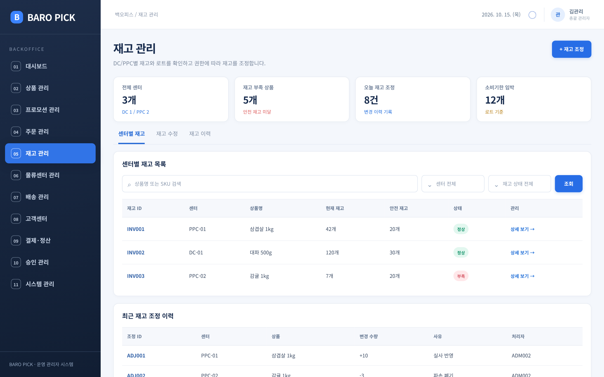

센터별 재고·안전재고·부족 상태, 조정 이력을 확인한다.

### 7.6 물류센터 관리

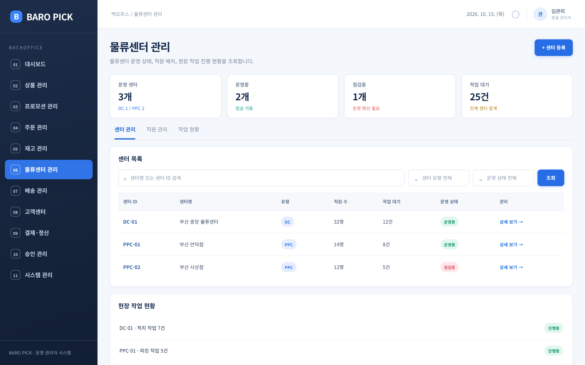

DC/PPC 센터 상태·직원·작업 대기량과 현장 진행을 조회한다.

### 7.7 배송 관리

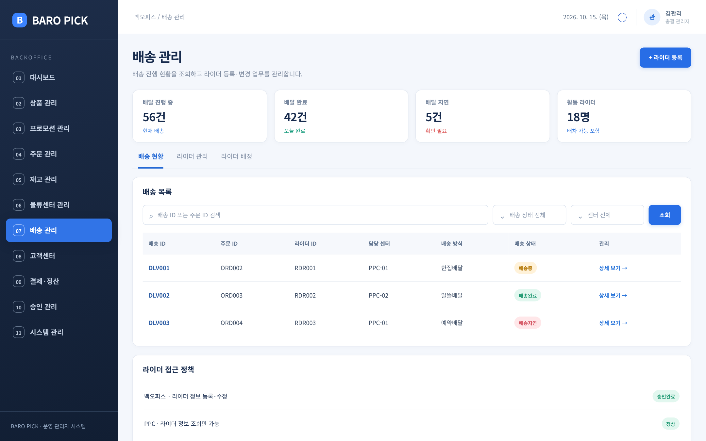

배송 방식·상태별 목록과 라이더 관리 기능을 제공한다.

### 7.8 고객센터

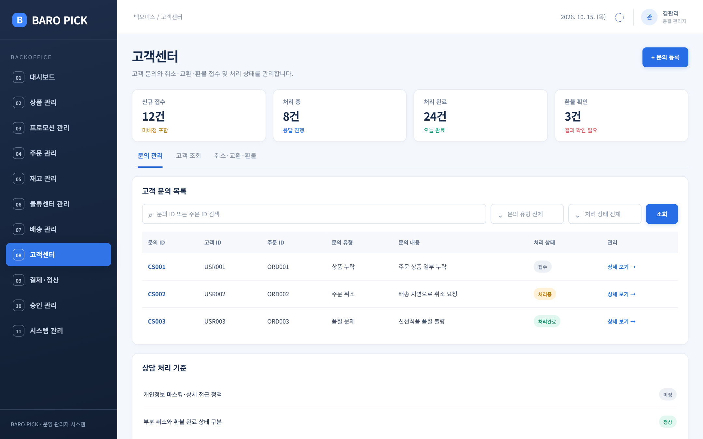

고객 문의, 주문 연계, 상담 처리 상태를 조회한다.

### 7.9 결제·정산

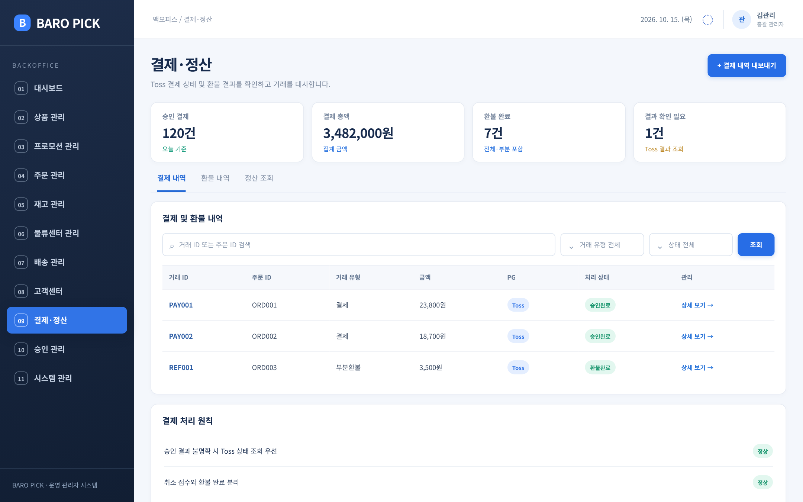

Toss 결제·부분환불 이력과 대사 대상 건을 조회한다.

### 7.10 승인 관리

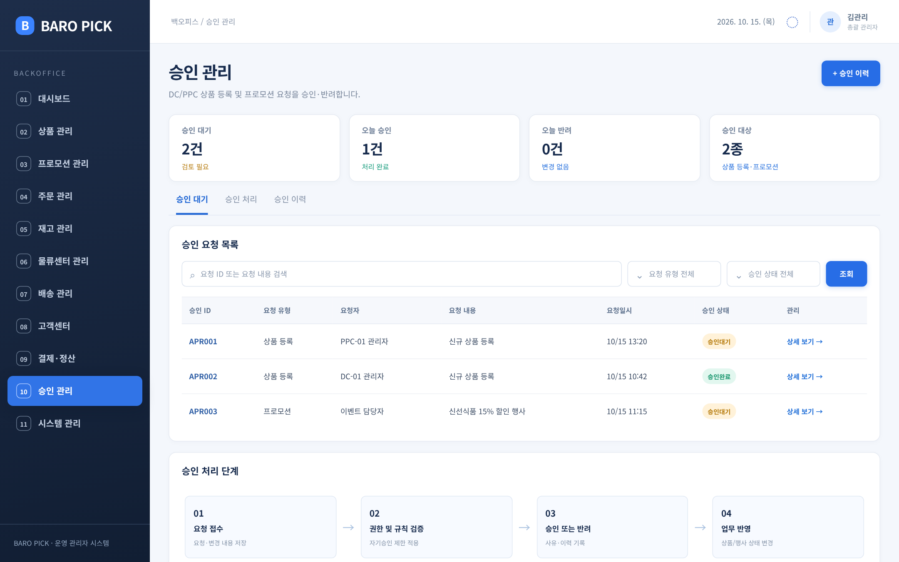

상품 등록 및 프로모션 요청 목록과 승인 처리 단계를 제공한다.

### 7.11 시스템 관리

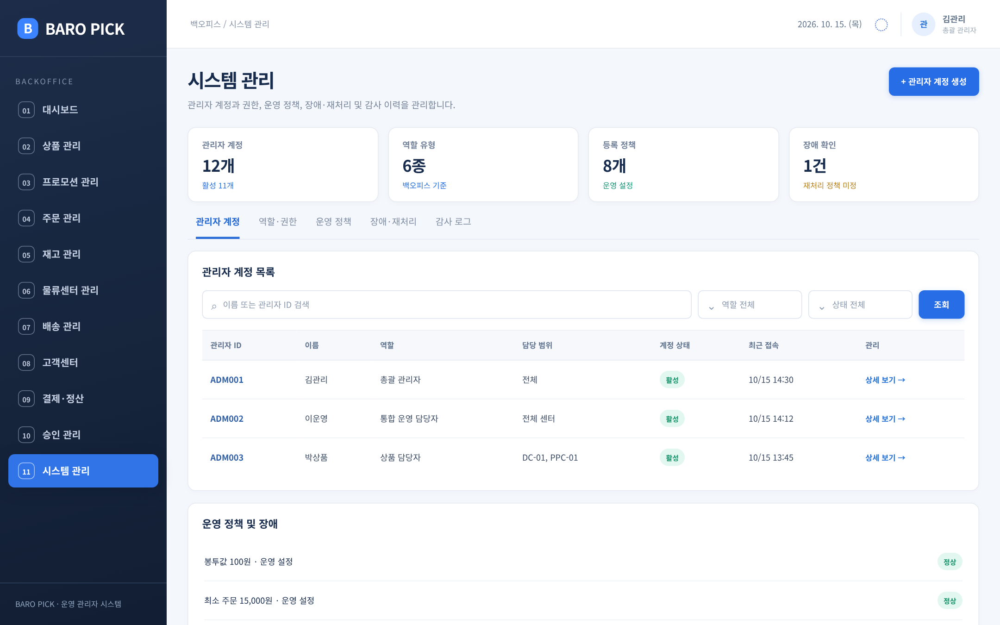

관리자 계정·권한·운영 정책·장애·감사 로그의 진입 화면이다.

---

## 8. 임시 데이터

아래 모든 기록은 화면 구현 검토를 위해 만든 **가상 예시**다. ID 체계·상품명·센터명·금액·통계는 확정된 운영 데이터가 아니다.

### 8.1 대시보드 — 통합 KPI

| 지표 ID | 지표명 | 현재 값 | 비교/참고 | 상태 |
|---|---|---|---|---|
| KPI001 | 오늘 주문 건수 | 128건 | 전일 대비 +12% | 정상 |
| KPI002 | 배송 지연 건수 | 5건 | 전일 대비 +2건 | 확인 필요 |
| KPI003 | 승인 대기 건수 | 2건 | 전일 대비 -1건 | 대기 |

### 8.2 상품 관리 — 상품 목록

| 상품 ID | 상품명 | 카테고리 | 판매가격 | 등록 주체 | 판매 상태 |
|---|---|---|---:|---|---|
| PRD001 | 국내산 삼겹살 1kg | 정육 | 19,900원 | 백오피스 | 판매중 |
| PRD002 | 국내산 대파 500g | 채소 | 2,100원 | DC-01 | 판매중 |
| PRD003 | 제주 감귤 1kg | 과일 | 6,900원 | PPC-01 | 판매중 |

*등록 주체가 DC/PPC인 판매중 상품은 승인 절차가 이미 완료된 예시로 가정한다.*

### 8.3 프로모션 관리 — 행사·쿠폰 목록

| 프로모션 ID | 유형 | 행사명 | 혜택 | 적용 기간 | 상태 |
|---|---|---|---|---|---|
| EVT001 | 상품 할인 | 신선식품 할인전 | 10% 할인 | 10/15~10/20 | 진행중 |
| EVT002 | 증정 행사 | 라면 1+1 행사 | 1개 추가 증정 | 10/18~10/25 | 예정 |
| CPN001 | 쿠폰 | 신규회원 할인 | 2,000원 할인 | 10/01~10/31 | 발급중 |

### 8.4 주문 관리 — 주문 목록

| 주문 ID | 고객 ID | 주문일시 | 주문금액 | 담당 센터 | 주문 상태 |
|---|---|---|---:|---|---|
| ORD001 | USR001 | 10/15 14:32 | 23,800원 | PPC-01 | 결제완료 |
| ORD002 | USR002 | 10/15 14:28 | 18,700원 | PPC-01 | 배송중 |
| ORD003 | USR003 | 10/15 14:25 | 34,200원 | PPC-02 | 배송완료 |

### 8.5 재고 관리 — 센터별 재고

| 재고 ID | 센터 | 상품명 | 현재 재고 | 안전 재고 | 상태 |
|---|---|---|---:|---:|---|
| INV001 | PPC-01 | 삼겹살 1kg | 42개 | 20개 | 정상 |
| INV002 | DC-01 | 대파 500g | 120개 | 30개 | 정상 |
| INV003 | PPC-02 | 감귤 1kg | 7개 | 20개 | 부족 |

### 8.6 물류센터 관리 — 센터 목록

| 센터 ID | 센터명 | 유형 | 직원 수 | 작업 대기 | 운영 상태 |
|---|---|---|---:|---:|---|
| DC-01 | 부산 중앙 물류센터 | DC | 32명 | 12건 | 운영중 |
| PPC-01 | 부산 만덕점 | PPC | 14명 | 8건 | 운영중 |
| PPC-02 | 부산 사상점 | PPC | 12명 | 5건 | 점검중 |

### 8.7 배송 관리 — 배송 목록

| 배송 ID | 주문 ID | 라이더 ID | 담당 센터 | 배송 방식 | 배송 상태 |
|---|---|---|---|---|---|
| DLV001 | ORD002 | RDR001 | PPC-01 | 한집배달 | 배송중 |
| DLV002 | ORD003 | RDR002 | PPC-02 | 알뜰배달 | 배송완료 |
| DLV003 | ORD004 | RDR003 | PPC-01 | 예약배달 | 배송지연 |

*ORD004는 이 표의 예시를 위한 추가 주문이며, 8.4의 세 개 대표 주문 목록에 표시되지 않은 것뿐이다.*

### 8.8 고객센터 — 고객 문의

| 문의 ID | 고객 ID | 주문 ID | 문의 유형 | 문의 내용 | 처리 상태 |
|---|---|---|---|---|---|
| CS001 | USR001 | ORD001 | 상품 누락 | 주문 상품 일부 누락 | 접수 |
| CS002 | USR002 | ORD002 | 주문 취소 | 배송 지연으로 취소 요청 | 처리중 |
| CS003 | USR003 | ORD003 | 품질 문제 | 신선식품 품질 불량 | 처리완료 |

### 8.9 결제·정산 — 결제/환불 목록

| 거래 ID | 주문 ID | 거래 유형 | 금액 | PG | 처리 상태 |
|---|---|---|---:|---|---|
| PAY001 | ORD001 | 결제 | 23,800원 | Toss | 승인완료 |
| PAY002 | ORD002 | 결제 | 18,700원 | Toss | 승인완료 |
| REF001 | ORD003 | 부분환불 | 3,500원 | Toss | 환불완료 |

*REF001은 ORD003에 대응하는 별도 결제 기록에서 발생한 환불 사례로 가정한다. 실제 DB에서는 환불이 반드시 원결제 `payment_id`를 참조해야 한다.*

### 8.10 승인 관리 — 승인 요청

| 승인 ID | 요청 유형 | 요청자 | 요청 내용 | 요청일시 | 승인 상태 |
|---|---|---|---|---|---|
| APR001 | 상품 등록 | PPC-01 관리자 | 신규 상품 등록 | 10/15 13:20 | 승인대기 |
| APR002 | 상품 등록 | DC-01 관리자 | 신규 상품 등록 | 10/15 10:42 | 승인완료 |
| APR003 | 프로모션 | 이벤트 담당자 | 신선식품 15% 할인 행사 | 10/15 11:15 | 승인대기 |

### 8.11 시스템 관리 — 관리자 계정

| 관리자 ID | 이름 | 역할 | 담당 범위 | 계정 상태 | 최근 접속 |
|---|---|---|---|---|---|
| ADM001 | 김관리 | 총괄 관리자 | 전체 | 활성 | 10/15 14:30 |
| ADM002 | 이운영 | 통합 운영 담당자 | 전체 센터 | 활성 | 10/15 14:12 |
| ADM003 | 박상품 | 상품 담당자 | DC-01, PPC-01 | 활성 | 10/15 13:45 |

---

## 9. DB 구조 설계

### 9.1 설계 범위 및 컬럼 규칙

- 아래는 핵심 컬럼을 추린 **35개 논리 테이블 초안**이다. 타입·인덱스·DDL을 확정한 물리 스키마가 아니다.
- `PK`는 기본키, `FK`는 외래키, `UK`는 고유 제약 후보를 뜻한다.
- `created_at`, `updated_at`, 상태 변경 시각, 변경자 등 공통 감사 컬럼은 표에서 일부 생략했다.
- 개인정보 접근, 결제, 승인, 재고 조정은 **누가·언제·무엇을·왜·어떻게 변경했는지** 추적할 수 있어야 한다.

### 9.2 관리자/권한 — 6개

| 테이블 | 주요 컬럼 | 목적 |
|---|---|---|
| `admin_account` | admin_id(PK), login_id(UK), name, status, created_at | 백오피스 관리자 계정 |
| `admin_role` | role_id(PK), role_name, description | 총괄/통합/상품/이벤트/CS/결제 역할 |
| `admin_role_mapping` | admin_id(FK), role_id(FK) | 계정과 역할의 다대다 연결 |
| `role_permission` | role_id(FK), permission_code | 메뉴·기능별 조회/등록/수정/승인 권한 |
| `admin_access_scope` | scope_id(PK), admin_id(FK), center_id(FK, nullable), scope_type | 센터·상품·업무 접근 범위 |
| `audit_log` | log_id(PK), actor_id, action, target_type, target_id, before_value, after_value, occurred_at | 관리자/시스템 변경 감사 기록 |

### 9.3 상품/가격/프로모션 — 8개

| 테이블 | 주요 컬럼 | 목적 |
|---|---|---|
| `product` | product_id(PK), sku(UK), name, category_id, status | 공통 상품 마스터 |
| `center_product` | center_id(FK), product_id(FK), sale_status | 센터별 취급·판매 상태 |
| `product_request` | request_id(PK), requester_id, center_id(FK), product_data, status | DC/PPC 상품 등록 요청 원본 |
| `product_price_history` | history_id(PK), product_id(FK), old_price, new_price, changed_by, changed_at | 가격 변경 및 버전 이력 |
| `promotion` | promotion_id(PK), name, type, start_at, end_at, status | 행사 기본 정보 |
| `promotion_target` | promotion_id(FK), product_id(FK), center_id(FK, nullable), benefit_value | 행사 적용 상품·센터·혜택 범위 |
| `coupon` | coupon_id(PK), promotion_id(FK), discount_amount, issue_limit, expires_at | 쿠폰 정의·발행 조건 |
| `coupon_issue` | issue_id(PK), coupon_id(FK), customer_id(FK), used_at, status | 고객별 발급·사용 상태 |

### 9.4 주문/센터/재고 — 8개

| 테이블 | 주요 컬럼 | 목적 |
|---|---|---|
| `orders` | order_id(PK), customer_id(FK), center_id(FK), total_amount, status, ordered_at | 주문 단위 기본 정보 |
| `order_item` | order_item_id(PK), order_id(FK), product_id(FK), quantity, unit_price | 주문 시점 상품/금액 스냅샷 |
| `order_status_history` | history_id(PK), order_id(FK), before_status, after_status, changed_at | 주문 상태 변경 이력 |
| `center` | center_id(PK), name, center_type, address, status | DC/PPC 기준 정보 |
| `center_employee` | employee_id(PK), center_id(FK), name, work_role, status | 센터별 직원 및 업무 |
| `inventory` | inventory_id(PK), center_id(FK), product_id(FK), lot_id(FK), stock_qty, reserved_qty | 센터·로트 단위 재고 |
| `inventory_lot` | lot_id(PK), product_id(FK), lot_number, manufactured_at, expires_at | 로트·제조일·소비기한 |
| `inventory_adjustment` | adjustment_id(PK), inventory_id(FK), before_qty, quantity_delta, after_qty, reason, admin_id(FK), created_at | 재고 조정·변경 근거 |

### 9.5 배송/라이더 — 4개

| 테이블 | 주요 컬럼 | 목적 |
|---|---|---|
| `rider` | rider_id(PK), name, phone, status, created_at | 라이더 기본 정보 |
| `rider_center` | rider_id(FK), center_id(FK), assigned_at, status | 라이더 센터 소속 이력 |
| `delivery` | delivery_id(PK), order_id(FK), rider_id(FK), status, assigned_at, delivered_at | 배송 및 배정 정보 |
| `delivery_status_history` | history_id(PK), delivery_id(FK), before_status, after_status, changed_at | 배송 상태 이력 |

### 9.6 고객/상담/결제/환불 — 4개

| 테이블 | 주요 컬럼 | 목적 |
|---|---|---|
| `customer` | customer_id(PK), name, phone, account_status | 고객 기본 정보; 민감 정보 접근 제한 필요 |
| `cs_ticket` | ticket_id(PK), customer_id(FK), order_id(FK), agent_id(FK), issue_type, status | 고객 문의 및 처리 상태 |
| `payment` | payment_id(PK), order_id(FK), toss_payment_key(UK), amount, status, approved_at | Toss 승인 결과·거래 식별 |
| `refund` | refund_id(PK), payment_id(FK), refund_amount, status, requested_at, completed_at | 전체/부분 환불과 진행 단계 |

### 9.7 승인/정책/장애 — 5개

| 테이블 | 주요 컬럼 | 목적 |
|---|---|---|
| `approval_request` | approval_id(PK), request_type, target_id, requester_id, status, created_at | 상품/프로모션 공통 승인 요청 |
| `approval_history` | history_id(PK), approval_id(FK), approver_id, action, reason, processed_at | 승인·반려 이력 |
| `policy_config` | policy_id(PK), policy_code(UK), policy_value, effective_at, version | 최소 주문금액·봉투값 등 운영 정책 |
| `operation_incident` | incident_id(PK), center_id(FK), incident_type, status, occurred_at | 운영 장애 및 이상 현황 |
| `retry_history` | retry_id(PK), incident_id(FK), requested_by, retry_status, retry_count, processed_at | 승인된 재처리 시도 및 결과 |

### 9.8 핵심 데이터 정합성 규칙

| 대상 | 권장 규칙 | 이유 |
|---|---|---|
| `center_product` | `(center_id, product_id)` 복합 고유키 후보 | 중복 취급상품 방지 |
| `inventory` | `(center_id, product_id, lot_id)` 고유키 후보 | 로트별 수량 정확성 확보 |
| `inventory_adjustment` | 수정 전·증감·수정 후 수량 및 사유 저장 | 재고 오차 분석·감사 |
| `payment` | Toss `paymentKey` 중복 저장·승인 방지 | 이중 결제·중복 결과 방지 |
| `refund` | 동일 원결제 누적 완료+진행 중 환불액 검증 | 원결제보다 큰 환불 방지 |
| `approval_request` | 요청 유형+대상 ID 존재 검증 | 서로 다른 원천 테이블과 연결 |
| `approval_history` | 요청자/승인자 및 적용 결과 분리 기록 | 자기승인·이력 손실 방지 |
| `audit_log` | 권한·가격·재고·환불 등 중요 변경 기록 | 사후 추적 및 분쟁 대응 |

---

## 10. 메뉴별 DB 연결 관계

| 메뉴 | 주요 연관 테이블 | 읽기/쓰기 기준 | 데이터 소유 관련 메모 |
|---|---|---|---|
| 대시보드 | `orders`, `inventory`, `delivery`, `approval_request` | 집계 조회 | 각 도메인 현황을 통합 조회 |
| 상품 관리 | `product`, `center_product`, `product_request`, `product_price_history` | 조회/등록/수정/요청 | 공통 상품 마스터 원천 정의 필요 |
| 프로모션 관리 | `promotion`, `promotion_target`, `coupon`, `coupon_issue` | 등록/변경/요청 | 행사 승인 후 적용 |
| 주문 관리 | `orders`, `order_item`, `order_status_history` | 조회·허용된 상태 처리 | 주문 서비스 상태 전이 규칙 준수 |
| 재고 관리 | `inventory`, `inventory_lot`, `inventory_adjustment` | 조회/조정 | 현장 재고 원천과 동기화 필요 |
| 물류센터 관리 | `center`, `center_employee` | 조회/허용된 수정 | DC/PPC 현장 처리와 구분 |
| 배송 관리 | `delivery`, `rider`, `rider_center`, `delivery_status_history` | 배송 조회, 라이더 관리 | PPC 라이더 조회 전용 |
| 고객센터 | `customer`, `orders`, `cs_ticket`, `refund` | 문의/처리 | 개인정보 범위 및 환불 권한 확인 |
| 결제·정산 | `payment`, `refund` | 조회/재조회/대사 | Toss 외부 API와 결과 일치 검증 |
| 승인 관리 | `approval_request`, `approval_history`, `product_request`, `promotion` | 승인/반려/적용 | 업무 원본과 승인 요청 연결 |
| 시스템 관리 | `admin_account`, `admin_role`, `admin_role_mapping`, `role_permission`, `admin_access_scope`, `policy_config`, `audit_log`, `operation_incident`, `retry_history` | 설정/조회/승인된 재처리 | 보안·운영 공통 영역 |

> **권장 연계:** 백오피스 화면 → 백오피스 API/BFF → 각 도메인 서비스 API → 해당 서비스 DB. 공통 현황 화면은 집계용 읽기 모델을 사용할 수 있으나, 상품·재고·주문·환불의 최종 상태 변경은 원천 서비스의 검증을 거쳐야 한다.

---

## 11. 주요 승인 흐름

### 11.1 DC/PPC 상품 등록

| 단계 | 처리 주체 | 동작 | 저장/변경 데이터 |
|---|---|---|---|
| 1. 등록 요청 | DC/PPC 관리자 | 상품 정보 입력 및 제출 | `product_request`: REQUESTED |
| 2. 승인 요청 | 시스템 | 요청을 공통 승인함에 등록 | `approval_request`: PENDING |
| 3. 검증 | 시스템 | 중복 SKU, 필수값, 권한/담당 범위 검증 | 검증 결과·오류 기록 |
| 4. 심사 | 상품 승인 권한자/총괄 관리자 | 요청 확인 후 승인·반려 결정 | `approval_history` |
| 5-A. 승인 | 시스템 | 상품 마스터 반영 또는 센터 연결 | `product`, `center_product`, 상태 APPLIED |
| 5-B. 반려 | 시스템 | 반려 사유·요청자 표시 | 상태 REJECTED |
| 6. 사후 기록 | 시스템 | 대상 ID, 버전, 처리 결과 기록 | `audit_log` |

> **주의:** 백오피스가 직접 등록하는 상품의 승인 필요 여부는 별도 정책으로 남긴다. 승인 성공과 실제 상품 반영 성공이 다를 수 있으므로 `APPROVED`와 `APPLIED`를 논리적으로 구분한다.

### 11.2 프로모션 요청

| 단계 | 처리 주체 | 동작 | 저장/변경 데이터 |
|---|---|---|---|
| 1. 행사 작성 | 이벤트 담당자 | 적용 상품·혜택·기간 지정 | `promotion`: DRAFT |
| 2. 승인 요청 | 이벤트 담당자 | 행사 적용 승인 요청 | `approval_request`: PENDING |
| 3. 심사 | 상품 담당자(제안) 또는 승인 권한자 | 상품·가격·기간·중복 행사 검토 | `approval_history` |
| 4-A. 승인 | 시스템 | 유효 기간에 맞춰 행사 적용 | `promotion`, `promotion_target` |
| 4-B. 반려 | 시스템 | 요청자에게 반려 사유 제공 | 승인 이력 |
| 5. 운영 | 시스템/담당자 | 시작·종료·중지·이력 관리 | 정책 및 감사 기록 |

### 11.3 승인 공통 상태와 예외

| 상태 | 의미 | 다음 처리 |
|---|---|---|
| `DRAFT` | 요청 작성 중 | 요청 제출 |
| `PENDING` | 승인 대기 | 승인/반려 |
| `APPROVED` | 업무 승인 완료 | 실제 반영 시도 |
| `REJECTED` | 반려 | 사유 확인/재요청 |
| `APPLIED` | 승인된 변경 실제 반영 완료 | 종료 |
| `APPLY_FAILED` | 승인 후 실제 반영 실패 | 오류 조사, 중복 방지 재처리 |

- 요청자와 승인자 ID는 별도 보관한다. 자기승인 예외 권한은 정책 확정 전 열어 두지 않는다.
- 승인 버튼의 중복 클릭이나 네트워크 재시도에도 하나의 승인 요청이 이중 반영되지 않아야 한다.
- 요청 내용이 승인 대기 중 변경되면 새로운 버전으로 심사하거나 기존 승인을 무효화해야 한다.
- 승인/반려 사유, 변경 전후 값, 처리 결과, 대상 ID, 처리 시간을 남긴다.

---

## 12. 설계 시 남겨둘 정책

| 정책 항목 | 현재 결정 여부 | 권장 기본값/검토 내용 | 회의에서 확정할 질문 |
|---|---|---|---|
| 고객 개인정보 접근 | 미결정 | 일반 조회 마스킹, 상세 접근 로그 제안 | 누가 어떤 근거로 상세 정보를 볼 수 있는가? |
| 고객정보 보관·삭제 | 미결정 | 최소 수집·보관 기간·파기 정책 분리 | 로그/상담 기록 보존 기한은? |
| 장애 재처리 유형 | 미결정 | 조회·실패 기록부터 구현 | 어떤 장애를 자동/수동으로 재처리하는가? |
| 재처리 승인 권한 | 미결정 | 재처리는 일단 제한 | 센터 운영자가 실행 가능한 범위는? |
| 총괄 관리자 자기승인 | 미결정 | 기본 금지 제안 | 예외 허용 조건과 사후 감사는? |
| 백오피스 상품 직접 등록 | 미결정(등록 가능만 결정) | 등록 기능 제공, 승인 우회 여부는 유보 | 백오피스 등록에 승인 과정이 필요한가? |
| 상품/가격 변경 범위 | 일부 미결정 | 담당 센터·상품 권한 부여 | 공통 가격과 센터별 가격 정책은? |
| 재고 수정 동시성 | 설계 필요 | 버전 체크·조정 이력 필수 제안 | 피킹 중 재고 수정 충돌은 어떻게 처리하는가? |
| 라이더 소속·배차 | 일부 결정 | 변경 권한 백오피스, PPC 조회 | 실제 자동 배차/재배차 실행 주체는? |
| 취소/환불 실행자 | 미결정 | 접수와 실제 Toss 취소 호출 분리 제안 | CS가 직접 취소 API를 실행하는가? |
| 결제 결과 불명확 | 기존 요구 반영 | Toss 상태 조회 우선, 중복 결제 방지 | 최종 실패 확정 전 주문 상태는? |
| 부분환불 누적액 | 설계 필요 | 진행 중·완료 금액을 구분 | 동시에 여러 환불을 요청하면? |
| 주문금액·배달팁 | 일부 결정 | 최소주문 15,000원, 첫구매 배달팁 무료 | 쿠폰 적용 전후의 주문금액 판정, 배송 방식별 금액은? |
| 예약 배송·마감 | 일부 결정 | 00:00~08:00 예약배달만 | 센터별 마감, 타임슬롯 선점 시점은? |
| KPI 집계 기준 | 미결정 | 주문 시점/결제 완료 시점 구분 | 주문·매출 취소/환불은 어느 지표에 포함하는가? |

### 12.1 구현 보완으로 제안하는 운영 기능

- 관리자에게 **권한이 없을 때** 메뉴뿐 아니라 직접 API 호출도 차단하고 실패 이유를 기록한다.
- 재고·가격·프로모션·환불처럼 결과 영향이 큰 작업은 **변경 전후 데이터 및 처리 사유**를 감사 로그에 남긴다.
- 승인 처리·PG API 호출·재처리에는 **멱등키 및 상태 검증**을 두어 중복 실행을 막는다.
- 고객정보·결제 정보는 역할에 따른 최소 항목만 노출하며, 실제 토큰·인증정보·카드 민감정보를 백오피스 DB에 저장하지 않는다.
- 화면에 나타난 단일 상태값 외에 **요청 접수 / 실행 진행 / 외부 결과 확정**을 구분해 운영자가 판단할 수 있게 한다.

---

## 13. 개발 적용 순서와 점검 항목

### 13.1 권장 구현 순서

| 순서 | 작업 | 예상 산출물 |
|---|---|---|
| 1 | 공통 레이아웃 및 로그인·역할·메뉴 권한 | 좌측 메뉴 트리, 역할별 접근 제한 |
| 2 | 센터·상품·주문·배송 통합 조회 | 핵심 테이블 화면과 필터 |
| 3 | 상품·프로모션 등록 요청 및 승인 | 요청/승인/반려/적용 이력 |
| 4 | 재고 조정 및 라이더 관리 | 권한 검사, 조정·변경 로그 |
| 5 | 고객센터와 Toss 결제/환불 조회 | 주문·문의·거래 상태 연결 |
| 6 | 대시보드 집계·운영 알림 | KPI, 예외 및 승인 대기 현황 |
| 7 | 장애 관리·재처리 | 정책 확정 후 구현 |

### 13.2 검토 체크리스트

- [ ] 11개 1차 메뉴와 각 하위 탭이 개발 범위에 포함되는가?
- [ ] 백오피스/DC/PPC에 중복된 상품·재고·라이더 수정 권한이 없는가?
- [ ] 총괄 관리자 모든 실행 권한과 자기승인 정책을 별도로 검토했는가?
- [ ] 상품/프로모션 승인 후 실제 반영 실패를 추적할 수 있는가?
- [ ] 재고 조정 시 현재 수량, 예약 수량, 로트, 변경 이력이 일치하는가?
- [ ] 결제/환불 요청과 Toss 결과 및 주문 상태가 일치하는가?
- [ ] 개인정보 조회·수정·환불 권한과 감사 기록을 확정했는가?
- [ ] 사용자 화면의 샘플 데이터가 실제 운영 수치로 오인되지 않는가?